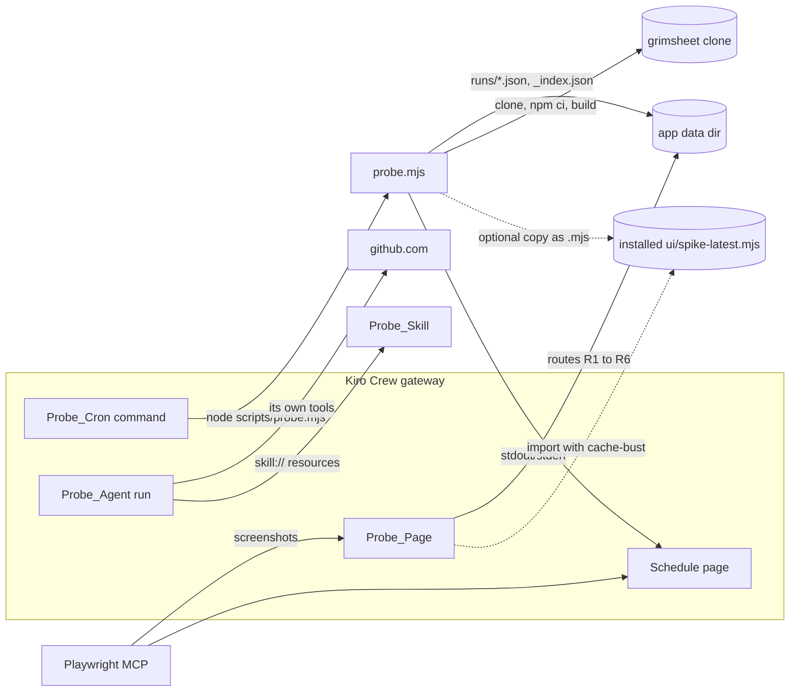

# Design Document

## Overview

`crew-spike` is a throwaway Kiro Crew app, installed locally on this Windows machine, that answers the three open questions in `docs/BRIEF.md` section 6 by observation:

1. How the `ui/` page reads a file a cron command wrote.
2. Whether a cron command and an agent run can reach the network, clone a public repo, build it, and find `node` on the path.
3. How a skill listed in `app.json` maps into the agent's `skill://` resources.

The spike writes nothing that survives. Its only lasting output is text in `docs/CREW_NOTES.md`, edits to `docs/BRIEF.md` and the steering files where an answer settles them, and an entry in `KIRO_USAGE.md`. Then `spike/` and the installed app are deleted.

### Design stance on unknowns

`docs/CREW_NOTES.md` marks many facts "not documented". This design does not fill those from memory. Every design choice that rests on one is labelled **Assumption (to test)**, and the spike records what it observed. The assumptions are collected in one table under Data Models, so tasks can tick each one off as confirmed, refuted or still unknown.

### Key design decisions

| Decision | Rationale |
|---|---|
| One Node script, `probe.mjs`, with no imports beyond Node built-ins, runs every cron probe | Requirement 1.1 allows one probe script. Node 22 is the stack in `tech.md`. If `node` is not on the cron path, that is itself the answer to Requirement 4. |
| The report is written after every step, not at the end | Requirement 4.8. A run killed by the cron timeout still leaves a partial report marked `running`. |
| Cheap probes (context, versions, HTTPS, `ls-remote`) run before clone and build | Requirement 4 is about learning fast. A missing `git` or a blocked network shows up in seconds, not after a 300 s timeout. |
| The probe finds its output directory from an env var, with a documented fallback inside `spike/` | How a cron command learns the app data directory is not documented. Round 1 observes it; round 2 pins it. |
| Pure logic (bounded index, step wrapper, scrubber, module serialiser) is kept as small separate functions in `probe.mjs` | They keep the script readable. The spike is throwaway, so none of it gets an automated test; the spike is observation. |
| Two UI rounds: declare nothing first, then declare what the docs list | The first round shows the documented "undeclared access throws" behaviour and the exact error. The second shows what works. |
| Agent runs are shared between Requirements 5 and 6 | The five-run cap (Requirement 5.7) cannot cover eight independent runs. |

## Architecture

### Spike layout

All spike code lives in `spike/`. The app proper is the first block. Requirement 1.1 lists the parts of the Spike_App; `evidence/` sits beside it and is not part of the app.

```text
spike/
  app.json                          Manifest: one agent, one skill, one cron, UI page, permissions
  agents/
    probe-agent.json                Probe_Agent: runs the Requirement 5 checks and answers the skill questions
  skills/
    probe-skill/
      SKILL.md                      Probe_Skill: name, description, license, metadata, unique marker phrase
      scripts/marker.mjs            Prints the marker; proves a skill's scripts/ are reachable (6.7)
      references/note.md            Holds a second marker; proves references/ is reachable (6.7)
  scripts/
    probe.mjs                       The one cron script: ordered probes, report, bounded index, optional served copy
  ui/
    package.json                    React + Vite + TypeScript strict; SDK, React and lucide-react are externals
    tsconfig.json                   strict: true
    vite.config.ts                  Library build to dist/index.mjs with the host-provided modules external
    src/index.tsx                   Probe_Page: runs each read route and renders its result
    src/routes.ts                   Route table: id, how it is called, permission needed, result type
    src/sdk.d.ts                    Local type declarations for the SDK calls used (SDK is not on npm)
    spike-latest.mjs                Written by probe.mjs at run time (fallback route R4); not committed, not built
  evidence/
    INDEX.md                        One row per piece of evidence: id, requirement, date, description, redaction checked
    E01-... .txt/.json/.png         Captured command output, files and Playwright screenshots
```

Run output (outside the repo, in the app data directory, path recorded in round 1):

```text
<dataDir>/
  _index.json            Bounded index of the last 5 runs
  runs/<runId>.json      One probe report per run
  grimsheet/             Shallow clone of the Public_Test_Repo (cron), with node_modules and dist-play after the build
  agent-grimsheet/       Shallow clone made by the Probe_Agent
```

**Assumption (to test):** the cron command's working directory is the installed app directory, so `node scripts/probe.mjs` resolves. `folder` exists as a cron field but its meaning is not documented. If the first run fails to find the script, the fallback is the absolute path from `kirocrew app info`, and the failure text is recorded.

**Assumption (to test):** `kirocrew app install` leaves a directory the cron and the agent can read, and `kirocrew app info` reports its path. Whether the install copies `spike/` or points at it is not documented. This decides where the installed `ui/` and `skills/` live.

### Components overview



### Order of work

| Phase | What | Requirements |
|---|---|---|
| P0 | Read the `kirocrew-app-dev` skill if available; otherwise record it as unavailable. Query `/kirodotdev/kirocrew`, then `/websites/deepwiki_kirodotdev_kirocrew` for anything still open. Record questions and results. | 2 |
| P1 | Write the Spike_App. Build `ui/`. Run `probe.mjs` by hand from PowerShell (no install needed) to check the script itself. | 1, 4 |
| P2 | Record versions. `kirocrew app install <abs path>`, trust it in the dashboard, `kirocrew app enable crew-spike`. Record each command and the result. | 1, 7 |
| P3 | Run the cron once by hand through the gateway. Record cwd, shell, `PATH`, versions, network, clone, build, and where the output appears in the Schedule page. | 3, 4 |
| P4 | UI round 1 (nothing declared), then round 2 (declared). Then the scheduled run with `every: 120`, then disable the cron. | 3 |
| P5 | Agent runs A1 to A5 (see the budget below). | 5, 6 |
| P6 | Write the Notes, update Brief and steering, write `KIRO_USAGE.md`. | 7, 8 |
| P7 | User confirms. Uninstall, delete app data, delete `spike/`, list what is left. | 10 |

P1 to P6 fit the Nov 8 to Nov 9 window of Requirement 9.5. The cron command makes no model call. Only P5 spends credits, capped at five runs.

### Probe order inside `probe.mjs`

Cheap, local and fast probes come first. Anything that touches the network is next. The slow work is last. Each step has its own timeout, and a total budget protects against the cron timeout.

| # | Step id | What it does | Cost | Step limit |
|---|---|---|---|---|
| 1 | `context` | cwd, user, platform and arch, `process.version`, `PATH`, env var **names** only, argv, trigger, data directory and its source, the `SPIKE_TIMEOUT_SECS` mirror | free | 5 s |
| 2 | `shell` | `ComSpec`, `SHELL`, parent pid and the parent image name via `tasklist /FI "PID eq <ppid>" /FO CSV /NH` | free | 10 s |
| 3 | `node-version` | `node --version` as a child process | free | 10 s |
| 4 | `npm-version` | `npm --version` | free | 10 s |
| 5 | `git-version` | `git --version` | free | 10 s |
| 6 | `https-github` | `fetch("https://github.com", { method: "HEAD" })` with a 15 s abort | network, small | 15 s |
| 7 | `git-ls-remote` | `git ls-remote --heads <repo> main` | network, small | 30 s |
| 8 | `clone-or-update` | No clone yet: `git clone --depth 1 --branch main <repo> <dataDir>/grimsheet`. Clone exists: `git fetch --depth 1 origin main` then `git reset --hard FETCH_HEAD` inside that clone. Then `git rev-parse HEAD`. Records `mode`, commit, duration, error text. | network, medium | 120 s |
| 9 | `npm-ci` | `npm ci` in the clone | heavy | 300 s |
| 10 | `build-play` | `npm run build:play`, then check `dist-play/headless.js` exists | heavy | 240 s |
| 11 | `play-list` | `node scripts/play.mjs --list` in the clone | small | 30 s |

Rules that keep one failure from hiding the others (Requirement 4.8):

- A step that throws or rejects is recorded as `failed` with the error text. The next step still runs.
- Step 8 is skipped only when step 5 failed (there is no `git` to run). The skip reason is recorded.
- Steps 9 to 11 are skipped only when step 8 did not succeed. When step 8 succeeded they all run, even if step 9 failed.
- Before each step the script computes `remaining = totalBudget - elapsed`. If `remaining` is less than the step's limit, the step limit becomes `remaining`; if `remaining <= 0` the step is `skipped` with reason `budget`. `totalBudget = SPIKE_TIMEOUT_SECS - 60`. The step limits sum to 755 s, which fits a 900 s timeout.
- A timed-out child is killed with `taskkill /PID <pid> /T /F` (process tree) and recorded `timeout` (Requirement 4.6, first part: whether a step was cut short).
- After every step the report is rewritten atomically (write `<file>.tmp`, then rename). The final status is `complete`. A run killed by the gateway leaves status `running`. The next run turns any older `running` entry into `cut-short` with `inferredBy: "next-run"` (Requirement 4.6, second part: the gateway timeout cut the run).

**Assumption (to test):** `npm` resolves in the cron shell on Windows only through `cmd` (`npm.cmd`), so child processes use `shell: true`. The commands are fixed strings with no user input.

**Assumption (to test):** the gateway does not tell the command which timeout it runs under. The same number is set in `app.json` as `timeout_secs` and mirrored into `SPIKE_TIMEOUT_SECS` in the cron `env`. Whether `timeout` or `timeout_secs` is honoured, and in which unit, is not documented. The check is that a deliberately short timeout (set once, 20 s, in P3) produces a `running` report that the next run marks `cut-short`.

### Output directory choice

**Assumption (to test):** no env var tells a cron command the app data directory. `probe.mjs` picks its directory in this order and records `dataDir.source`:

1. `SPIKE_DATA_DIR` if set (`source: "env"`).
2. `<script dir>/../data` inside `spike/` (`source: "fallback"`). This is allowed by Requirement 9.2.

Round 1 runs on the fallback. The report lists env var **names** (never values) so a gateway-provided data directory variable would be visible. The true app data directory is read from `kirocrew app info` and from `getAppDataDir()` in the Probe_Page (route R2). In round 2 `SPIKE_DATA_DIR` is set in the cron `env` to that path and the app is reinstalled, so Requirement 3.1 (write to the app data directory) is met and compared with where the gateway says the directory is.

## Components and Interfaces

### 1. `spike/app.json` (initial content, round 1)

```json
{
  "name": "crew-spike",
  "displayName": "Crew Spike",
  "version": "0.0.1",
  "description": "Throwaway spike for Grimsheet Playtester. Answers three open Kiro Crew questions, then is deleted.",
  "author": "Grimsheet Playtester",
  "agents": ["agents/probe-agent.json"],
  "skills": ["skills/probe-skill"],
  "crons": [
    {
      "name": "probe",
      "command": "node scripts/probe.mjs --trigger cron",
      "every": 120,
      "timeout_secs": 900,
      "env": { "SPIKE_TIMEOUT_SECS": "900" },
      "persistent_session": false,
      "silent": false,
      "enabled": false
    }
  ],
  "permissions": {
    "cron": true,
    "api": [],
    "events": [],
    "storage": true
  },
  "ui": {
    "entry": "dist/index.mjs",
    "pages": [
      { "route": "/apps/crew-spike", "label": "Crew Spike", "icon": "FlaskConical" }
    ]
  }
}
```

Field notes. Only `displayName`, semver `version`, `agents`/`skills` as path arrays, `crons` with `permissions.cron: true`, `permissions` as an object, and `ui.entry`/`ui.pages` are documented (Notes section a). The rest is below.

- **Assumption (to test):** `name`, `description` and `author` are accepted. The examples always carry them; no required/optional table was returned.
- **Assumption (to test):** `permissions.api` and `permissions.events` are arrays of strings, and `permissions.storage` takes a boolean. Only the key names are documented. The exact error text on a wrong shape is evidence.
- **Assumption (to test):** the `icon` value `FlaskConical` is a lucide-react icon name. The documented field is `icon` or `iconUrl`; the value format is not documented. If the page does not show, drop `icon`.
- **Assumption (to test):** `env` is an object of strings. `timeout_secs` is in seconds. `enabled: false` means the cron is listed but not scheduled, and can be run by hand from the Schedule page.
- `persistent_session: false` and `silent: false` are documented fields. The aim is to see command output in the Schedule page (Requirement 3.8).
- The cron is `enabled: false` for P3 and turned on only for the scheduled-run window (Requirement 3.3). How it is toggled (Schedule page, or edit and reinstall) is itself recorded.
- `network` is deliberately absent. The variant for Requirement 5.5 adds `"network": true`. **Assumption (to test):** this key has no runtime effect (the sandbox RFC page says `network` is stored and shown with no runtime gate). The variant run is the test, and only happens if the first agent run is blocked from the network (Requirement 5.5, 5.6).
- No `setup` block. Local installs skip `setup.onInstall`, so `ui/` is built before install.

Round 2 edits, fixed in P0 from what the docs list and recorded as the evidence for the edit:

| Key | Round 1 | Round 2 |
|---|---|---|
| `permissions.api` | `[]` | the gateway paths the docs list for storage, app files and cron output |
| `permissions.events` | `[]` | the cron-completion event names the docs list, if any |
| `crons[0].env` | `SPIKE_TIMEOUT_SECS` | also `SPIKE_DATA_DIR` (path from `kirocrew app info`) and `SPIKE_SERVE_DIR` (installed `ui/` directory) |
| `version` | `0.0.1` | `0.0.2` (so `updateAvailable` and reinstall behaviour are visible) |

If P0 finds no documented path, `api` stays empty and the answer to routes R3 and R6 is "no documented path". No path is guessed.

### 2. `spike/scripts/probe.mjs`

ESM, `// @ts-check`, JSDoc types, Node built-ins only (`node:fs`, `node:path`, `node:child_process`, `node:os`, `node:url`). Main runs only when the file is the entry point:

```js
// @ts-check
import { pathToFileURL } from 'node:url';

export function parseIndex(text, max) { /* ... */ }
export function insertRun(index, entry) { /* ... */ }
export function patchRun(index, runId, patch) { /* ... */ }
export function markStaleRunning(index) { /* ... */ }
export async function runStep(def, ctx) { /* never rejects */ }
export function scrub(text) { /* ... */ }
export function tailText(text, max) { /* ... */ }
export function toModuleText(value) { /* ... */ }

if (process.argv[1] && import.meta.url === pathToFileURL(process.argv[1]).href) {
  await main();
}
```

Pure interfaces:

```js
/** @typedef {'running'|'complete'|'cut-short'} RunStatus */
/** @typedef {'ok'|'failed'|'skipped'|'timeout'} StepStatus */
/** @typedef {{ok:number, failed:number, skipped:number, timeout:number}} StepCounts */
/** @typedef {{runId:string, counter:number, startedAt:string, finishedAt:string|null,
 *   trigger:'cron'|'manual'|'unknown', status:RunStatus, file:string, steps:StepCounts,
 *   inferredBy?:'next-run'}} IndexEntry */
/** @typedef {{schema:1, max:number, nextCounter:number, runs:IndexEntry[]}} RunIndex */

/** Corrupt, empty or wrong-schema text yields an empty valid index. */
// parseIndex(text: string, max: number): RunIndex
/** Adds entry, sorts by counter descending, keeps the newest `max`. */
// insertRun(index: RunIndex, entry: IndexEntry): { index: RunIndex, evicted: string[] }
/** Merges patch into the entry with runId; no-op if the runId is not in the index. */
// patchRun(index: RunIndex, runId: string, patch: Partial<IndexEntry>): RunIndex
/** Every entry with status 'running' becomes 'cut-short' with inferredBy 'next-run'. */
// markStaleRunning(index: RunIndex): RunIndex
/** Runs def.fn within def.limitMs; always resolves with a StepResult. */
// runStep(def: StepDef, ctx: RunCtx): Promise<StepResult>
/** Replaces the value after token=, Authorization: and similar with REDACTED. */
// scrub(text: string): string
/** Returns at most `max` trailing characters, prefixed with a marker if cut. */
// tailText(text: string, max: number): string
/** `export default ${JSON.stringify(value)};\n` — the fallback route R4 file. */
// toModuleText(value: unknown): string
```

Main flow: read `--trigger`; resolve data directory; read `_index.json` through `parseIndex`; call `markStaleRunning`; allocate `counter = index.nextCounter`; `insertRun` with status `running`; delete the report files of any `evicted` run ids (only files named `runs/<runId>.json` inside `dataDir`); run steps in the order above, rewriting the report after each; set status `complete`; `patchRun` the index; if `SPIKE_SERVE_DIR` is set, write `spike-latest.mjs` there with `toModuleText({ index, latest: report })`.

The script writes only inside `dataDir` and, when set, `SPIKE_SERVE_DIR` (inside the installed app, i.e. inside `spike/` or the installed copy of it). It never writes into the cloned repo beyond what `npm ci` and `npm run build:play` create there (`node_modules`, `dist-play`). Exit code is 0 whenever a report was written, even if steps failed, so the Schedule page shows the run as run; failure details live in the report. It exits 1 only when it could not write a report at all.

### 3. UI read routes (Probe_Page)

The page runs every route on mount and on a Refresh button, and renders one row per route: `id`, `status` (`data` | `empty` | `error`), and the first 300 characters of the response or the error text. It never hides a failure. `src/sdk.d.ts` declares only what the page calls.

**Assumption (to test):** the entry module's default export is the page component. The getting-started page is the only hint; no signature is quoted in the Notes.

**Assumption (to test):** the SDK signatures declared in `sdk.d.ts` (`useAppApi()` returning `{ get, post, put, delete }`, `useAppEvents(event, cb)`, `getAppDataDir()`, `getAppConfig()`, `setAppConfig()`) match the runtime. A call that throws a "not a function" or a rejected promise is recorded as the finding.

| Id | Route | What it tries | Permission it needs | Status of knowledge |
|---|---|---|---|---|
| R1 | `useAppApi().get(<path>)` before any declaration | Any `/api/...` path | none declared (round 1) | Documented: undeclared access throws. Test: record the exact error text. |
| R2 | `getAppDataDir()` | Returns or resolves the app data directory | `storage` (declared) | The call exists (documented). Return type and whether it needs `storage`: **Assumption (to test)**. Compare the value with the path in `dataDir.path` from the report (Requirement 3.3). |
| R3 | `useAppApi().get(<storage or files path from P0>)` | Reads `_index.json` or `runs/<runId>.json` from the data directory | `api` entry for that path; possibly `storage` | The path that serves app files: **not documented**. Only a path found in P0 is tried. If P0 finds none, R3 is recorded as "no documented path". |
| R4 | `import("/apps/crew-spike/ui/spike-latest.mjs?t=<now>")` | Reads results the cron wrote as a module in the served `ui/` directory (the Brief section 6 fallback) | none | The dashboard serves `.mjs`/`.js` under `/apps/<app>/ui/` (documented, for the entry). That any other `.mjs` in `ui/` is served, and that a file written after install is served: **Assumption (to test)**. |
| R5 | `useAppEvents(<event>, cb)` | Logs any event that fires while a cron run finishes | `events` entry per event | The documented part is that it exists and is limited to declared events. Which events a cron run emits: **not documented**. Only names found in P0 are subscribed. |
| R6 | `useAppApi().get(<cron or schedule path from P0>)` | Reads cron job output or last-run data | `api` entry for that path | Output location for an app cron: **not documented** beyond the Schedule page listing the job. Path only if P0 finds one. |
| R7 | `getAppConfig()` then `setAppConfig()` | Baseline that the SDK calls work. Reads the config; writes a counter and reads it back. | `storage` | Exists (documented). Whether a cron command can write config: **not documented**, not tried. R7 is a control, not a route for cron output. |

Freshness (Requirement 3.7). With a cron run in progress:
1. Load the page, note the latest `counter` shown by each route that returned data.
2. Let a new run finish. Without reloading, press Refresh; note whether the value changed.
3. Reload the page; note again.
4. For R4 compare an import with a `?t=` cache-buster against one without.
5. Record whether `useAppEvents` fired for the run finishing and which event name.

Everything that needs a person to look at the dashboard (Requirements 1.3, 3.4, 3.7, 3.8) is done with the Playwright MCP server pinned in `.kiro/settings/mcp.json`. See Evidence capture.

### 4. Agent and skill setups (Requirement 6)

**Probe_Skill** (`skills/probe-skill/SKILL.md`):

```markdown
---
name: probe-skill
description: Spike skill. Use when asked to list visible skills or to quote the spike marker.
license: MIT
metadata:
  purpose: crew-spike
---

# Probe skill

MARKER: lantern-kettle-4821

To prove scripts are reachable, run `node scripts/marker.mjs` from this folder.
To prove references are reachable, read `references/note.md` in this folder.
```

`scripts/marker.mjs` prints `SCRIPT-MARKER: kettle-orchard-7730`. `references/note.md` contains `REFERENCE-MARKER: orchard-lantern-1159`. Three different markers make it clear which file the agent actually read.

`license` and `metadata` are present from the start (Requirement 6.6). The install and the first agent run show whether they are accepted or ignored. If install rejects them, a second install without them is made (an install is not an agent run) and the rejection text is the evidence.

**Probe_Agent** (`agents/probe-agent.json`), setup S1:

```json
{
  "name": "probe-agent",
  "description": "Spike agent. Runs environment checks and reports which skills it can see.",
  "resources": [],
  "prompt": "You are a spike probe. Do exactly what the user message asks and report each result verbatim: the command, its exit code and its output. Do not write anywhere except <DATA_DIR>/agent-grimsheet and do not modify any repository. Never print tokens or credentials."
}
```

`<DATA_DIR>` is replaced with the real path once recorded in P3. `tools`, `allowedTools` and `model` are omitted on purpose.

**Assumption (to test):** with no `tools` and `allowedTools`, the agent gets some default toolset and can run shell commands. The value format of those fields is not documented in the Notes. Requirement 5.2 is met by asking the agent to list its own tools and by recording any approval prompt. If the first run is blocked for lack of a shell tool, the field names and values are taken from the docs read in P0 and added for run A4, and the change is recorded.

**Assumption (to test):** agent edits take effect only after a reinstall, or with `kirocrew app dev crew-spike` (live reload, documented to exist). Which one is needed is recorded the first time `resources` changes.

The three `resources` setups, tried in this order:

| Setup | `resources` value | Why |
|---|---|---|
| S1 | `[]` (no `skill://` entry) | The documented baseline: an agent with no mapping gets no skill catalog. Expected result: skill not visible. |
| S2 | `["skill://.kiro/skills/*/SKILL.md"]` | The glob form shown in the docs. Whether it resolves for an app agent: **Assumption (to test)**. |
| S3 | `["skill://<INSTALL_PATH>/skills/*/SKILL.md"]` | `<INSTALL_PATH>` is the on-disk path recorded from `kirocrew app info` or the file system (Requirement 6.2). Forward slashes first. Backslash form, and a glob that matches the namespaced install path if that differs from the app root: **Assumption (to test)**, tried only with a spare run. |

For each setup the question to the agent is: list every skill you can see, then quote the marker phrase from `probe-skill`. Result is `visible` only if the quoted phrase equals `lantern-kettle-4821`. A made-up marker or "I cannot see it" is `not visible`.

### 5. Agent run budget (at most five, Requirement 5.7)

Requirements 5 and 6 share runs. Each of runs A1 to A3 carries the skill question for its setup; A1 also carries the full network and clone checks.

| Run | Setup | Asks | Serves |
|---|---|---|---|
| A1 | S1, no `network` key | Full Requirement 5.1 checks: `PATH`, `node --version`, `npm --version`, `git --version`, HTTPS to `github.com`, shallow clone into `<DATA_DIR>/agent-grimsheet`, `node scripts/play.mjs --list` (if it fails because `dist-play` is missing, also `npm ci` and `npm run build:play`, then `--list` again). Also: list your tools. Then the S1 skill question. | 5.1, 5.2, 5.3, 5.4, 6.4 (S1) |
| A2 | S2 | Skill question only. If A1 was blocked from the shell, repeat the checks that A1 could not do. | 6.4 (S2) |
| A3 | S3 | Skill question, then read `references/note.md` and run `node scripts/marker.mjs` from the skill folder. | 6.4 (S3), 6.7 |
| A4 | reserve | If A1 was blocked from the network: repeat the checks with `"network": true` declared (Requirement 5.5). Otherwise, if a tool-field fix was needed, rerun the failed checks. | 5.5 or retry |
| A5 | reserve | A second try for whichever result is ambiguous: a backslash `skill://` form, or a repeat of a result that disagreed with the cron. | 5.4, 6.5 |

If A1 is not blocked, A4 is not used for the network comparison and the Notes say why (Requirement 5.6). Any run not used is recorded as unused. The ledger of used runs (id, setup, date, what was asked, outcome) lands in Notes section h.5.

Where the agent runs: **Assumption (to test)** the agent is started from the dashboard chat, which `docs/CREW_NOTES.md` section g lists as a verification step. A command to start one from the CLI is not documented. Approval prompts (the `sessionApproval` permission exists) are answered by the person at the dashboard, and the exact prompt text is evidence for Requirement 5.3.

### 6. Evidence capture

Evidence is files under `spike/evidence/` plus one row each in `spike/evidence/INDEX.md`. Nothing goes into `docs/CREW_NOTES.md` until it has a row.

| Kind | How it is captured |
|---|---|
| Command line and output (install, enable, `app info`, `--version`) | Run in PowerShell with `2>&1 | Out-File spike/evidence/E<nn>-<slug>.txt`, then scrub (below) |
| Probe reports and `_index.json` | Copy the files as they are into `spike/evidence/` as `E<nn>-<slug>.json`; reports hold env var names only |
| Dashboard views (Library, sidebar, Schedule page, Probe_Page, agent chat) | Playwright MCP `browser_navigate` and `browser_take_screenshot` (the two auto-approved tools); `browser_snapshot` text if a screenshot is not enough. Files saved as `spike/evidence/E<nn>-<slug>.png` |
| Windows and Crew versions | `(Get-CimInstance Win32_OperatingSystem).Caption` and `.Version`; Crew version from `kirocrew --version`. **Assumption (to test):** that flag exists. If not, record the version text `kirocrew app info` shows, or "not available". |
| Agent answers | Screenshot of the chat plus the answer pasted into a `.txt` file |

Rules (Requirement 7.5):
- The dashboard token URL from `kirocrew token` is used to open the page and is never written to a file, a command line in a transcript, or a file name. Screenshot names use `E<nn>-<slug>` only.
- Playwright screenshots capture the page, not the address bar. Before saving, the page is checked to not display the token. Any text evidence is passed through the same pattern as `scrub()` and searched for `token` before it gets a row in `INDEX.md`; the row's "redaction checked" column is set only after that.
- `INDEX.md` columns: `id`, `requirement`, `date`, `what it shows`, `file`, `redaction checked`.

Screenshots are deleted with `spike/` (Requirement 10.4), so the Notes **describe** each screenshot in words in the Evidence line and refer to its id; they do not link to it.

Where evidence lands in `docs/CREW_NOTES.md`: a new top-level section after `g`, headed `## h. Spike findings (crew-spike)`, with a header block stating the date, the Windows version, the Crew version, and a legend: **Observed** means seen on this machine; **Context7** means from the libraries. Subsections:

| Section | Holds | Requirements |
|---|---|---|
| h.1 Install and trust | Exact commands, trust steps, errors, what appeared in Library, sidebar and Schedule | 1.3, 1.4 |
| h.2 Docs and skill consulted | Whether `kirocrew-app-dev` was available; guidance used; the deepwiki queries and results | 2 |
| h.3 UI data path | Per route R1 to R7: result, permissions needed, response shape, freshness | 3.4 to 3.7 |
| h.4 Cron: node, network, clone, build | Report fields per step; second-run fetch behaviour; timeout behaviour | 4 |
| h.5 Agent: node, network, clone, build | Tools, prompts, differences from the cron, the run ledger | 5 |
| h.6 Skill mapping | The working `skill://` glob or what failed; `license`/`metadata`; `scripts/` and `references/` reachability | 6 |
| h.7 Cron output location | Where the Schedule page shows command output | 3.8 |
| h.8 Still not documented | What was tried, what was seen, why it stays open | 7.3 |

Each subsection uses the same four lines: **Question**, **Answer**, **Basis** (Observed or Context7), **Evidence** (ids, with a prose description of each screenshot).

Replacing "not documented" markers (Requirement 7.2): the original sentence in sections a to g stays word for word, and ` → answered in section h.N (observed <date>)` is appended to it. The same appended pointer is added in `.kiro/steering/crew-app.md` and `.kiro/steering/dashboard.md` (Requirement 8.3).

### 7. Downstream edits (Requirement 8)

| Outcome | Edit |
|---|---|
| R3, R6 or R5 serve the data directory | Brief section 6 and section 4 name that route as the result-reading path. `dashboard.md` "Data access" is rewritten to match. |
| Only R4 (served `.mjs`) works, or nothing documented works | Apply the Brief section 6 fallback: the replay script also writes results as a module in the served `ui/` directory. Brief sections 4, 5 and 10 (replay-runner, dashboard) are updated before any later spec. |
| Clone or build fails in the cron | Brief section 4 (replay step 1 and 2) and `tech.md` change to state the real constraint. |
| Agent cannot reach the network or `node` | Brief section 4 (hunt) and the `find-exploits` plan are changed to say the agent works from the cron-made checkout. |
| A `skill://` glob works | `crew-app.md` "Agents" and Brief section 5 record it. |

Every changed statement is listed in the Brief with the Notes section that justifies it. `KIRO_USAGE.md` records what Kiro did in the spike and which decisions changed.

### 8. Deletion steps (Requirement 10)

Run only after the user confirms the Notes and Brief edits are complete (Requirement 10.2). The data directory and the clone are real deletions, so each path is printed and checked before it is removed.

1. Confirm with the user. Show the list of what will be deleted: the installed app, `<dataDir>`, `spike/`.
2. Disable and uninstall: `kirocrew app disable crew-spike` if that command exists, then the `kirocrew` uninstall command. **Assumption (to test):** the command is `kirocrew app uninstall crew-spike`. The Notes only document `init`, `install`, `enable`, `info`, `dev` and `token`. The real command is taken from `kirocrew app --help` and recorded in h.1.
3. Check with `kirocrew app info crew-spike` that the app is gone. Record the output.
4. Delete the app data directory including the clones. The path is the one recorded in the report (`dataDir.path`) and confirmed by `getAppDataDir()`. Before deleting, check the path is non-empty, absolute, and its last segment contains `crew-spike`. Then `Remove-Item -LiteralPath <path> -Recurse -Force`. **Assumption (to test):** uninstall may leave the directory behind; if it does, this step removes it. Record whether it was there. If a long `node_modules` path blocks the delete, record the error and retry with `cmd /c rmdir /s /q`.
5. Delete `spike/` whole: `Remove-Item -LiteralPath <repo>\spike -Recurse -Force`. This removes `node_modules`, `ui/dist`, `evidence/` and screenshots (Requirement 10.4). Confirm `spike/` is gone.
6. List the remaining files with `Get-ChildItem -Recurse -File` excluding `.git`. The expected set: `.gitignore`, `LICENSE`, `KIRO_USAGE.md`, `docs/`, `.kiro/` (steering, settings, specs). Show it to the user (Requirement 10.3).
7. `.kiro/specs/crew-spike/` stays as the record (Requirement 10.5).

No git write command is part of any step. Git is used on the machine only by `probe.mjs` and the agent, and only to clone into the data directory.

## Data Models

### Probe report: `<dataDir>/runs/<runId>.json`

`runId` is `r<counter, 4 digits>-<UTC YYYYMMDDTHHMMSSZ>`, for example `r0003-20261108T141500Z`.

| Field | Type | Meaning |
|---|---|---|
| `schema` | `1` | Report format version |
| `runId` | string | As above |
| `counter` | integer ≥ 1 | Monotonic run number, from `index.nextCounter` |
| `trigger` | `"cron"` \| `"manual"` \| `"unknown"` | From `--trigger`; missing means `unknown` |
| `status` | `"running"` \| `"complete"` \| `"cut-short"` | `running` while steps execute; `cut-short` only inferred by a later run |
| `startedAt`, `finishedAt` | ISO 8601 string, `finishedAt` may be `null` | Run times |
| `budgetSecs` | number | `SPIKE_TIMEOUT_SECS - 60`, or `null` if the env var is missing |
| `timeoutSecsMirror` | number \| `null` | Value of `SPIKE_TIMEOUT_SECS`; the number the report claims the cron ran under |
| `dataDir` | `{ path: string, source: "env" \| "fallback" }` | Where this run wrote |
| `environment` | object | `cwd`, `user`, `platform`, `arch`, `nodeVersion`, `pathValue`, `envNames` (string array, names only), `argv`, `comspec`, `shellEnv`, `parent: { pid, image }` |
| `steps` | `StepResult[]` | One per step id, in probe order, always all 11 once the run completes |

`StepResult`:

| Field | Type | Meaning |
|---|---|---|
| `id` | string | One of `context`, `shell`, `node-version`, `npm-version`, `git-version`, `https-github`, `git-ls-remote`, `clone-or-update`, `npm-ci`, `build-play`, `play-list` |
| `status` | `"ok"` \| `"failed"` \| `"skipped"` \| `"timeout"` | Outcome |
| `startedAt` | ISO string \| `null` | `null` when skipped |
| `durationMs` | integer \| `null` | |
| `limitMs` | integer | Limit applied to this step |
| `exitCode` | integer \| `null` | Child exit code; `null` for in-process steps, timeouts and skips |
| `stdoutTail`, `stderrTail` | string | Scrubbed, at most 4000 trailing characters each |
| `error` | string \| `null` | Error text for `failed` and `timeout` |
| `skipReason` | string \| `null` | For example `git-version failed`, `clone did not succeed`, `budget` |
| `detail` | object | Step-specific: `https-github` → `{ httpStatus }`; `clone-or-update` → `{ mode: "clone" \| "fetch-reset", commit, repo, branch }`; `build-play` → `{ headlessJsExists: boolean }`; `play-list` → `{ levelIds: string[] }` |

### Index: `<dataDir>/_index.json`

| Field | Type | Meaning |
|---|---|---|
| `schema` | `1` | |
| `max` | integer, fixed at **5** | Bound. Small for the spike so eviction is seen in a few runs. The real app uses 30. |
| `nextCounter` | integer ≥ 1 | Next run number. Never decreases, even after eviction. |
| `runs` | `IndexEntry[]` | Newest first, sorted by `counter` descending, length ≤ `max`, unique `runId` and `counter` |

`IndexEntry`: `runId`, `counter`, `startedAt`, `finishedAt` (nullable), `trigger`, `status`, `file` (`runs/<runId>.json`), `steps` (`{ok, failed, skipped, timeout}` counts), and `inferredBy` (`"next-run"`, only when `status` was inferred as `cut-short`).

Eviction rule: after an insert, sort by `counter` descending and keep the first `max`. The dropped entries' run ids are returned and their report files are deleted. Only the newest runs by `counter` survive, not by clock time. `patchRun` on an evicted or unknown `runId` changes nothing. A missing, empty, unparsable or wrong-schema `_index.json` is treated as a new empty index with `nextCounter: 1`.

### Served copy: `<SPIKE_SERVE_DIR>/spike-latest.mjs`

`export default {"index":{...},"latest":{...}};` followed by a newline. `latest` is the most recent report. The text is valid JavaScript for any JSON value.

### Evidence index: `spike/evidence/INDEX.md`

A Markdown table with the six columns listed under Evidence capture.

### Assumptions to test

One list so the tasks can close each one. Each is labelled **Assumption (to test)** where it is used above.

| Id | Assumption | Tested by | Notes gap it relates to |
|---|---|---|---|
| A-01 | Cron command cwd is the installed app dir | P3 report `environment.cwd` | d, e |
| A-02 | Install leaves a readable directory; `app info` shows its path | P2 | g |
| A-03 | No env var tells a command the app data dir | P3 `envNames` | f |
| A-04 | `npm` needs `cmd` resolution in the cron shell | P3 step `npm-version` | e |
| A-05 | `timeout_secs` is honoured, in seconds; gateway does not expose it | P3 short-timeout check | d |
| A-06 | `name`, `description`, `author` accepted | P2 | a |
| A-07 | Shapes of `permissions.api`, `events`, `storage` (array, array, boolean) | P4 | a, f |
| A-08 | `icon` is a lucide icon name | P2 sidebar | a |
| A-09 | `env` is an object of strings; `enabled: false` allows a manual run | P3 | d |
| A-10 | `network` has no runtime effect | A4 only if needed | e |
| A-11 | Entry module default export is the page component | P4 | f |
| A-12 | SDK signatures in `sdk.d.ts` match runtime | P4 | f |
| A-13 | Any `.mjs` under `ui/`, written after install, is served | R4 | f |
| A-14 | No `tools`/`allowedTools` gives a usable default toolset | A1 | b |
| A-15 | Agent edits need reinstall or `app dev` | first `resources` change | b |
| A-16 | Agent is started from the dashboard chat | A1 | g |
| A-17 | `skill://.kiro/skills/*/SKILL.md` resolves for an app agent | A2 | b |
| A-18 | Install-path glob with forward slashes resolves | A3 | b |
| A-19 | `license` and `metadata` accepted or ignored | P2, A1 | c |
| A-20 | `kirocrew --version` exists | P2 | g |
| A-21 | `kirocrew app uninstall crew-spike` is the uninstall command | P7 | g |
| A-22 | Uninstall may leave the data dir | P7 | e |
| A-23 | Cron run can be started by hand from the Schedule page | P3 | d |


## Error Handling

The spike is built to record failures, not avoid them.

| Situation | Behaviour |
|---|---|
| A probe step throws, fails or times out | Recorded as `failed` or `timeout` with error text; later steps still run (4.8) |
| `git` missing | `clone-or-update` skipped with `skipReason`; steps 9 to 11 skipped because the clone did not succeed |
| Network blocked | `https-github` and `git-ls-remote` fail fast; the clone is still attempted so its error text is recorded |
| Total budget used up | Remaining steps `skipped` with reason `budget` |
| Gateway kills the run at its timeout | Report stays `running`; next run marks it `cut-short` |
| `node` not on the cron path | No report is written. The failure text is taken from the Schedule page output (3.8) and recorded as the answer to Requirement 4. A second try uses the absolute node path found with `where node`. |
| Cron cwd is not the app dir | Script not found; the absolute path from `kirocrew app info` is used and the first failure is recorded |
| `_index.json` missing or corrupt | Treated as an empty index; the old report files are left alone |
| Install or enable fails | Command, error output and the Notes section g step followed are recorded (1.4). No workaround is hidden. |
| `permissions` shape rejected | Error text recorded as evidence for assumption A-07; shape adjusted and the change recorded |
| UI route throws | Row shows `error` and the message; the page keeps going |
| Agent blocked by a tool restriction, approval or sandbox rule | Exact message and the setting involved recorded (5.3) |
| A question stays unanswered | What was tried, what was seen, and that it stays "not documented" go into h.8 (7.3). Nothing is filled from memory. |
| Evidence might hold a secret | Not saved until scrubbed and checked; the token URL is never written down (7.5) |
| Deletion path looks wrong | Delete stops; the path checks under Deletion steps must pass first |

Limits that keep the spike safe: no write to the Grimsheet repo (the clone is read-only use apart from `npm ci` and the build output inside the data directory); writes only to the app data directory, `spike/` and the installed copy of the app; no paid API and no hosting; no git write command in this repository.

## Testing Strategy

Two kinds of checks. The spike code has no automated tests. Everything is observation with recorded evidence.

The spike code is throwaway, so it has no unit or property tests. The index-bound, round-trip and verdict properties belong to the verifier and replay-runner specs (BRIEF section 11). Type checks stay: `tsc --noEmit` for `ui/` (strict).

### Why no automated tests for the rest

Install, trust, cron scheduling, UI reads, agent behaviour and `skill://` mapping are host behaviour, behave the same for every input, and cost credits or time to repeat. Example-style observation is the right tool. `probe.mjs`'s probe steps themselves depend on the network and the machine, so they get one real run each, plus the second-run check for fetch-and-reset.

### Observation checks (manual, with evidence)

| Check | How | Evidence |
|---|---|---|
| App appears in Library, sidebar, Schedule (1.3) | Playwright screenshots | E-ids in h.1 |
| Each UI route R1 to R7 (3.4 to 3.7) | Probe_Page rows, screenshot before and after a run | h.3 |
| Cron probes (4.1 to 4.7) | Copy of `runs/*.json`, `_index.json`, second-run `mode` | h.4 |
| Scheduled run at `every: 120`, then disable (3.3) | Report with `trigger: "cron"`, then the Schedule page showing the cron disabled | h.4, h.7 |
| Agent runs A1 to A5 (5, 6) | Chat screenshots and pasted answers; run ledger | h.5, h.6 |
| Deletion (10) | `app info` output, directory listing | h.1 and the final listing shown to the user |

Done means every row of the assumptions table is marked confirmed, refuted or still not documented in the Notes, and the Brief and steering match.
