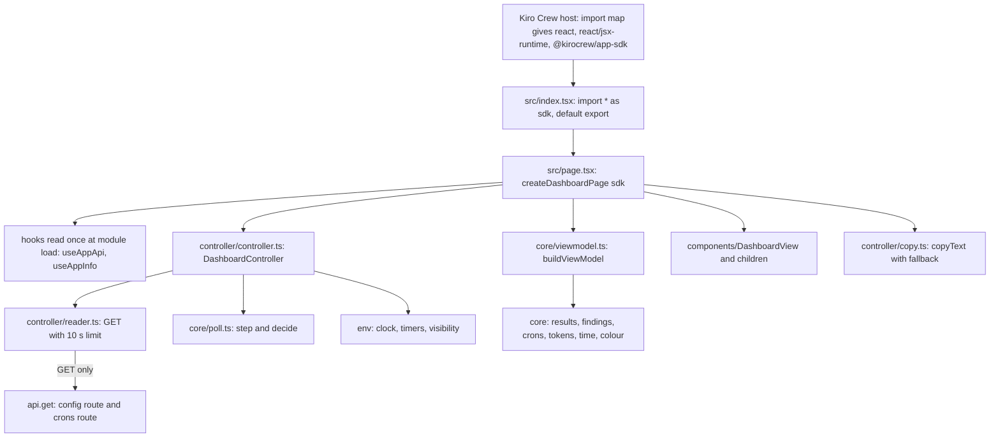
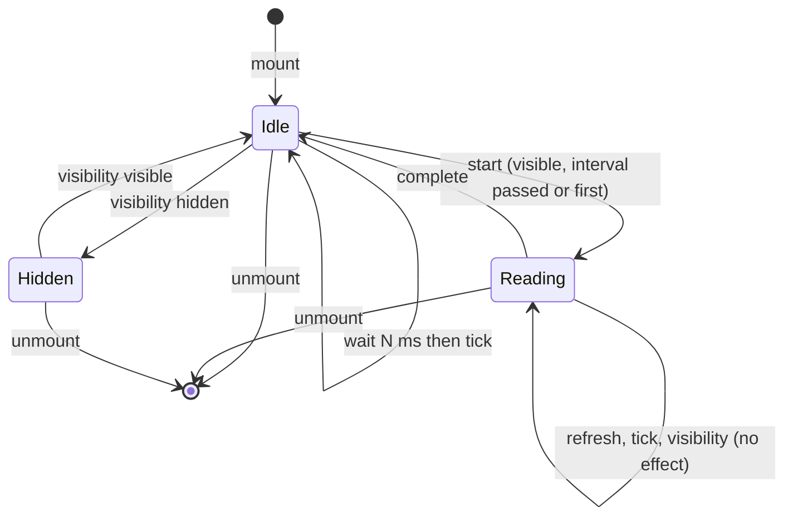

# Design Document

## Overview

The Dashboard_Page is a read-only React page in `ui/`. It reads two routes, turns what they return into a View_Model with one pure function, and renders the View_Model with plain components. A small controller (no React, no SDK import) owns the polling: it takes the clock, the timers and the API object as arguments, so every timing rule is tested with fakes.

The design has four layers, from the inside out:

1. `core/`: pure modules. No React, no SDK, no clock, no random source, no global. They hold every rule of the requirements: validation, the View_Model, colours, trend, findings, the Token codec, the time functions, the poll decision and the stale rule.
2. `controller/`: the reader (two requests with a time limit), the poll scheduler as a state machine, the clipboard flow. It takes `env` (clock, timers, visibility) and `api` as arguments. No React, no SDK import.
3. `components/` and `page.tsx`: a thin layer. The components render a View_Model as text and semantic elements. `page.tsx` is the only place that calls React hooks and the SDK hooks.
4. `index.tsx`: the entry. It imports `@kirocrew/app-sdk` as a namespace, passes it to `createDashboardPage`, and has the default export.

What was read for this design (read only): `requirements.md` (as amended), `.kiro/steering/dashboard.md`, `.kiro/specs/replay-runner/design.md` (Results_Key and the compact forms), `.kiro/specs/exploit-hunt/design.md` (Findings_Value, "Token grammar"), `scripts/replay/types.mjs`, the shape of the real `data/config.json` of the replay smoke run (two runs, five levels, all green, no `findings` key, 1522 bytes), and the evidence E09, E10, E14 and E24.

Not verified here: nothing has been built or installed. Unconfirmed: the versions of React, Vite and the React types that `npm install` will pick (the task will pin exact versions), that the host fires `visibilitychange` for the page, that `useAppApi().get` resolves to parsed JSON for both routes (observed for the config route in E24 R3; the crons route was read as an object in E24 R6), that an `esbuild` JSX transform in library mode writes `react/jsx-runtime` imports (E10 shows this for the spike), the formats of `last_run_ts` and `next_run_ts`, and the clipboard in the host.

## Architecture



The data flow of one Read: the controller asks the scheduler for a decision, the scheduler says "start", the reader sends the two GET requests, each route state is updated when its request settles (success, failure or the 10 second limit), and when both have settled the controller sends `complete` to the scheduler. After every state change the controller emits a snapshot; `page.tsx` builds the View_Model from the snapshot with `buildViewModel` and renders it.

Nothing in the render path reads a clock or a route. The only clock reads are in the controller (`env.nowMs()`), and the value reaches the View_Model builder as the `nowMs` argument (Requirement 2, criterion 8).

## Module layout under `ui/`

```
ui/
  package.json              own project; scripts: build, check:dist, typecheck, test
  tsconfig.json             strict; include src and tests; jsx react-jsx
  vite.config.ts            library mode (see "Build configuration")
  vitest.config.ts          environment node; alias '@kirocrew/app-sdk' to tests/stubs/app-sdk.ts
  scripts/check-dist.mjs    scans dist/index.mjs after the build (Requirement 9, criteria 2, 7 and 10)
  src/
    index.tsx               import * as sdk; export default createDashboardPage(sdk)
    page.tsx                createDashboardPage(sdk): the container component; reads hooks once at creation
    sdk.ts                  SdkRecord type; pickFunction(sdk, name); no import of the SDK module
    core/                   pure; imports only from core/
      constants.ts          APP_NAME, CONFIG_PATH, CRONS_PATH, TOP_KEY, limits, intervals
      text.ts               every fixed phrase of the page (so tests quote the same constants)
      json.ts               isRecord, readString, readFiniteNumber, readCount, readBool, clip
      time.ts               parseTime, parseCronTime, formatUtc, isStale, STALE_LIMIT_MS
      colour.ts             COLOURS, normaliseColour, colourLabel, markerClass
      tokens.ts             decodeToken, decodeActions, encodeAction, encodeActions, actionsFileText, replayCommand
      results.ts            parseLatest, parseLevelEntries, parseTrend, parseSchema
      findings.ts           parseFindings (validation, dedupe, order, caps)
      crons.ts              findReplayJob, parseJob, readIsRunning
      cards.ts              buildCards (union of ids, trend cells, trend text)
      viewmodel.ts          buildViewModel, types of the View_Model
      poll.ts               decide, step, initialScheduler, intervals
      change-key.ts         changeKey(vm)
      errors.ts             errorText(e)
      app-name.ts           appNameNotice(infoName)
    controller/             no React, no SDK import; env and api are arguments
      env.ts                Env type and realEnv()
      reader.ts             readRoute(api, path, env, limitMs)
      controller.ts         DashboardController
      copy.ts               copyText(text, env) and the copy-state reducer
    components/
      DashboardView.tsx     main, h1, sections, the stale and error texts
      ReplaySummary.tsx     commit, time, state, stale warning, failure
      LevelCard.tsx         one card
      TrendStrip.tsx        strip with the text equivalent; RunCounts table
      JobPanel.tsx          job state
      FindingsList.tsx      header, description, items
      FindingItem.tsx       one finding: tokens, command, file text, copy buttons
      CopyButton.tsx        button element with an accessible name
      LiveRegion.tsx        aria-live polite region
      styles.ts             one STYLE_TEXT string rendered in a <style> element
  tests/
    fixtures/               JSON fixtures (see "Fixtures")
    arbitraries.ts          fast-check generators
    stubs/app-sdk.ts        an empty module, only so that index.tsx can be imported in a test
    *.test.ts, *.test.tsx
```

Rules that tests enforce:

- A file under `src/core/` imports only from `src/core/`. A file under `src/controller/` imports only from `src/core/`, `src/controller/` and `src/sdk.ts` types. Neither imports `react`, `react-dom` or `@kirocrew/app-sdk` (Requirement 10, criterion 1).
- Only `src/index.tsx` imports `@kirocrew/app-sdk`, and no file imports `@kirocrew/app-sdk/ui` (Requirement 9, criterion 7).
- `ui/src/` contains no call of `.post(`, `.put(`, `.delete(`, `fetch(`, no `XMLHttpRequest`, no `useAppEvents` and no `dangerouslySetInnerHTML` (Requirement 1, criterion 8; Requirement 2, criterion 9).

`lucide-react` is listed as an external because the host provides it (Requirement 9, criterion 2), but the page imports no icons. The state of every item is shown by text, so no icon is needed.

## The entry and the SDK

`src/index.tsx`:

```tsx
import * as sdk from '@kirocrew/app-sdk';
import { createDashboardPage } from './page';

export default createDashboardPage(sdk as unknown as Readonly<Record<string, unknown>>);
```

`createDashboardPage(sdk)` reads `useAppApi` and `useAppInfo` from `sdk` with `typeof ... === 'function'` once, when it is called, which is when the module loads (Requirement 9, criterion 6). The component it returns calls these two constants unconditionally on every render, so the order of hooks never changes. The namespace import means a missing export cannot fail the link (E09, E10).

In the component:

- `useAppApi` missing, or calling it throws (caught around the call): `api` is `null`, the page shows "Kiro Crew did not provide the app API", the controller makes no request, and the Refresh_Button is disabled with that text as its explanation (a choice, see Decision 8).
- `useAppInfo` missing or throwing: ignored. If it returns an object with a string `name` different from `APP_NAME`, the page shows `appNameNotice(name)` with both names; it still uses the constant (Requirement 9, criterion 9).

`src/sdk.ts` holds only the type `SdkRecord = Readonly<Record<string, unknown>>` and `pickFunction(sdk, name)`, which returns the export when `typeof` is `function` and `null` otherwise.

## Core types

All View_Model values are plain JSON values (strings, finite numbers, booleans, `null`, arrays, objects). There is no `undefined` and no class instance, so two equal inputs give results that are equal with `toStrictEqual`.

```ts
// core/viewmodel.ts
export type Colour = 'green' | 'amber' | 'red' | 'error';
export type CardColour = Colour | 'none';

export type RouteStatus = 'pending' | 'ok' | 'failed';

/** What the controller knows about one route. `good` is the value of the last successful Read. */
export interface RouteState {
  status: RouteStatus;          // pending: never settled; ok / failed: how the latest Read of this route ended
  hasGood: boolean;
  good: unknown;                // meaningful only when hasGood
  goodAtMs: number | null;      // when `good` was read
  error: string | null;         // text of the latest failure (at most 200 characters), null after a success
}

export interface ViewModelInput {
  config: RouteState;
  crons: RouteState;
  nowMs: unknown;               // the Now_Input; any value is accepted
}

export interface ViewModel {
  loading: boolean;             // either route is still 'pending'
  resultsRoute: { error: string | null; readAt: string | null };   // readAt: 'YYYY-MM-DD HH:MM UTC' or null
  jobRoute: { error: string | null; readAt: string | null };
  results: ResultsView;
  job: JobView;
}

export interface ResultsView {
  hasData: boolean;             // a good config value exists
  present: boolean;             // that value has the key playtesterResults (a record)
  notice: string | null;        // different schema version of the Results_Value
  replay: ReplayView | null;    // null: "No replay run recorded yet"
  levels: LevelCardView[];      // ordered by levelId ascending
  runs: TrendRunView[];         // the valid Trend_Entries, newest first, at most 30
  findings: FindingsView;
  dropped: { levels: number; trend: number };
}

export interface ReplayView {
  runId: string | null;
  state: string | null;                         // running, complete, failed, cut-short, or null
  commit: string | null;                        // full hash or null ("commit unknown")
  commitShort: string | null;                   // first 7 characters
  time: string;                                 // 'YYYY-MM-DD HH:MM UTC' or 'time unknown'
  stale: boolean;                               // Requirement 5, criterion 11
  failure: { stage: string; reasonCode: string; message: string } | null;
}

export interface LevelCardView {
  levelId: string;
  colour: CardColour;
  label: string;                                // colourLabel(colour), or "Unknown colour"
  outcome: 'won' | 'not won' | 'not judged' | 'no result';
  reasonCode: string | null;
  timedOut: boolean;
  ink: { spent: number; minimal: number } | null;
  endHp: number | null;
  noDetail: boolean;                            // in the newest Trend_Entry but not in latest.levels
  trend: TrendCell[];                           // newest first, one per entry of `runs` (at most 30)
  trendText: string;                            // "Last 12 runs: 11 green, 1 amber"
}
export interface TrendCell { runId: string; counter: number; colour: CardColour }

export interface TrendRunView {
  runId: string;
  counter: number;
  state: string | null;
  startedAt: string;                            // formatted time
  commitShort: string | null;
  counts: { green: number | null; amber: number | null; red: number | null; error: number | null };
}

export interface FindingsView {
  present: boolean;                             // the findings key exists
  notice: string | null;                        // different schema version of the Findings_Value
  header: HuntHeader | null;
  items: FindingView[];                         // at most 20, newest first, no repeated (level, class, tokens)
  dropped: number;                              // invalid items plus items beyond the cap
}
export interface HuntHeader {
  updatedAt: string; commit: string | null; commitShort: string | null; huntId: string | null;
  counts: { attempts: number | null; confirmed: number | null; rejected: number | null;
            error: number | null; duplicate: number | null; notRecorded: number | null };
}
export interface FindingView {
  id: string; levelId: string;
  classKey: string;                             // the stored class string, at most 40 characters
  classLabel: string;                           // "Cheaper win", "Free win", "Unexpected route", or classKey
  commit: string | null; commitShort: string | null;
  foundAt: string;                              // formatted time
  tokens: string[]; tokensText: string;         // tokens joined by single spaces
  replayCommand: string | null;                 // null when the level id is not valid
  actionsFileText: string | null;               // null when a Token does not decode
  result: { won: boolean | null; inkSpent: number | null; minimalInk: number | null;
            editCount: number | null; newEditAddresses: string[] };
}

export type JobView =
  | { kind: 'pending' }
  | { kind: 'unavailable' }                     // the crons route failed and no good value exists, or `jobs` is not a list
  | { kind: 'not-registered' }
  | { kind: 'found'; lastRun: string; lastStatus: string | null; running: boolean;
      consecutiveFailures: number | null; nextRun: string; paused: boolean };
```

`JobView` has no field for `script`, `command`, `folder` or any path (Requirement 5, criterion 10); the type makes it impossible to carry one.

The "earlier commit" label is not in the View_Model. A pure function `isEarlierCommit(latestCommit, findingCommit)` in `core/findings.ts` returns true when both are non-empty strings and differ, and the component calls it with `vm.results.replay?.commit` and `finding.commit`. This keeps the findings view independent of `latest`, which the "bad part" property needs (Property 3).

## Validation of each part

Helpers (`core/json.ts`), all total: `isRecord(v)` (a non-null object that is not an array), `readString(v)` (a string or `null`), `readFiniteNumber(v)`, `readCount(v)` (a finite integer at least 0, else `null`), `readBool(v)` (`true` or `false`, else `null`), `clip(s, n)`. A field with the wrong type is read as `null`; nothing is converted (Requirement 2, criterion 6). Reading a field uses `Object.prototype.hasOwnProperty`, so a key such as `__proto__` or `constructor` in a route value is data, not a lookup into the prototype chain.

`buildViewModel(input)` runs inside one `try`. If an unexpected exception still escapes a part builder, that part gets its empty state and the rest is kept; the function as a whole never throws (Requirement 2, criterion 2). Each part is built by its own function, and none of them reads another part's output, except `buildCards`, which combines `latest.levels` and the runs on purpose.

| Part | Valid when | If not valid | Caps and order |
|---|---|---|---|
| Config value | `RouteState.hasGood`, and the value is a record | not a record (array, string, ...): treated as a config with no `playtesterResults`, dropped count not shown | none |
| `playtesterResults` | a record | absent: `present` false ("No results yet..."). Present but not a record: `present` true with empty parts and `dropped.levels` and `dropped.trend` unchanged; the text of Requirement 3, criterion 3 is shown | none |
| `schemaVersion` of the Results_Value or the Findings_Value | the number 1 | a number greater than 1, or not a number (also absent): `notice` = "This value comes from a different schema version (found: N)" or "(found: none)"; the parts that validate are still read | none |
| `latest` | a record; `runId` or `startedAt` is a string | `replay` null | none |
| `latest.state` | one of `running`, `complete`, `failed`, `cut-short` | `state` null, shown as "state unknown" | none |
| `latest.commit` | a non-empty string | null, shown "commit unknown" | `commitShort` is the first 7 characters |
| `latest.failure` | a record with string `stage`, `reasonCode`, `message` (each clipped to 200) | null | none |
| Level_Entry | a record with `levelId` a string (1 to 80 characters) and `colour` a string | dropped, counted in `dropped.levels` | at most 100 entries; the rest are left out and counted. A repeated `levelId`: the first one stays, the rest are counted |
| `colour` | one of the four | any other string becomes `error` with label "Unknown colour" | none |
| `inkSpent`, `minimalInk` | both finite integers at least 0 | `ink` null ("ink not recorded") | none |
| `endHp` | a finite number at least 0 | null (omitted) | none |
| `reasonCode` | a string, clipped to 60 | null | none |
| `timedOut` | exactly `true` | false | none |
| `trend` | an array | not an array: no runs, `dropped.trend` is 1 | the valid entries are deduplicated by `runId` (first kept after sorting), sorted, and cut to 30; the rest are counted |
| Trend_Entry | a record with `runId` a string and `counter` a finite integer at least 0 | dropped, counted in `dropped.trend` | sort: `counter` descending, then `startedAt` descending (string comparison of the stored text; a missing one sorts last), then `runId` descending |
| Trend_Entry `levels` | a record | treated as `{}` | an entry whose key is not a string of 1 to 80 characters, or whose value is not a string, is ignored; an unknown colour string becomes `error`; at most 100 keys are read |
| Trend_Entry counts | `readCount` | null, shown "unknown" | none |
| `findings` | absent: `present` false. A record: valid. Any other value (a legacy array, a string): `present` false and `dropped` 1 | see Requirement 3, criterion 4 | none |
| Findings header | `updatedAt` a string; `commit`, `huntId` strings or null | `updatedAt` missing: shown "time unknown"; the other fields null | counts by `readCount`, null shown "unknown" |
| Finding | a record; `id`, `levelId`, `class`, `foundAt` strings; `actions` an array of 1 to 40 strings, each at most 140 characters | dropped, counted | `class` clipped to 40; `levelId` clipped to 80 |
| Finding `result` | a record | all result fields null and `newEditAddresses` empty | `newEditAddresses`: strings only, at most 8, each clipped to 12 |
| `Findings_Value.items` | an array | not an array: no items, `dropped` 1 | see "Findings order and caps" below |
| Crons value | a record with `jobs` an array | `jobs` not an array: `JobView` is `unavailable` | at most 50 jobs are inspected |
| Replay job | the first job (in list order) that matches A-5 | none matches: `not-registered` | none |
| Job fields | `last_run_ts`, `next_run_ts` through `parseCronTime`; `last_status` a string clipped to 40; `is_running` exactly `true`; `consecutive_failures` by `readCount`; `user_paused` exactly `true` or `enabled` exactly `false` gives `paused` | a field of the wrong type is read as absent (shown "time unknown", status omitted, running false, failures unknown) | none |

A-5 in code (`findReplayJob`): the first job whose `name` is a string equal to `replay` or ending with `/replay`; if there is none, the first job whose `script` is a string containing `replay_cron.py`. The `script` string is read only inside this function and never copied into a result.

### Findings order and caps

`parseFindings` does these steps, in this order:

1. Validate each item of `items`; count the invalid ones.
2. Sort the valid ones: `foundAt` parsed by `parseTime` descending (an unparseable time sorts after every parseable one), then `id` descending (string comparison).
3. Remove an item whose key `levelId + "\u0000" + class + "\u0000" + tokens.join(" ")` was already seen; the first in the sorted order stays. A removed duplicate is not counted as dropped, because the same finding is still shown.
4. Keep the first 20; count the rest as dropped.

`dropped` is the sum of step 1 and step 4 (Requirement 6, criterion 7).

### Cards and the trend

`buildCards(levels, runs)` (`core/cards.ts`):

1. The ids are the distinct `levelId`s of `levels` plus the ids named in the newest run's `levels` map, sorted ascending by plain string comparison (`a < b`). The newest run is the first element of `runs`. At most 100 ids.
2. A card whose id is in `levels` shows that entry. A card whose id is only in the newest run takes its colour from that run, `outcome` from the colour, `noDetail` true, and no ink or end HP.
3. `trend` has one cell per run in `runs`, newest first: the colour that run names for the level, or `none`. The strip is drawn oldest on the left by reversing this list in the component.
4. `trendText` is "Last N runs: " followed by the non-zero counts in the order green, amber, red, not judged, no result, joined by ", " (for example "Last 12 runs: 11 green, 1 amber"); with no runs it is "No runs recorded".
5. `outcome`: `green` and `amber` give "won", `red` gives "not won", `error` gives "not judged", `none` gives "no result". `timedOut` adds "play timed out" in the component.

The colour is stored data. `buildCards` never reads `inkSpent` or `minimalInk` to decide a colour (Requirement 4, criterion 4).

## Colour mapping

```ts
// core/colour.ts
export const COLOURS = ['green', 'amber', 'red', 'error'] as const;
export function normaliseColour(v: string): Colour;            // unknown string -> 'error'
export function colourLabel(c: CardColour): string;
// green: "Green: intended solution holds", amber: "Amber: wins with a different ink count",
// red: "Red: no longer wins", error: "Not judged", none: "No result"
export function markerClass(c: CardColour): string;            // 'marker-green' | 'marker-amber' | 'marker-red' | 'marker-error' | 'marker-none'
```

`markerClass` is a function of the colour only. A card with an unknown colour has the colour `error` and the label "Unknown colour" in the place of the Colour_Label; the label comes from the card's `label` field, which `buildCards` sets to `colourLabel(colour)` or to "Unknown colour". Property 6 checks `label === colourLabel(colour)` for every card whose entry had a known colour.

## Time functions

All in `core/time.ts`, pure and total.

- `parseTime(v: unknown): number | null`. A string that matches `^(\d{4})-(\d{2})-(\d{2})T(\d{2}):(\d{2})(?::(\d{2})(?:\.(\d{1,9}))?)?(Z|[+-]\d{2}:\d{2})$`, with the fields checked by hand (month 1 to 12, day 1 to the days of that month in that year, hour 0 to 23, minute 0 to 59, second 0 to 59, offset hour 0 to 23 and offset minute 0 to 59), converted with `Date.UTC` and the offset. It does not rely on `Date.parse`, whose handling of an invalid day differs between engines. Anything else is `null`. The replay and the hunt write `YYYY-MM-DDTHH:MM:SS.mmmZ`.
- `parseCronTime(v: unknown): number | null`. A finite number at least 0: below `1e11` it is seconds and is multiplied by 1000, otherwise milliseconds; the result must be a valid date (at most 8.64e15). A string goes through `parseTime`. Anything else is `null` (Requirement 5, criterion 7).
- `formatUtc(ms: number | null): string`. `YYYY-MM-DD HH:MM UTC` with the minute floored, or "time unknown" for `null` or a value that is not a valid date.
- `STALE_LIMIT_MS = 129_600_000`.
- `isStale(replayMs: number | null, nowMs: unknown): boolean`. True exactly when `replayMs` is a number, `nowMs` is a finite number, and `nowMs - replayMs > STALE_LIMIT_MS`. A time exactly 36 hours old gives false; a time after `nowMs` gives false; either input missing gives false.

The replay time (`replayTimeOf(latest)`) is `finishedAt` when it is a string, otherwise `startedAt`. A `finishedAt` string that does not parse gives "time unknown" and no stale warning; there is no fallback to `startedAt` in that case (Requirement 5, criterion 11). `ReplayView.time` and `ReplayView.stale` both come from this one value.

## Token codec

`core/tokens.ts`. The grammar is the exploit-hunt grammar ("Token grammar"); the page has its own copy of the code and shares nothing with `scripts/`.

```ts
export type Action =
  | { kind: 'move'; dir: 'N' | 'S' | 'E' | 'W' }
  | { kind: 'wait' }
  | { kind: 'undo' }
  | { kind: 'edit'; address: string; raw: string };

export function decodeToken(token: string): Action | null;                     // total; never throws
export function decodeActions(tokens: readonly string[]): Action[] | null;     // null when any token fails
export function encodeAction(a: Action): string;                               // canonical
export function encodeActions(actions: readonly Action[]): string[];
export function actionsFileText(actions: readonly Action[]): string;           // JSON.stringify(actions, null, 2)
export function replayCommand(levelId: string): string | null;
```

Decoding a token:

- `N`, `S`, `E`, `W` give a move; `wait` gives a wait; `undo` gives an undo. Tokens are case sensitive.
- `edit:ADDRESS=RAW`: split at the first `=`. `ADDRESS` must match `^[A-Z]+[0-9]+$` and be at most 6 characters. `RAW` is scanned left to right: a character of `A-Z a-z 0-9 . _ -` is one byte; `%` must be followed by two hex digits of either case; any other character (including `=`, `:`, a space and every non-ASCII character) fails. The bytes are decoded with `new TextDecoder('utf-8', { fatal: true, ignoreBOM: true })`. `ignoreBOM: true` is needed because the default strips a leading U+FEFF, which would change a `raw` that starts with that character. The decoder is created once at module level. A decode error fails the token.
- The page does not enforce the hunt's limit of 40 decoded bytes; its own limit is the 140-character token cap of the View_Model (Decision 12).

Encoding is the canonical rule: each code point of `raw` becomes its UTF-8 bytes; a byte that is a safe ASCII character stays; every other byte is `%` plus two upper-case hex digits. `encodeAction` of an edit is `edit:` + address + `=` + encoded raw.

`replayCommand(levelId)` returns `node scripts/play.mjs ${levelId} --actions-file <actions-file>` when `levelId` matches `^[a-z0-9][a-z0-9-]*$`, else `null`.

`actionsFileText(actions)` is `JSON.stringify(actions, null, 2)` without a trailing newline. Each action object has its keys in the order `kind`, then `dir`, or `address` and `raw`.

The View_Model builder computes `actionsFileText` for every Finding once (decode all tokens; `null` if any fails). The components never decode.

The round trip is guaranteed for action lists whose `raw` strings are well-formed Unicode (no lone surrogate). A lone surrogate cannot be written as UTF-8 and is replaced by U+FFFD when encoded; the generator therefore builds `raw` from code points outside the range D800 to DFFF (Property 8). The same range cannot appear in a decoded string, because the decoder is fatal.

## Poll scheduler as a state machine

`core/poll.ts`. The scheduler is a pure reducer. The controller keeps the state, feeds events, and carries out the effect.

```ts
export const POLL_INTERVAL_MS = 60_000;
export const RUNNING_INTERVAL_MS = 15_000;

export interface SchedulerState {
  visible: boolean;
  inFlight: boolean;
  lastStartMs: number | null;
  isRunning: boolean;           // the Replay_Job reports is_running
  closed: boolean;              // the page was unmounted
}
export type SchedulerEvent =
  | { type: 'mount'; nowMs: number; visible: boolean }
  | { type: 'tick'; nowMs: number }
  | { type: 'visibility'; nowMs: number; visible: boolean }
  | { type: 'refresh'; nowMs: number }
  | { type: 'complete'; nowMs: number; isRunning: boolean }
  | { type: 'unmount' };
export type Effect = { do: 'start' } | { do: 'wait'; ms: number } | { do: 'none' };

export function decide(input: {
  visible: boolean; inFlight: boolean; lastStartMs: number | null; nowMs: number;
  pollIntervalMs: number; isRunning: boolean;
}): Effect;
export function step(state: SchedulerState, event: SchedulerEvent): { state: SchedulerState; effect: Effect };
```

`decide` is the function of Requirement 8, criterion 12:

- If the page is not visible: `none`.
- If a Read is in flight: `none` (the `complete` event decides again).
- The effective interval is `RUNNING_INTERVAL_MS` when `isRunning` is true, otherwise `pollIntervalMs`. It is never larger than `pollIntervalMs`.
- If `lastStartMs` is `null`: `start`.
- Otherwise `remaining = lastStartMs + interval - nowMs`: `start` when `remaining <= 0`, else `wait` with `ms = remaining`.

`step` transitions:

| State and event | New state | Effect |
|---|---|---|
| `closed`, any event | unchanged | `none` |
| `mount` | `visible` set, `lastStartMs` null, `inFlight` false | `decide` (starts at once when visible) |
| `tick` | unchanged | `decide` |
| `visibility` to hidden | `visible` false | `none` (the controller clears its timer) |
| `visibility` to visible | `visible` true | `decide` (a Read at once when the last start is more than one interval ago, otherwise `wait` for the rest) |
| `refresh`, visible and not in flight | unchanged | `start` |
| `refresh`, hidden or in flight | unchanged | `none` |
| `complete` | `inFlight` false, `isRunning` from the event | `decide` |
| `unmount` | `closed` true | `none` |

When `step` returns `start`, it has already set `inFlight` true and `lastStartMs` to `nowMs` in the new state. Because only `step` sets `inFlight`, and it does so only from a state with `inFlight` false, two Reads cannot overlap (Requirement 8, criterion 3). A `complete` event arriving when `inFlight` is already false (a late duplicate) changes nothing but the `isRunning` flag and then calls `decide`, which cannot start a Read before the interval.



Every Read ends: the reader gives each request a 10 second limit (see "Reader"), so `complete` always follows a `start`. The scheduler itself has no timer for this; Property 10 therefore completes every started Read in its model, and a separate controller test shows that a request that never settles still yields `complete` after the limit.

## Reader and controller

`controller/reader.ts`:

```ts
export interface Api { get(path: string): Promise<unknown> }
export type ReadResult = { ok: true; value: unknown } | { ok: false; error: string };
export function readRoute(api: Api, path: string, env: Env, limitMs: number): Promise<ReadResult>;
```

`readRoute` calls `api.get(path)` inside a `try` (a synchronous throw is a failure), races it with a timer from `env.setTimeout(limitMs)`, and settles once. After it settles, the timer is cleared and any later answer is ignored. A failure becomes `{ ok: false, error: errorText(e) }`; the limit gives "The request took longer than 10 seconds". `readRoute` only ever calls `api.get`. It has no other method of `api` in its code, so a recording fake sees GET calls only (Requirement 1, criterion 7).

`core/errors.ts`, `errorText(e: unknown): string`:

- Take `e.message` when `e` is an object with a string `message`; otherwise the fixed phrase "The request failed".
- Redact `token=` followed by non-space, non-`&` characters, and `Bearer ` followed by non-space characters, replacing the secret with `…`.
- Take the first line only (no stack), trim, clip to 200 characters.

`controller/env.ts` defines what the controller may touch:

```ts
export interface Env {
  nowMs(): number;
  setTimeout(fn: () => void, ms: number): unknown;
  clearTimeout(handle: unknown): void;
  isVisible(): boolean;
  onVisibilityChange(cb: () => void): () => void;   // returns the unsubscribe function
}
export function realEnv(): Env;                      // uses Date.now, window timers, document.visibilityState
```

`controller/controller.ts`, `DashboardController`:

```ts
export interface Snapshot {
  config: RouteState; crons: RouteState; nowMs: number;
  inFlight: boolean; visible: boolean; version: number;
}
export class DashboardController {
  constructor(api: Api | null, env: Env, paths = { config: CONFIG_PATH, crons: CRONS_PATH });
  start(): void;                       // mount: subscribes to visibility, sends 'mount'
  stop(): void;                        // unmount: clears the timer, unsubscribes, bumps the generation
  refresh(): void;                     // the Refresh_Button
  subscribe(listener: () => void): () => void;
  getSnapshot(): Snapshot;             // a new object only when something changed
}
```

How it works:

1. `start` creates the state with both routes `pending`, subscribes to visibility, and sends `mount`. With `api === null` it sets both routes to `failed` with "Kiro Crew did not provide the app API" and never reads.
2. After every `step`, the controller clears its single timer and carries out the effect: `start` begins a Read; `wait` sets one timer (`env.setTimeout`) that sends `tick`; `none` sets nothing.
3. A Read increments a `generation` counter, calls `readRoute` twice (config path, then crons path) and updates each route as its request settles, if the generation is still current and the controller is not stopped. A success sets `status` `ok`, `good`, `goodAtMs` (from `env.nowMs()`), `error` null. A failure sets `status` `failed` and `error`, and keeps `good` (Requirement 8, criteria 10 and 11).
4. When both requests have settled, the controller sends `complete` with `isRunning = readIsRunning(crons.good)` (from `core/crons.ts`; false without a good value).
5. `stop` sets `closed`, bumps the generation so late answers are discarded, clears the timer and unsubscribes (Requirement 8, criterion 9). `start` after `stop` (React strict mode mounts twice in development) builds a fresh state, so it is safe to call again.
6. Every snapshot carries `nowMs = env.nowMs()` taken when the snapshot is built. That is the Now_Input of the View_Model.

`page.tsx` creates one controller per mounted component (a `useRef`), calls `start` in an effect and `stop` in its cleanup, and reads the snapshot with `useSyncExternalStore`. It builds the View_Model with `useMemo(() => buildViewModel(snapshot), [snapshot])`.

The stale warning is computed when a snapshot is built, so it is as fresh as the last Read, visibility change or Refresh. A page that stays visible polls every minute, so the warning cannot lag by more than about a minute.

## Clipboard flow

`controller/copy.ts`:

```ts
export interface CopyEnv {
  writeText?: (text: string) => Promise<void>;      // navigator.clipboard.writeText when it is a function
  selectionCopy?: (text: string) => boolean;        // creates a hidden textarea, selects it, runs document.execCommand('copy')
}
export type CopyOutcome = { ok: true } | { ok: false };
export async function copyText(text: string, env: CopyEnv): Promise<CopyOutcome>;
```

`copyText` tries `writeText` (a missing function, a rejection and a throw all count as failure), then `selectionCopy` (a throw or `false` is failure). It never throws. The component state is a small reducer in the same file: `idle`, `copied` (message "Copied", cleared by a timer after 3 seconds), `fallback` (message "Copy is not available here. Select the text and press Ctrl+C." and the text). In `fallback` state the component renders a read-only `textarea` that is focused and fully selected on mount (a `useEffect` calls `focus()` and `select()`); the message goes into the same live region (Requirement 11, criteria 5 and 6). `page.tsx` builds the real `CopyEnv` from `navigator` and `document`, reading them inside the click handler, never at module load.

The live region has one polite element. It holds, in this order of priority: the copy message, otherwise "Results updated" when `changeKey(vm)` differs from the key of the previous successful Read (not on the first Read, not on a failed Read), otherwise empty. `changeKey(vm)` (`core/change-key.ts`) is `JSON.stringify` of `vm.results` and `vm.job`, so a Read that returns the same data announces nothing (Requirement 11, criterion 7).

## Components

All components take their data as props and render text from strings in the View_Model or from the constants in `core/text.ts`. They never receive a raw route value.

| Component | Renders | Notes |
|---|---|---|
| `DashboardView` | `main` with `h1` "Grimsheet Playtester"; the states of Requirement 3; the Refresh_Button; the live region; the style element | `main` is the only landmark of its kind |
| `ReplaySummary` | section "Last replay" (`h2`): short commit with the full hash in `title` and in visually hidden text, time, state, stale warning, failure stage, reason code and message | "commit unknown" for a null commit |
| `LevelCard` | `li` with `h3` level id, the marker (a `span`, `aria-hidden`), the Colour_Label, outcome, "play timed out", ink, end HP, "no detail in the last run", the trend strip and its text | the marker class is `markerClass(colour)` only |
| `TrendStrip` | `div role="img"` with `aria-label` equal to `trendText`; one `span` per cell, oldest on the left, each `aria-hidden`; the visible text `trendText` and "oldest to newest" | the strip is decoration; the text is the information |
| `RunCounts` | `table` with a caption and one row per run, newest first: run id, time, commit, green, amber, red, not judged | Requirement 4, criterion 13 |
| `JobPanel` | section "Replay job" (`h2`): last run, status, "replay running now", consecutive failures with "consecutive failures" and a warning text, next run, "paused" | the warning is text ("Warning: ...") |
| `FindingsList` | section "Findings" (`h2`): the sentence of Requirement 6, criterion 6, the hunt header, the dropped count, the items | |
| `FindingItem` | `li` with `h3` "levelId, class label"; commit, found at, "found on an earlier commit" when `isEarlierCommit`; the tokens in a monospace `code` element that wraps; the command and its help text; the file text in a read-only `pre`; copy buttons; result line | `white-space: pre-wrap; overflow-wrap: anywhere` |
| `CopyButton` | a `button` element with a text label and an `aria-label` that includes the level id, for example "Copy action list for 02-the-chaser" | Enter and Space work because it is a button |
| `LiveRegion` | `div aria-live="polite"` | |

Fixed texts live in `core/text.ts`, for example `LOADING = 'Reading results'`, `NO_RESULTS = 'No results yet. The nightly replay has not written any results.'`, `NO_REPLAY = 'No replay run recorded yet'`, `NO_HUNT = 'No hunt has run yet'`, `HUNT_EMPTY = 'The last hunt found no exploits'`, `RESULTS_FAILED = 'Results could not be read'`, `JOB_UNAVAILABLE = 'Replay job state is unavailable'`, `JOB_NOT_REGISTERED = 'The replay job is not registered'`, `API_MISSING = 'Kiro Crew did not provide the app API'`, `STALE = 'The last replay is older than 36 hours'`. Tests import the constants, so a wording change is made in one place and the requirements text is checked against the constants once, in a test that lists the literal strings of the requirements.

Display of each state (Requirement 3):

| Situation | VM fields | Text |
|---|---|---|
| First Read not finished | `loading` | "Reading results" |
| Config answered, no key | `hasData`, not `present` | `NO_RESULTS`, no cards, no findings |
| Key present, `latest` absent or invalid | `replay` null | `NO_REPLAY` in the level area; valid trend and findings still shown |
| `findings` absent | `findings.present` false | `NO_HUNT` |
| `findings` present, no items | `present`, `items` empty | `HUNT_EMPTY` and the hunt header |
| `latest.state` is `failed` | `replay.failure` | stage, reason code, message; cards still shown |
| `cut-short` or `running` | `replay.state` | the state as text; the levels that exist |
| Config route failed | `resultsRoute.error` | `RESULTS_FAILED` and the error text; the last good results stay, with "last read at" |
| Crons route failed | `jobRoute.error` | `JOB_UNAVAILABLE` in the job area only |
| Crons answered, no job | `job.kind` `not-registered` | `JOB_NOT_REGISTERED` |
| Both failed on the first Read | both errors | both texts and a working Refresh_Button |

The page styles are one constant string in a `<style>` element rendered once by `DashboardView`. The host loads only the `.mjs` file, so there is no separate CSS file. The string is a constant and holds no route data. It uses the host's text colour (`color: inherit`) for every label, marker colours only as a decorative background or border, a visible `:focus-visible` outline, and a `prefers-reduced-motion` rule (the page has no animation).

## Build configuration

`ui/package.json` (versions are pinned at the task, exact, no ranges): `type: module`; scripts `build` (`vite build && node scripts/check-dist.mjs`), `typecheck` (`tsc --noEmit`), `test` (`vitest --run`). Dependencies: none. Dev dependencies: `typescript`, `vite`, `vitest`, `fast-check`, `react`, `react-dom`, `@types/react`, `@types/react-dom`. `react` and `react-dom` are dev dependencies only, for types and for server rendering in the tests; the host provides them at run time. `@kirocrew/app-sdk` is not listed and not installed (Requirement 9, criterion 3). `vitest`, `fast-check` and `typescript` use the same versions as the root `package.json`, so the project has one set of tools.

`vite.config.ts` (library mode, one ES module):

```ts
import { defineConfig } from 'vite';

export default defineConfig({
  esbuild: { jsx: 'automatic' },
  build: {
    target: 'es2022',
    outDir: 'dist',
    emptyOutDir: true,
    sourcemap: false,
    minify: true,
    cssCodeSplit: false,
    lib: { entry: 'src/index.tsx', formats: ['es'], fileName: () => 'index.mjs' },
    rollupOptions: {
      external: ['@kirocrew/app-sdk', 'react', 'react/jsx-runtime', 'react-dom', 'lucide-react'],
      output: { inlineDynamicImports: true },
    },
  },
});
```

No Vite plugin is used (the `kirocrewApp()` plugin stays unconfirmed). The `esbuild.jsx: 'automatic'` setting makes the bundle import `jsx` from `react/jsx-runtime`, as the spike's bundle did (E10); no `react/jsx-dev-runtime` appears in a production build. `inlineDynamicImports` keeps the output to one file. The build needs the network only for `npm install` (Requirement 9, criterion 11).

`scripts/check-dist.mjs` (plain ESM, run by `npm run build` after Vite) reads `dist/index.mjs` and fails with a non-zero exit when:

- the file is missing, or `dist/` holds any other file than `index.mjs`;
- a static `import ... from '<specifier>'` has a specifier outside the five externals (`@kirocrew/app-sdk`, `react`, `react/jsx-runtime`, `react-dom`, `lucide-react`);
- the text holds `@kirocrew/app-sdk/ui`;
- the text matches a drive-letter path (`[A-Za-z]:\\`), `Users\`, `token=`, or `http://localhost`, or `https://`-URLs other than the host's own (none are expected, so any `http://` or `https://` is a failure);
- the SDK is imported by name (`import { ... } from "@kirocrew/app-sdk"`) instead of as a namespace.

`typecheck` is `tsc --noEmit` with `strict: true`, `noUncheckedIndexedAccess: true`, `jsx: react-jsx`, `moduleResolution: bundler`, and an `include` of `src` and `tests`. The repository's root `tsconfig.json` does not include `ui/`, so the root typecheck and `npm test` are unchanged; the `ui/` project has its own `npm test`. How a single command runs both is a `packaging` question.

## Error handling

- Every route value is untrusted. `buildViewModel` is total; a part that fails validation is dropped or replaced by its empty state, counted, and shown as text such as "2 findings could not be read".
- A route failure keeps the last good data of that route and shows the error text beside it (Requirement 3, criteria 9 and 10; Requirement 8, criterion 11).
- A thrown error in a render is not caught by this design. The components are written so that every value they print is a string or a finite number from the View_Model; a test renders the page for generated View_Models and for generated raw inputs through the builder, and expects no throw. A React error boundary is a possible addition, left out because the rendering of validated plain values has no known failure (Decision 6).
- Error texts come from `errorText` (one line, at most 200 characters, secrets redacted).
- An unexpected exception inside one part builder gives that part's empty state and a dropped count of 1; it is not rethrown.

## Testing strategy

Vitest, fast-check (`numRuns` at least 100 for each property, each tagged `// Feature: dashboard, Property N: <title>`), `react-dom/server` for rendering, a fake `api` and a fake `Env` (a manual clock and a manual timer queue) for the controller. The tests need no browser and no network (Requirement 10, criteria 2 and 8).

### Correctness properties

| # | Property | Requirement criteria |
|---|---|---|
| 1 | **Total View_Model.** For any JSON value as the config value, any JSON value as the crons value, any route statuses and any value as the Now_Input, `buildViewModel` returns a View_Model and does not throw. | 2.2, 10.3 |
| 2 | **Deterministic.** Equal inputs give `toStrictEqual` results. | 2.8, 10.7 |
| 3 | **A bad part never blanks the good parts.** For any valid Results_Value and any one of the parts `latest`, `trend`, `findings` replaced by an arbitrary JSON value (or removed), the other sections of the View_Model are equal to those of the unchanged value. The compared sections are: `replay`, `runs`, `findings` and `job`, and for each replaced part the sections that do not derive from it. `levels` derives from `latest` and `trend` together and is excluded when either is replaced; it is compared when only `findings` is replaced. | 2.3, 10.6 |
| 4 | **Trend order and size.** For any `trend` value, `runs` has at most 30 entries, is sorted by `counter` descending (ties by `startedAt` descending, then `runId` descending), and holds no repeated `runId`. | 4.11, 2.7, 4.14 |
| 5 | **One card per level id.** For any `latest.levels` and any trend, there is one card for each distinct level id of `latest.levels` and the newest run, ordered ascending, and no other card. | 4.1, 4.14 |
| 6 | **Colour and label.** For any card, `colour` is one of the five values, `label` equals `colourLabel(colour)` (or "Unknown colour" for an unknown stored string), `markerClass` depends on the colour only, and changing `inkSpent` or `minimalInk` of an entry never changes its colour. | 2.10, 4.3, 4.4, 10.4 |
| 7 | **Findings view.** For any Findings_Value, the view has at most 20 items, no two with the same level id, class and Token list, in newest-first order (`foundAt` descending, then `id` descending), every item has at most 40 tokens of at most 140 characters, and `dropped` equals the number of invalid items plus the items beyond the cap. | 6.3, 6.7, 6.8, 2.7 |
| 8 | **Token round trip.** For any valid action list (up to 40 actions, edits with `raw` from well-formed Unicode), `decodeActions(encodeActions(list))` equals the list; and the C3-f token `edit:B14=%3DIF%28DIST%28HERO%2CSELF%29%3C1%2CTOWARD%28HERO%29%2C%22-%22%29` decodes to the edit `{"kind":"edit","address":"B14","raw":...}` with the value `=IF(DIST(HERO,SELF)<1,TOWARD(HERO),"-")` (the example of the exploit-hunt design). | 7.8, 10.5 |
| 9 | **Decoder totality and rejection.** For any string, `decodeToken` does not throw. A token with a lone `%`, a `%` followed by fewer than two hex digits, a non-hex escape, or bytes that are not valid UTF-8 fails; a token with lower-case hex decodes to the same action as the same token with upper-case hex. | 7.9, 10.5 |
| 10 | **Poll scheduler.** For any sequence of `tick`, `visibility`, `refresh` and `complete` events with non-decreasing times, in a model that completes every started Read: the number of Reads in flight never exceeds 1, no `start` effect is returned while `visible` is false or `closed` is true, a `start` always follows an elapsed interval (or is the first, or a Refresh), `decide` never returns an interval larger than `POLL_INTERVAL_MS`, and after the sequence a `tick` at a time past the interval starts a Read when the page is visible and nothing is in flight (progress). | 8.3, 8.4, 8.5, 8.6, 8.7, 8.12, 8.13 |
| 11 | **Stale warning.** For any Results_Value and any Now_Input, `replay.stale` is true exactly when the replay time parses and `nowMs - time > 129_600_000`, with the Now_Input a finite number. | 5.11, 10.11 |
| 12 | **Time functions.** `formatUtc(parseTime(s))` has the form `YYYY-MM-DD HH:MM UTC` for any valid ISO string, `parseTime` returns `null` for any string that is not valid ISO 8601 (an invalid day such as `2026-02-30` included), `parseCronTime` of a number below `1e11` equals `parseCronTime` of the same number times 1000 expressed in milliseconds, and no input makes any of them throw. | 5.2, 5.7 |
| 13 | **Read only.** For any sequence of `start`, polls, Refresh activations, visibility changes, route failures, late answers and `stop` driven through the controller with a recording fake API, every recorded call is a `get` of one of the two paths, and nothing else is called. | 1.1, 1.2, 1.3, 1.7, 8.13 |
| 14 | **Text, not markup.** For any strings in the string fields of a Results_Value, a Findings_Value and a Crons value (including `<script>`, `&`, quotes and `javascript:`), the HTML the page renders contains no element that the page did not put there: the count of `<script`, `"` as a placeholder |
| `crons.replay-running.json`, `crons.replay-failing.json`, `crons.none.json` | the running, failing and empty variants |

`last_run_ts` and `next_run_ts` appear in the three forms (epoch seconds, epoch milliseconds, ISO string) across the fixtures, because their real format is not recorded (A-6). A test scans every fixture for a drive-letter path (`[A-Za-z]:\\`), `Users\`, `token=` and a home-directory marker, and fails on a match (Requirement 10, criterion 9). The commit in the fixtures is a public Grimsheet commit hash from the smoke run, not a path.

A fixture test builds the View_Model from `config.replay-two-runs.json` and checks five green cards, a trend of two runs, the commit `6372d9a`, and "No hunt has run yet". The shape check against the writer (that a value written by the replay code validates here with `dropped` all zero) uses the fixture, not the replay modules (A-2).

## Decisions to confirm

1. **A controller layer between the page and the pure core.** The requirements name pure functions for the builder and the scheduler. The reader, the timers and the visibility handling are also moved out of React into `DashboardController`, so Requirement 1, criterion 7 and Requirement 8 are tested as properties with fakes. It adds one module family, `controller/`.
2. **No CSS file; one inline style constant.** The host loads only the `.mjs`. The style text is a constant and holds no route data.
3. **`lucide-react` is an external but unused.** No icons; every state has a text.
4. **A Level_Entry without a string `colour` is dropped and counted.** The requirements say an unknown colour string becomes `error`; a non-string colour is treated as a failed validation, not as a guess.
5. **A removed duplicate finding is not counted as dropped.** Only invalid items and items beyond the cap are counted.
6. **No React error boundary.** Rendering uses only validated plain values. Add one if a real host shows a crash.
7. **`loading` lasts until both routes have settled once.** Requirement 3, criterion 1 says "until the first Read has finished", and a Read ends when both requests have settled or timed out. A fast config answer is therefore not shown before the crons answer (at most 10 seconds later).
8. **The Refresh_Button is disabled when the app API is missing,** with the text "Kiro Crew did not provide the app API". Requirement 3, criterion 12 asks for a working button for route failures, which still holds.
9. **The Now_Input is read when a snapshot is built** (every state change), not on every render. The stale warning can therefore be as old as the last snapshot; the minute poll keeps it fresh while the page is visible.
10. **`errorText` redacts `token=` and `Bearer` values** as well as clipping to 200 characters. The requirements ask that no token is shown; the message text of an SDK error is not under the page's control.
11. **ISO 8601 is parsed by hand,** with the field ranges checked, instead of `Date.parse`, so that `2026-02-30` is "time unknown" on every engine. Only the full form with `T`, a time and `Z` or an offset is accepted; a date alone is not.
12. **The decoder uses `TextDecoder` with `fatal: true` and `ignoreBOM: true`** and does not enforce the hunt's 40-byte limit on `raw`. The page's limit is the 140-character token cap.
13. **The actions file text has no trailing newline.** It is valid JSON either way.
14. **`decide` takes the base interval and `isRunning`,** and picks 15 seconds when the job is running. Requirement 8, criterion 12 lists both inputs; this is how they combine.
15. **A Refresh while the page is hidden does nothing.** Requirement 8, criterion 13 forbids a Read while hidden; the button is not reachable in a hidden page in practice.
16. **"Found on an earlier commit" is decided at render time** by `isEarlierCommit`, not stored in the View_Model, so the findings view does not depend on `latest` (Property 3).
17. **`ui/` is its own npm project.** The root `npm test` and `npm run typecheck` do not run it. A combined command is left to `packaging`.
18. **The live region announces "Results updated" from `changeKey`,** a string of the validated results and job data, so a poll that returns the same data stays silent.
19. **Reads are two parallel requests;** a Read ends when both have settled.
20. **A job list is inspected up to 50 entries;** a `jobs` value that is not an array gives "Replay job state is unavailable".
21. **A findings value that is not an object** (a legacy array) is treated as absent and counted as one dropped part, so the page shows "No hunt has run yet" and "1 findings part could not be read".
22. **A trend entry with an empty `levels` map** (the replay writes one when a Result_File is missing) is valid; its cells are `none` for every card.

Open questions Q3, Q8 and Q9 of the requirements stay open for `packaging`.
