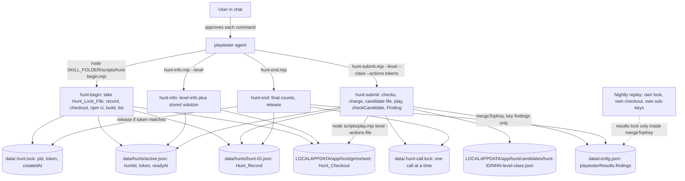
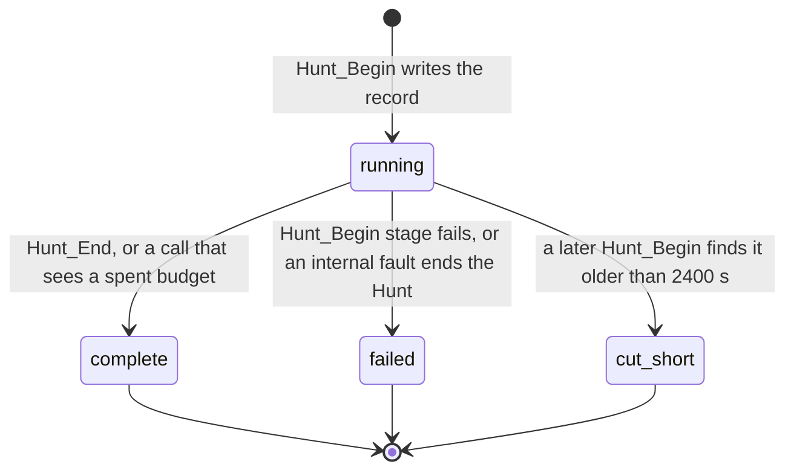

# Design Document

## Overview

The hunt has four small Node entry scripts, one agent and two skills. The agent (`playtester`) studies levels and proposes action lists. It never plays, never writes a file and never decides what counts as an exploit. Four scripts do the work, one process per call: `hunt-begin.mjs`, `hunt-info.mjs`, `hunt-submit.mjs` and `hunt-end.mjs`. Each entry file is a few lines. It imports the App_Folder modules under `scripts/hunt/` by `../../../scripts/hunt/<module>.mjs` (decision D-C4, proven by Check C4).

Rules this design follows:

- The verifier decides. `hunt-submit` replays a Candidate with Grimsheet's play command and passes the result to `checkCandidate` unchanged. A Finding exists only when `checkCandidate` returned `confirmed`.
- The scripts enforce every limit: 4 Attempts per level, 20 per hunt, 1800 seconds, 10 Refusals. The skills repeat the numbers, and a test checks that the text equals the constants.
- State carries across the four separate processes through files only: the Hunt_Lock_File held from Begin to End, an active-hunt pointer, the Hunt_Record, and a short per-call lock.
- Everything that does I/O takes the `Deps` pattern of the replay-runner (clock, sleep, fs, paths, spawn, token, pid, app name, platform) plus `checkCandidate` in place of the replay's `verifier`. Tests pass fakes. No test needs the network, a real Grimsheet, a real git or npm, or a model.
- No replay-runner file and no verifier file is changed. Every module of the replay that the hunt reuses was read and is usable as it is (table in "Reuse of replay-runner modules").

What was read for this design (all read only): `requirements.md` of this spec in full; `.kiro/specs/replay-runner/design.md` and `.kiro/specs/verifier/design.md`; `scripts/replay/{types,run-record,index-store,levels,process,checkout,run}.mjs`, `scripts/replay.mjs`, `scripts/file-lock.mjs`, `scripts/results-store.mjs`; `tests/helpers/fake-fs.mjs` and `fake-spawn.mjs`; the fixtures in `tests/fixtures/`; `docs/CREW_NOTES.md` section h.10 and `docs/evidence/E31`; the five steering files; the Grimsheet `play-level` skill (ideas only, nothing copied); `scripts/play.mjs` of the Grimsheet checkout (usage text only); and `data/config.json` (sizes only, through a read-only script that prints numbers).

Not verified here: the `--level-info` output of the levels other than 02 (one capture, of level 02, exists in `tests/fixtures/level-info/`; Decision 8), whether `play.mjs` ignores the extra key `claimedClass` in a Candidate_File (A-14 is only inferred from the stored solutions, which carry `levelId` and `minimalInk`; Decision 13), how long the agent's shell tool lets one command run (Hunt_Begin may take minutes; Decision 18), a command line of about 800 characters and an edit token of 132 characters (the longest measured argument was 74 characters; both are untested), and any real hunt with the agent.

**Two numbers were decided by the developer** from Grimsheet's real data (the longest formula in any level is 39 characters, in levels 02 and 05; the most ink any level gives is 2; stored solutions have at most 2 edits): the decoded `RAW` limit is 40 UTF-8 bytes (Decision 2) and the edit limit is 4 (Decision 1), with `FINDING_MAX_BYTES` 1536. The worst-case Finding is then **1199 bytes**, which fits. See "Size calculation" and "Token grammar".

## Architecture



Hunt_State changes (Requirement 11, criterion 6):



(`cut_short` is written `cut-short` in the files.)

### State across the four processes

Hunt_Begin, Hunt_Info, Hunt_Submit and Hunt_End are separate Node processes with no memory. They share state only through these files, all in `data\` except the checkout and the candidates:

| File | Written by | Meaning |
|---|---|---|
| `data\.hunt.lock` | Begin (create), End or self-finish (remove, token checked) | Content `{pid, token, createdAt}` from the replay's `acquireLock`. It is the proof that a Hunt is live. The `token` is the Hunt token. |
| `data\hunts\active.json` | Begin (after ready), finish (remove) | Content `{schemaVersion, huntId, token, readyAt}`. Says which Hunt the later calls belong to and when the Time_Budget started. |
| `data\hunts\<Hunt_Id>.json` | Begin, Submit, End | The Hunt_Record. The charges and counts live here. |
| `data\.hunt-call.lock` | Submit, End (per call) | A short lock so two calls cannot run at once. Same lock primitive, own file. |
| `data\.results.lock`, `data\config.json` | `mergeTopKey` only | The shared results store. |
| `%LOCALAPPDATA%\<App_Name>\hunt\grimsheet` | Begin (git, npm) | Hunt_Checkout. Submit and Info only run `node scripts/play.mjs` in it. |
| `%LOCALAPPDATA%\<App_Name>\hunt\candidates\<Hunt_Id>\` | Submit | Candidate_Files. |

**How a later process proves it belongs to the active Hunt.** `resolveActiveHunt` returns the Hunt only when all four checks pass:

1. `data\hunts\active.json` exists and parses.
2. `data\.hunt.lock` exists and its `token` equals the `token` in `active.json`.
3. The lock is not older than the lock age limit (2400 s, from the lock's `createdAt`).
4. The Hunt_Record named by `active.json` exists and has the state `running`.

Any other case is "no active Hunt" and the call is refused with `no_active_hunt`, exit 3, touching nothing. A leftover `active.json` from a killed Hunt fails check 2, 3 or 4 and is removed by the next Hunt_Begin once it holds the lock.

**What each call reads and writes** (under the lock it holds):

| Call | Reads | Writes | Locks |
|---|---|---|---|
| Begin | `data\launcher\control.json`, `data\hunts\`, the lock file | lock, Hunt_Record (running), then the final Hunt_Record or failure, `active.json`, candidate-folder prune, record prune, git and npm files in the Hunt_Checkout | takes the Hunt_Lock_File (no waiting) and keeps it |
| Info | `active.json`, lock file, Hunt_Record, stored solution | nothing | none (read only) |
| Submit | `active.json`, lock file, Hunt_Record, stored solution, `config.json` (inside `mergeTopKey`) | Hunt_Record (charge, then outcome), Candidate_File, `findings` in `config.json` | call lock for the whole call; results lock only inside `mergeTopKey`, never across the play process |
| End | same as Submit | Hunt_Record (final), `findings` (final counts), removes `active.json` and the Hunt_Lock_File | call lock |

**Per-call lock (new in this design, Decision 5).** Two Hunt_Submit processes started at once (an agent that issues two tool calls in parallel) would both read `attempts = 3` and both charge to 4. The call lock `data\.hunt-call.lock` serialises them. It uses `acquireLock` with `staleAfterMs` 60000 and `waitMs` 45000. A call that cannot get it in 45 s is refused with `call_busy`, exit 3, charged to nothing. Forty-five seconds is longer than the longest legitimate call (a play of at most 30 s, a results-lock wait of at most 10 s). The call lock is taken first, before check 1 of Requirement 9, criterion 10, so no call reads or writes the Hunt_Record without it. Hunt_Info reads only and takes no call lock.

**Time_Budget and the lock age limit.** The Hunt_Lock_File is created at the start of Hunt_Begin, `T0`. Hunt_Begin has a 600 s allowance, so it reports ready at `readyAt <= T0 + 600 s`. The Time_Budget runs from `readyAt` for 1800 s. So the Hunt's last allowed moment is `T0 + 2400 s`, which is the lock age limit (A-9). A Hunt that uses all its time reaches the end of the budget and the stale age together. A call after the budget sees one of two things:

- the lock is still younger than 2400 s: the call finds the Time_Budget passed, refuses with `time_budget_spent` and finishes the Hunt as `complete`;
- the lock is older: check 3 of `resolveActiveHunt` fails, the call is refused with `no_active_hunt`, and the Hunt_Record stays `running` until the next Hunt_Begin marks it `cut-short`.

Both are refused with exit 3 and charge nothing. Because the lock is never refreshed, a long call that straddles the 2400 s mark can run beside a new Hunt_Begin that took the stale lock over. The straddling call writes only its own Hunt_Record (a different file) and merges `findings` through the shared store, which is safe; the odd result is that the older Hunt's findings can land after the newer Hunt began. This is rare and not prevented.

### What a kill leaves behind

| Killed during | Lock files | Pointer | Hunt_Record | `config.json` | Candidate_File | Next step |
|---|---|---|---|---|---|---|
| Begin before the lock | none | none | none | unchanged | none | nothing to repair |
| Begin after the lock, before the first record write | `.hunt.lock` left | none or stale | none | unchanged | none | next Begin gets `already_running` until the lock is 2400 s old (Decision 7 offers an earlier takeover) |
| Begin during checkout, install, build or list | `.hunt.lock` left | none | `running`, `commit` null | unchanged | none | same; the record is marked `cut-short` by the next Begin once older than 2400 s |
| Begin after `active.json` was written, before the output | `.hunt.lock` left | present | `running`, ready | unchanged | none | the Hunt is live and usable; the agent got no output, so it should call Hunt_Info (it works) or wait out the lock |
| Between two calls (agent stops, user closes chat) | `.hunt.lock` left | present | `running` | has the Findings merged so far | files so far | the Hunt stays live up to 2400 s from `T0`; a later Hunt_End finishes it; otherwise the next Begin after the stale age marks it `cut-short` |
| Submit before the charge | `.hunt-call.lock` left (stale after 60 s) | present | unchanged | unchanged | none | the next call within 60 s waits, then gets `call_busy` after 45 s; after 60 s it takes the lock over |
| Submit after the charge, before the play | call lock left | present | `attempts` +1, no outcome counted | unchanged | written or not | the Attempt stays charged; no refund |
| Submit during the play | call lock left | present | charged | unchanged | written | the play child lives at most 30 s more and writes nothing |
| Submit after `checkCandidate`, before the merge | call lock left | present | charged, no outcome | unchanged | written | the Finding is lost; the Candidate_File remains as evidence; sending the same Candidate again costs another Attempt |
| Submit after the merge, before the Hunt_Record update | call lock left | present | charged, outcome missing | has the Finding | written | a resubmit of the same Candidate is a `duplicate` |
| Any Hunt_Record write | a `.hunt-….json.<token>.tmp` file may stay | unchanged | old or new, never half (temp file then rename) | unchanged | n/a | the temp file is ignored; prune matches only record names |
| End or self-finish after the final record, before the lock release | `.hunt.lock` left | removed or left | `complete` | final | n/a | `Hunt_Begin` gets `already_running` until the lock is stale (Decision 7) |

## Components and Interfaces

All files are plain ESM JavaScript with JSDoc and `// @ts-check`. Entry scripts and modules are checked by the existing `tsc` include once the include list covers `skills/**/scripts/*.mjs` (Tooling).

### Module and script list

| File | Role |
|---|---|
| `skills/find-exploits/scripts/hunt-begin.mjs` | Entry: `await main('begin')` |
| `skills/find-exploits/scripts/hunt-info.mjs` | Entry: `await main('info')` |
| `skills/find-exploits/scripts/hunt-submit.mjs` | Entry: `await main('submit')` |
| `skills/find-exploits/scripts/hunt-end.mjs` | Entry: `await main('end')` |
| `scripts/hunt/cli.mjs` | `main(name, argv, io)`: build deps, call the orchestrator, print one JSON line with `exitStatus`, set the exit code |
| `scripts/hunt/deps.mjs` | `buildHuntDeps()`: the one place with real clock, fs, spawn, token, paths and `checkCandidate` |
| `scripts/hunt/types.mjs` | Typedefs only |
| `scripts/hunt/limits.mjs` | All constants (budgets, token limits, caps). No imports. The skill test reads this file. |
| `scripts/hunt/tokens.mjs` | Token parser and printer (pure) |
| `scripts/hunt/level-info.mjs` | `reduceLevelInfo(info)`: the reduced view of a level description (pure, no imports) |
| `scripts/hunt/args.mjs` | Pure parsers for the command lines of the four scripts |
| `scripts/hunt/budget.mjs` | Pure: the order of checks (`decideSubmit`) and charging helpers |
| `scripts/hunt/hunt-record.mjs` | Pure builders: record, charges, outcomes, summary, Hunt_Id, cut-short |
| `scripts/hunt/findings.mjs` | Pure: Finding build, dedupe, Newest-first order, caps, eviction, Findings_Value |
| `scripts/hunt/hunt-store.mjs` | I/O: Hunt_Record, active pointer, lock proof, call lock, Candidate_File, prune |
| `scripts/hunt/publish.mjs` | I/O: `mergeTopKey` call for `findings` |
| `scripts/hunt/finish.mjs` | I/O: finish a Hunt (final counts, final record, pointer, lock) |
| `scripts/hunt/begin.mjs`, `info.mjs`, `submit.mjs`, `end.mjs` | Orchestrators, one per script |

### Reuse of replay-runner modules

| Import | Used for | Usable as it is? |
|---|---|---|
| `scripts/file-lock.mjs`: `acquireLock(deps, opts)`, `releaseLock(deps, path, token)` | Hunt lock, call lock | Yes. `acquireLock` returns the `token` and a `release` closure; the closure works only inside the acquiring process, so later processes call `releaseLock(deps, path, tokenFromActiveJson)`. |
| `scripts/results-store.mjs`: `mergeTopKey(deps, {topKey, buildOwned, budgetBytes})` | Write `findings` | Yes. `buildOwned(existingTop)` receives the current top-level value and returns `{ok:true, owned:{findings}}`. The module counts the **whole** top-level value (replay sub-keys included) against 65536 bytes. The hunt needs no change (see Decision 16). |
| `scripts/replay/checkout.mjs`: `ensureCheckout`, `checkoutPath`, `checkDeletable`, `forceRemove`, `isValidSubPath` | Hunt_Checkout | Yes. `subPath` is one or more segments matching `^[a-z0-9][a-z0-9-]*$` joined by a backslash; the default is `grimsheet`. The hunt passes `'hunt\\grimsheet'`. `checkoutPath` then gives `<localAppData>\<appName>\hunt\grimsheet`. `checkDeletable` accepts it when the path ends with `\<appName>\hunt\grimsheet` and does not overlap the App_Folder or Data_Folder. Requirement D-1 and D-2 are already met in the code. D-1's extra check "not the replay Checkout" has no function: it holds by construction (the two paths end differently), and Hunt_Begin also asserts `huntDir !== replayDir` with two `checkoutPath` calls. |
| `scripts/replay/levels.mjs`: `LEVEL_ID_PATTERN`, `isValidLevelId`, `parseLevelList`, `readSolution` | Level list, stored solution | Yes. `readSolution` returns `{kind:'ok', path, solution}`, `{kind:'no_file'}` or `{kind:'unreadable'}`, which map to `no_solution_file` and `solution_unreadable`. `findUnlisted` and `buildCoverage` are not used. |
| `scripts/replay/process.mjs`: `makeStartProcess`, `STEP_LIMITS_MS`, `effectiveLimit` | Every process | Yes. `runDeadline` is not used (it is built for the cron timeout); Begin uses `startMs + 600000`. |
| `scripts/replay/run-record.mjs`: `byteLength`, `BYTE_BUDGET` | Sizes | Yes. |
| `scripts/replay/types.mjs`: `Deps`, `Fs`, `Failure`, `ProcResult` | Types | Yes. `Deps` requires a `verifier` property for the replay. The hunt does not have one, so `HuntDeps = Omit<Deps, 'verifier'> & {checkCandidate}`. |

Nothing else is imported from the replay. The atomic JSON writer of `index-store.mjs` is private there, so `hunt-store.mjs` has its own six-line copy (temp file in the same folder, then rename). Exporting it from the replay would be a dependency (Decision 3) but is not needed.

### Types and dependencies (`types.mjs`, `deps.mjs`)

```js
/**
 * @typedef {Omit<import('../replay/types.mjs').Deps, 'verifier'> & {
 *   checkCandidate: (levelId: unknown, stored: unknown, claimedClass: unknown,
 *                    actions: unknown, exitCode: unknown, play: unknown) => CheckResult,
 * }} HuntDeps
 */
/** @typedef {'cheaper_win'|'free_win'|'unexpected_route'} ClaimedClass */
/** @typedef {{kind:'move', dir:'N'|'S'|'E'|'W'} | {kind:'wait'} | {kind:'undo'} | {kind:'edit', address:string, raw:string}} Action */
/** @typedef {{ok:true, actions:Action[]} | {ok:false, detail:string}} ParsedActions */
/** @typedef {'running'|'complete'|'failed'|'cut-short'} HuntState */
/** @typedef {'refusal'|'none'} Charge */
/** @typedef {{exit: 0|3|4, body: Record<string, unknown>}} HuntResult   body is printed with exitStatus = exit added */
// CheckResult, CheckOk, CheckError: as in .kiro/specs/verifier/design.md (re-declared, not imported, as the replay does)
```

```js
// deps.mjs
/** The only place with real dependencies. The App_Folder comes from this file's own location
 *  (scripts/hunt/ -> two levels up), so it is the same whether the entry runs through the junction or the real path.
 *  @param {{env?: Record<string,string|undefined>}} [opts] @returns {HuntDeps} */
export function buildHuntDeps(opts)
```
Real values: `clock` = `Date.now`, `sleep` = a timer, `fs` = `node:fs/promises`, `paths.localAppData` = `LOCALAPPDATA` or `''`, `spawn` = `makeStartProcess({})`, `checkCandidate` from `../verifier.mjs`, `token` = 16 random bytes as hex, `pid` = `process.pid`, `appName` = `grimsheet-playtester`, `platform` = `win32` or `other`. This is the only file that imports `../verifier.mjs`.

### Entry script (all four are the same but for the name)

```js
// skills/find-exploits/scripts/hunt-submit.mjs
// @ts-check
import { main } from '../../../scripts/hunt/cli.mjs';
await main('submit');
```

### `cli.mjs`

```js
/**
 * @param {'begin'|'info'|'submit'|'end'} name
 * @param {string[]} [argv]   default process.argv.slice(2)
 * @param {{buildDeps?: () => HuntDeps, run?: Record<string, (deps: HuntDeps, argv: string[]) => Promise<HuntResult>>,
 *          write?: (text: string) => void, setExitCode?: (code: number) => void}} [io]
 * @returns {Promise<HuntResult>}
 */
export async function main(name, argv, io)
/** Pure. Adds exitStatus as the LAST key. @param {Record<string, unknown>} body @param {0|3|4} exit @returns {Record<string, unknown>} */
export function withExitStatus(body, exit)
```
`main` builds deps, calls the orchestrator inside `try`, prints `JSON.stringify(withExitStatus(body, exit))` plus a newline, and sets the exit code to `exit`. If the orchestrator throws, it prints `{"outcome":"error","reasonCode":"hunt_internal_error","exitStatus":4}` and exits 4 (Decision 22). The printed `exitStatus` is the same number that is passed to `setExitCode`, built in one place, so they cannot differ.

### `limits.mjs`

```js
export const LEVEL_BUDGET = 4;          export const HUNT_BUDGET = 20;
export const TIME_BUDGET_SEC = 1800;    export const REFUSAL_BUDGET = 10;
export const BEGIN_ALLOWANCE_SEC = 600; export const LOCK_AGE_SEC = TIME_BUDGET_SEC + 600;   // 2400
export const MAX_LEVELS = 20;           export const LEVEL_ID_MAX = 40;                      // Decision 10
export const MAX_TOKENS = 40;           export const MAX_EDITS = 4;                          // Decision 1
export const MAX_RAW_BYTES = 40;        export const MAX_ADDRESS_CHARS = 6;                  // Decision 2
export const FINDINGS_MAX_ITEMS = 20;   export const FINDING_MAX_BYTES = 1536;               // Decision 1
export const FINDINGS_MAX_BYTES = 16384;
export const KEEP_HUNT_RECORDS = 10;    export const KEEP_CANDIDATE_FOLDERS = 10;
export const CALL_LOCK_STALE_MS = 60000; export const CALL_LOCK_WAIT_MS = 45000;
export const INFO_MAX_BYTES = 8192;     export const TOP_KEY = 'playtesterResults';
export const CLASSES = ['cheaper_win', 'free_win', 'unexpected_route'];
export const DEFAULT_REPO_URL = 'https://github.com/UBayouski/Grimsheet';                    // same as the Launcher default
export const DEFAULT_BRANCH = 'main';
```

### `tokens.mjs` (pure)

```js
/** @param {unknown} args the arguments after --actions @returns {ParsedActions}  Never throws. Applies MAX_TOKENS, MAX_EDITS, MAX_RAW_BYTES. */
export function parseActions(args)
/** @param {Action} action @returns {string} one canonical token. Precondition: a well-formed action (valid address, well-formed string). */
export function printAction(action)
/** @param {Action[]} actions @returns {string[]} */
export function printActions(actions)
/** For stored solutions: no limits, null when an action cannot be written as a token. @param {unknown} actions @returns {string[]|null} */
export function tryPrintActions(actions)
/** The percent-encoding of a string, canonical. @param {string} raw @returns {string} */
export function encodeRaw(raw)
/** @param {string} encoded @returns {{ok:true, raw:string}|{ok:false, detail:'unescaped_character'|'bad_escape'|'bad_utf8'}} */
export function decodeRaw(encoded)
```

### `args.mjs` (pure)

```js
/** `--level ID --class CLASS --actions TOKEN...` in this order. @param {unknown} argv
 *  @returns {{ok:true, levelId:string, claimedClass:ClaimedClass, actions:Action[]} | {ok:false, detail:string}} */
export function parseSubmitArgs(argv)
/** `--level ID` @returns {{ok:true, levelId:string} | {ok:false, detail:string}} */
export function parseInfoArgs(argv)
/** No arguments allowed. @returns {{ok:true} | {ok:false, detail:string}} */
export function parseNoArgs(argv)
```

### `budget.mjs` (pure)

```js
/**
 * The seven checks of Requirement 9, criterion 10, in order. The first failing check decides; there is one reason code.
 * @param {{active:boolean, refusals:number, attempts:number, levelAttempts:Record<string,number>, levels:string[],
 *          nowMs:number, deadlineMs:number, parsed:ReturnType<typeof parseSubmitArgs>}} state
 * @returns {{kind:'attempt', levelId:string, claimedClass:ClaimedClass, actions:Action[]}
 *         | {kind:'refuse', reasonCode:'no_active_hunt'|'refusal_budget_spent'|'bad_arguments'|'unknown_level'|'level_budget_spent'|'total_budget_spent'|'time_budget_spent',
 *            charge:Charge, finish:boolean, detail?:string}}
 */
export function decideSubmit(state)
/** @returns {{level:number|null, total:number, refusals:number, seconds:number}} what is left; level null when no level applies */
export function budgetLeft(record, levelId, nowMs, deadlineMs)
/** @returns {number} readyAtMs + TIME_BUDGET_SEC * 1000 */
export function deadlineOf(readyAtMs)
```
`finish` is true for `refusal_budget_spent`, `total_budget_spent` and `time_budget_spent` (Requirement 9, criteria 3 and 10). `charge` is `'refusal'` for `bad_arguments`, `unknown_level` and `level_budget_spent`, and `'none'` for the others.

### `hunt-record.mjs` (pure)

```js
export function huntIdOf(ms)                       // 'hunt-20261108T110312Z'
export const HUNT_RECORD_PATTERN                   // /^hunt-\d{8}T\d{6}Z\.json$/
export function newHuntRecord({huntId, startedAt, repoUrl, branch})            // state running, readyAt null
export function readyRecord(record, {readyAt, commit, levels, levelsSkipped})  // sets levels map with zero counters
export function chargeAttempt(record, levelId)     // attempts +1, levels[id].attempts +1
export function chargeRefusal(record, reasonCode)  // refusals +1, reasonCodes[code] +1
export function noteReason(record, reasonCode)     // reasonCodes[code] +1 (no charge)
export function recordOutcome(record, levelId, outcome, reasonCode)  // outcome: confirmed|rejected|error|duplicate|notRecorded
export function finishRecord(record, {state, finishedAt, failure})   // idempotent on final states
export function failRecord(record, {finishedAt, failure})
export function markCutShort(record, nowMs)        // running and older than LOCK_AGE_SEC -> cut-short; otherwise unchanged
export function summaryOf(record, nowMs)           // totals over levels + seconds used
export function countsOf(record)                   // {attempts, confirmed, rejected, error, duplicate, notRecorded}
```
All return a new object. A record in `complete`, `failed` or `cut-short` is returned unchanged by `finishRecord`, `failRecord` and `markCutShort`.

### `findings.mjs` (pure)

```js
export function findingId(huntId, attempt)         // 'hunt-20261108T110312Z-007'
/** @returns {Finding} from a CheckOk; copies won, inkSpent, minimalInk, editCount, newEditAddresses, reasonCode */
export function buildFinding({huntId, attempt, commit, foundAt, levelId, claimedClass, tokens, checkOk})
/** @returns {boolean} same levelId, same class and same token list */
export function isDuplicate(a, b)
/** @param {unknown} raw whatever is stored under findings @returns {FindingsValue} a legacy array or garbage gives the empty value */
export function normalizeFindings(raw)
/** Newest first: foundAt descending, then id descending. Returns a new array. */
export function sortNewestFirst(items)
/** @returns {number} UTF-8 length of the compact JSON text */
export function sizeOf(value)
/**
 * Adds a Finding, evicting the oldest items first until the caps hold (Requirement 10, criterion 8).
 * @returns {{value:FindingsValue, duplicate:boolean, duplicateOf:string|null, evicted:string[], tooLarge:boolean}}
 */
export function addFinding(existing, finding, header)   // header: {updatedAt, commit, huntId, counts}
/** Header-only refresh used by Hunt_End: same items, new header. */
export function withHeader(existing, header)
/** A Finding built from the limits with the longest possible values. Used by the size test. */
export function worstCaseFinding()
```

### `hunt-store.mjs` (I/O)

```js
export function huntPaths(deps)   // {dataFolder, huntsFolder, lockPath, callLockPath, activePath, huntLocalFolder, checkoutDir, candidatesFolder}
export async function writeJsonAtomic(deps, finalPath, value)   // temp '.<name>.<token>.tmp' in the same folder, rename; UTF-8, no BOM, 2 spaces, trailing newline
export async function readHuntRecord(deps, huntId)              // null when missing or not an object
export async function writeHuntRecord(deps, record)
export async function markStaleRunningCutShort(deps, nowMs)     // reads every record name matching the pattern
export async function pruneHuntRecords(deps)                    // keeps the 10 highest ids; touches only HUNT_RECORD_PATTERN names
export async function pruneCandidateFolders(deps)               // keeps the 10 highest names matching ^hunt-\d{8}T\d{6}Z$
export async function readActive(deps)                          // {huntId, token, readyAt} | null
export async function writeActive(deps, active)
export async function clearActive(deps)
/** @returns {Promise<{ok:true, hunt:{huntId:string, token:string, readyAtMs:number, record:HuntRecord}} | {ok:false}>} the four checks */
export async function resolveActiveHunt(deps)
/** @template T @returns {Promise<{ok:true, value:T} | {ok:false, reason:'busy'|'io_error'}>} */
export async function withCallLock(deps, fn)
export async function writeCandidateFile(deps, huntId, attempt, levelId, claimedClass, actions)  // returns the absolute path
```

### `publish.mjs`, `finish.mjs` (I/O)

```js
/**
 * Merge the Findings_Value. Reads the existing value inside buildOwned (under the results lock), so there is no lost update.
 * With a new Finding it calls addFinding; without one it only refreshes the header (Hunt_End).
 * Also retries record.pendingFindings. Never throws.
 * @returns {Promise<{findingsKey:'ok'|'lock_timeout'|'config_unreadable'|'too_large'|'write_failed', duplicate:boolean, duplicateOf:string|null, tooLarge:boolean, evicted:string[]}>}
 */
export async function publishFindings(deps, {record, finding, nowMs})
/**
 * Final counts merge, final record, pointer removal, lock release (token checked), in this order. Safe to call twice.
 * @returns {Promise<{record:HuntRecord, summary:object}>}
 */
export async function finishHunt(deps, {hunt, record, state})
```

### `level-info.mjs` (pure, no imports)

```js
/**
 * The reduced view of a `--level-info` value. Returns a new object; the input is not changed. Never throws.
 * Every top-level field is kept unchanged and in its order. Only `cells` is reduced.
 * The grid is the rectangle of `map`: rows 1..map.length, columns A..(the letter of the longest row length, in code points).
 * An address is parsed as capital letters then digits (`^[A-Z]+[0-9]+$`; column letters read as a base-26 number, A = 1);
 * an address that does not parse, or lies outside the rectangle, is kept (outside = the rule panel).
 * Inside the grid a cell is kept only if `locked` is not true, or it has a `name`, or its `raw` starts with "=", or its `raw` is longer than one character.
 * A kept cell is the source cell as given (`address`, `raw`, `locked`, `name`; keys present only as in the source, none added).
 * If `info` has no `map` array or no `cells` array, it is returned unchanged (a copy).
 * @param {unknown} info the parsed JSON value
 * @returns {unknown}
 */
export function reduceLevelInfo(info)
```

### Orchestrators

```js
export async function runBegin(deps, argv)   // begin.mjs  -> HuntResult
export async function runInfo(deps, argv)    // info.mjs
export async function runSubmit(deps, argv)  // submit.mjs
export async function runEnd(deps, argv)     // end.mjs
```

### Agent and skill file texts

These are the intended file contents. The three files are lint-checked by a test (Requirement 16, criteria 6 and 7). In the skills, `SKILL_FOLDER` is a placeholder without angle brackets: the agent writes the folder that the skill load reports in its place, and the command keeps the same words around it. The commands use forward slashes after the folder, as the approval record of Check C4 shows.

#### `agents/playtester.json`

The `prompt` is one JSON string; `\n` marks a line break. The file has no `allowedTools`, no `permissions` and (until Decision 27) no `model`.

```json
{
  "name": "playtester",
  "description": "Studies Grimsheet levels and proposes exploit candidates. Scripts replay every candidate and a deterministic verifier judges it.",
  "tools": ["execute_bash"],
  "resources": ["skill://~/.kiro/crew/apps/grimsheet-playtester/skills/*/SKILL.md"],
  "prompt": "You are the Grimsheet playtester. You study Grimsheet levels and propose action lists that might break them: a cheaper win, a free win or an unexpected route. Small scripts replay every proposal and a deterministic verifier judges it. You supply the ideas. The scripts supply the facts and the limits.\n\nBefore your first command, load the find-exploits skill. It holds the budgets, the candidate format and the order of calls. The play-level skill explains how to read a level and a result.\n\nYou work under approvals. Each command you run is shown to the user before it runs, and you must wait for the answer. Never try to avoid, change or work around an approval.\n\nRun only commands of the form node followed by a script path and its arguments. The script path is the folder that the skill load reports, plus /scripts/ and the script name. Run each command exactly as given and append nothing: no semicolon, no echo of an exit-code variable, no quotes around the script path, and nothing before or after the command. The user sees the command in the approval prompt. Do not use command chains, pipes, redirects, directory changes, environment variables or inline JSON. Ignore stderr text. Read the JSON that the script prints and its exitStatus field.\n\nYou never create, change or delete a file in a Grimsheet checkout, in the app folder or in the data folder. You do not run the play command yourself. Give every candidate to the submit script as a list of tokens. The script writes the file, replays it and asks the verifier.\n\nStop when a script reports a spent budget or says the hunt is finished. Then tell the user what was confirmed, what was rejected and why, using the numbers the scripts printed. The hunt is a bounded search. It is not a proof that no cheaper win exists."
}
```

Why the file has neither `allowedTools` nor `permissions` (Requirement 1, criterion 4): the App Kit owns `allowedTools` of an app agent and regenerates it as an empty list, and a `permissions.rules` block was kept in the generated file but was not shown to be enforced (Notes h.10.4). The user's approvals are the only guard, so the prompt says so.

#### `skills/play-level/SKILL.md`

````markdown
---
name: play-level
description: Read a Grimsheet level and the result of a replayed candidate through the hunt scripts. Use when studying a level, or when reading what a submitted candidate did.
license: MIT
metadata:
  author: Grimsheet Playtester
  version: "1.0.0"
---

# Read a Grimsheet level and a result

This skill is about reading. The budgets, the candidate format and the order of calls are in the find-exploits skill. Load that skill first.

Hunt_Begin prepares the game for you. Nothing here asks you to prepare anything. You only run the four hunt scripts, one command at a time.

## How to run a script

The hunt scripts are in the scripts folder of the find-exploits skill. The skill load for find-exploits reports its folder. In a command, SKILL_FOLDER stands for that folder: write the folder in its place.

Run each command exactly as given and append nothing: no semicolon, no echo of an exit-code variable, no quotes around the script path, and nothing before or after the command. The user sees the command in the approval prompt, which is the only place where an addition would show. Wait for the answer to each approval. Ignore stderr text. Read the JSON the script prints and its exitStatus field.

## Read a level

Run Hunt_Info once for each level:

```
node SKILL_FOLDER/scripts/hunt-info.mjs --level 02-the-chaser
```

It prints the level description from the game and the stored solution. The description comes from the game's own level-info command: title, hint, starting HP, ink, hero, monsters, map and cells. The stored solution is the intended route. It gives minimalInk, the fewest formula edits the intended route needs, and the route itself written as tokens. The description lists only the cells that matter: the rule panel, unlocked or named cells, formulas and cells with more than one character. The plain map tiles are in map. If the description is too large, the script refuses with the reason code level_info_too_large and prints nothing of it.

The current stored routes fit the limits for candidates, so you can send any cell text from them back as it is, in percent form.

## The actions

- A move goes one cell north, south, east or west: N, S, E, W.
- wait lets a turn pass without moving.
- undo reverts the last accepted turn or edit and refunds its ink. It goes back one step only: a second undo in a row is refused.
- An edit changes the text of one cell. It costs 1 ink when the formula changes.

A zero-edit probe uses only moves and waits. Its ink spent is then 0.

## Read a result

Every Hunt_Submit prints one JSON value. Read these fields:

- outcome: confirmed, rejected, error, duplicate, not_recorded or refused.
- reasonCode and reason: the verdict and the plain sentence. Learn from a rejection.
- won, inkSpent, minimalInk, editCount, newEditAddresses: what the replay measured. Ink spent is the start ink minus the final ink.
- play: steps, finalStatus, finalHp, firstRefused and firstStatusChange. Steps are counted from 0 in the order of your tokens. Actions after the game ends are refused. firstStatusChange is the first step where the game status changes, and it is the place to look: it shows where the level was won or lost.
- left: attempts left on this level, attempts left in total, refusals left and seconds left.
- finished: true when the hunt is over.
- exitStatus: 0 when the call was carried out, 3 when it was refused, 4 when a record could not be written.

An exit status of 2 from the game itself is not shown. It appears as the reason code bad_input.

## Ideas taken from the Grimsheet play-level skill

Only these ideas were taken: the description of the three action kinds plus undo, the fields of the play output, the meaning of exit 2, and the tip that a zero-edit probe uses only moves and waits. No text or code of the Grimsheet repository is copied.
````

#### `skills/find-exploits/SKILL.md`

````markdown
---
name: find-exploits
description: Hunt for exploits in Grimsheet levels with a fixed budget. Use when asked to find a cheaper win, a free win or an unexpected route in a level, or to run the hunt.
license: MIT
metadata:
  author: Grimsheet Playtester
  version: "1.0.0"
---

# Find exploits in Grimsheet levels

You propose action lists that might break a level. Small scripts replay each one and a deterministic verifier judges it. Only a proposal that the verifier confirms becomes a finding. You supply the ideas. The scripts supply the facts and the limits. Read the play-level skill too: it explains how to read a level and a result.

The hunt is a bounded search. It is not a proof that no cheaper win exists.

## How to run a script

The scripts are in the scripts folder of this skill. The skill load reports this skill's folder. In a command, SKILL_FOLDER stands for that folder: write the folder in its place, and keep everything else as it is.

Run each command exactly as given and append nothing: no semicolon, no echo of an exit-code variable, no quotes around the script path, and nothing before or after the command. The user sees the command in the approval prompt, which is the only place where an addition would show. Wait for the answer to each approval.

Run one command at a time. Do not use command chains, pipes, redirects, directory changes, environment variables or inline JSON. Ignore stderr text. Each script prints one JSON value with its result and a field exitStatus: 0 when the call was carried out, 3 when it was refused, 4 when a record could not be written. Read that and nothing else.

## Order of calls

1. Hunt_Begin, once. It prepares a separate copy of Grimsheet and can take several minutes.
2. Hunt_Info, once for each level in the list that Hunt_Begin printed.
3. Hunt_Submit, once for each candidate.
4. Hunt_End, once.

```
node SKILL_FOLDER/scripts/hunt-begin.mjs
node SKILL_FOLDER/scripts/hunt-info.mjs --level 02-the-chaser
node SKILL_FOLDER/scripts/hunt-submit.mjs --level 02-the-chaser --class cheaper_win --actions E E E E N N E E E E E S S
node SKILL_FOLDER/scripts/hunt-end.mjs
```

## Budgets

- 4 attempts for each level.
- 20 attempts for the whole hunt.
- 1800 seconds, counted from the moment Hunt_Begin says ready.
- 10 refusals for the whole hunt.

The scripts enforce these numbers. When a budget is spent, the script refuses the call with a reason code and does nothing else. A refusal is a call that was not an attempt: bad_arguments, unknown_level and level_budget_spent. Refusals are counted against the 10. Calls refused for a spent hunt, a spent refusal budget or spent time are counted against nothing, and they end the hunt.

Every Hunt_Submit costs the user one approval and costs you one turn. So spend your 4 attempts on each level on the ideas you judge best. Think about the level, then submit.

When a result says the 4 attempts of one level are spent, go on with another level. Stop when a result says finished is true, or says the 20 attempts, the 1800 seconds or the 10 refusals are spent. After your 20th attempt, call Hunt_End once. Call it also when you have nothing better to try, unless a result already said finished is true. Then report to the user.

## The three classes

A candidate claims one class. The verifier checks the claim against its own definition.

- cheaper_win: the level is won and the ink spent is below minimalInk. This is impossible when minimalInk is 0.
- free_win: the level is won with no edit at all, on a level whose minimalInk is above 0.
- unexpected_route: the level is won with an accepted, not undone edit on a cell that the stored solution never edits.

## Writing a candidate

A candidate is a list of tokens, separated by spaces, written after --actions as separate words. Never put the list in quotes. The tokens are:

- N, S, E or W: a move.
- wait: let a turn pass.
- undo: revert the last accepted turn or edit and refund its ink. One step only: a second undo in a row is refused.
- edit:ADDRESS=TEXT: change one cell. ADDRESS is capital letters then digits, at most 6 characters in all, for example B14. TEXT is the new cell text.

Write TEXT in percent form. Keep the letters A to Z and a to z, the digits 0 to 9, and the three characters dot, underscore and minus. Write every other character as a percent sign and two hex digits of its UTF-8 bytes, with capital hex digits. Examples: equals sign is %3D, open parenthesis is %28, close parenthesis is %29, comma is %2C, plus is %2B, less-than sign is %3C, space is %20 and the double quote is %22. Never type a double quote: the shell removes it.

To type the cell text =B15+1 write:

```
edit:B14=%3DB15%2B1
```

Limits: at most 40 tokens, at most 4 edit tokens, and at most 40 bytes of TEXT (counted as UTF-8) before it is written in percent form. A candidate that breaks a limit, or an unknown token, is refused as bad_arguments and counted as a refusal.

## Worked examples

These show the form. They are ideas to try, not known exploits.

A cheaper win. Level 02-the-chaser has minimalInk 1 and its intended route starts with one edit. Try the same moves with no edit at all:

```
node SKILL_FOLDER/scripts/hunt-submit.mjs --level 02-the-chaser --class cheaper_win --actions E E E E N N E E E E E S S
```

A free win. Level 03-the-locked-crypt has minimalInk 2. Try to walk through with moves only:

```
node SKILL_FOLDER/scripts/hunt-submit.mjs --level 03-the-locked-crypt --class free_win --actions E E E E E E E E E
```

An unexpected route. The stored route of 03-the-locked-crypt edits B14 and B15. Try an edit on a different cell, then walk:

```
node SKILL_FOLDER/scripts/hunt-submit.mjs --level 03-the-locked-crypt --class unexpected_route --actions edit:C14=7 E E E E E E E E E
```

## Reading the answer

The answer holds outcome and reasonCode. A confirmed outcome means the verifier reproduced the class and the finding is recorded. A rejected outcome says why, for example not_won or not_cheaper. An error outcome means the replay could not be judged. A duplicate outcome means an equal finding already exists. A not_recorded outcome means the finding was too large to store. Read the reason, look at the play block, and decide the next idea. The play-level skill lists the fields.

## Finish

When you have no better idea, or the hunt budget is spent, call Hunt_End once if no answer said finished is true. Tell the user how many candidates were confirmed, rejected and refused, with the reason codes, and the hunt id.
````

**Text lint result.** The three texts above were extracted from this file and checked again after the undo and limit changes, by a read-only script that prints only a verdict. Result (all checks pass; the one change from the earlier run is that the sentence is matched without its final full stop, because the skills continue it with a comma): no `&&`, `|`, `>`, `$env:`, `$` followed by a letter or `cd ` inside any code block or code span; no `&&`, `$env:` or `cd ` anywhere in prose; no `{` followed by a double quote anywhere; each of the three texts holds the phrases "exactly as given", "append nothing" and "The user sees the command in the approval prompt"; the old undo wording ("take back") is gone from both skills; no drive letter, user name or home path; no word about an approval mode; the two skills hold none of the words npm, clone, fetch, install or build; the agent JSON parses, with `tools` equal to `["execute_bash"]` and the single `skill://~/.kiro/crew/apps/grimsheet-playtester/skills/*/SKILL.md` entry; both skills have the frontmatter `name`, `description`, `license: MIT`, `metadata.author` and `metadata.version`; and the find-exploits text holds "4 attempts", "20 attempts", "1800 seconds", "10 refusals", "40 tokens", "4 edit tokens" and "40 bytes", which the budget test parses. The frontmatter of both skills was not changed by these edits. The same checks become the lint test (Testing Strategy).

#### Model field plan (Open question 10)

Not decided. The design gives the steps, and the name of the model goes under Decision 27.

1. **Find the allowed values** (read only, no agent run): the Crew documentation page on agent spec fields, the same page the notes quote in h.10.4 and E32, lists `model` among the agent fields. Read it for the accepted value form. The value `auto` is what the check agents ran on (the usage line shows `auto`). Nothing else about allowed values is recorded in the notes, so "which names are accepted by Crew 0.12.0" is **not documented here** until that page is read.
2. **Measure** (needs the developer, a few supervised runs): run the same short task twice, once with no `model` field and once with the candidate value. The task is fixed: Hunt_Begin, Hunt_Info for one level, one Hunt_Submit with a fixed token list, Hunt_End. Compare the credits on the gateway usage line of each run (as done in h.10.3 and h.10.4). One pair of runs is a rough signal only; the checks saw 0.1 to 0.4 credits for such runs, so differences below that scale need more runs.
3. **Check the field survives a Sync** (read only, like C1): after a Sync, open the generated file `~\.kiro\agents\grimsheet-playtester--playtester.json` and look for the `model` value. The App Kit regenerates `tools`, `allowedTools`, `prompt` and `resources`; whether it keeps `model` is **not documented** and must be seen. Also check the `model` field of the usage line of a real run, to confirm the model that ran is the one set.
4. If the field does not survive, the agent runs on `auto` and the design needs no change; the cost question stays open.

## Data Models

All JSON files are UTF-8 without a BOM, indented two spaces, with a trailing newline. All times are ISO 8601 UTC with milliseconds and `Z`. Level ids, the commit hash and the ink values come from the fixtures (`01-the-corridor` to `05-the-lich`, `minimalInk` 0, 1, 2, 1, 2; commit `e1c61a35b3da027aada5d9ef4460efa4470488a4`). Results of plays are illustrative, because no real exploit has been found.

### Hunt_Record (`data\hunts\hunt-20261108T110312Z.json`)

Fields of Requirement 11, criterion 2, including `readyAt` (the Time_Budget starts there), `levelsSkipped` (criterion 3) and `pendingFindings` (confirmed Findings the merge could not store yet; criterion 2 and Decision 16). `levels` is an object keyed by level id.

```json
{
  "schemaVersion": 1,
  "huntId": "hunt-20261108T110312Z",
  "state": "running",
  "startedAt": "2026-11-08T11:03:12.481Z",
  "readyAt": "2026-11-08T11:03:19.870Z",
  "finishedAt": null,
  "repoUrl": "https://github.com/UBayouski/Grimsheet",
  "branch": "main",
  "commit": "e1c61a35b3da027aada5d9ef4460efa4470488a4",
  "budget": { "perLevel": 4, "total": 20, "seconds": 1800, "refusals": 10 },
  "levelsSkipped": 0,
  "attempts": 3,
  "refusals": 1,
  "levels": {
    "01-the-corridor": { "attempts": 0, "confirmed": 0, "rejected": 0, "error": 0, "duplicate": 0, "notRecorded": 0 },
    "02-the-chaser": { "attempts": 2, "confirmed": 1, "rejected": 1, "error": 0, "duplicate": 0, "notRecorded": 0 },
    "03-the-locked-crypt": { "attempts": 1, "confirmed": 0, "rejected": 1, "error": 0, "duplicate": 0, "notRecorded": 0 },
    "04-the-trap-row": { "attempts": 0, "confirmed": 0, "rejected": 0, "error": 0, "duplicate": 0, "notRecorded": 0 },
    "05-the-lich": { "attempts": 0, "confirmed": 0, "rejected": 0, "error": 0, "duplicate": 0, "notRecorded": 0 }
  },
  "reasonCodes": { "class_reproduced": 1, "not_cheaper": 1, "not_won": 1, "bad_arguments": 1 },
  "findingsKey": "ok",
  "pendingFindings": [],
  "failure": null
}
```

A failed Hunt has `state: "failed"`, `commit` possibly `null`, `readyAt` `null`, `levels` `{}` and, for example:

```json
"failure": { "stage": "build", "reasonCode": "build_failed", "message": "The Grimsheet build failed with exit code 1.", "exitCode": 1 }
```

The record holds no Candidate_Text, no action list and no `reason` text of a rejected Candidate (Requirement 11, criterion 4). `pendingFindings` holds only confirmed Findings, and only while a merge has failed (Decision 16).

### Active pointer (`data\hunts\active.json`)

```json
{ "schemaVersion": 1, "huntId": "hunt-20261108T110312Z", "token": "9f3c0a51d2b84e67a1c05be3f7d92a48", "readyAt": "2026-11-08T11:03:19.870Z" }
```

### Lock files

`data\.hunt.lock` and `data\.hunt-call.lock` have the replay's shape: `{ "pid": 12345, "token": "9f3c0a51d2b84e67a1c05be3f7d92a48", "createdAt": "2026-11-08T11:03:12.490Z" }`. The `pid` of the Hunt lock is the pid of the Hunt_Begin process, which has exited when the Hunt is live; it is not used as proof of life.

### Candidate_File (`%LOCALAPPDATA%\grimsheet-playtester\hunt\candidates\hunt-20261108T110312Z\007-02-the-chaser-cheaper_win.json`)

```json
{
  "levelId": "02-the-chaser",
  "claimedClass": "cheaper_win",
  "actions": [
    { "kind": "edit", "address": "B14", "raw": "7" },
    { "kind": "move", "dir": "E" },
    { "kind": "move", "dir": "E" }
  ]
}
```

`play.mjs` reads the `actions` array and (assumed, A-14) ignores `levelId` and `claimedClass`. The stored solutions have the extra keys `levelId` and `minimalInk` and are accepted, but `claimedClass` itself is not proven; a fixture task confirms it (Decision 13).

### Findings_Value and one Finding

The Findings_Value is the `findings` sub-key of `playtesterResults`. `counts` are the six counts of Requirement 10, criterion 5, for the latest Hunt that merged (Decision 19); with `notRecorded` included, `attempts` equals the sum.

```json
{
  "schemaVersion": 1,
  "updatedAt": "2026-11-08T11:14:02.640Z",
  "commit": "e1c61a35b3da027aada5d9ef4460efa4470488a4",
  "huntId": "hunt-20261108T110312Z",
  "counts": { "attempts": 7, "confirmed": 1, "rejected": 5, "error": 0, "duplicate": 1, "notRecorded": 0 },
  "items": [
    {
      "id": "hunt-20261108T110312Z-007",
      "levelId": "02-the-chaser",
      "class": "cheaper_win",
      "commit": "e1c61a35b3da027aada5d9ef4460efa4470488a4",
      "huntId": "hunt-20261108T110312Z",
      "foundAt": "2026-11-08T11:14:02.511Z",
      "actions": ["E", "E", "E", "E", "N", "N", "E", "E", "E", "E", "E", "S", "S"],
      "result": { "won": true, "inkSpent": 0, "minimalInk": 1, "editCount": 0, "newEditAddresses": [], "reasonCode": "class_reproduced" }
    }
  ]
}
```

The Finding `id` is the Hunt_Id, a dash and the three-digit Attempt number (Decision 9). `actions` are canonical tokens (capital hex). The example item is 386 bytes compact. `result.reasonCode` is always `class_reproduced`, because only `confirmed` results become Findings.

### Output of every script (stdout, one line, `exitStatus` last)

The examples are shown on several lines for reading; the scripts print one line.

**Hunt_Begin**

```json
{ "state": "ready", "huntId": "hunt-20261108T110312Z", "commit": "e1c61a35b3da027aada5d9ef4460efa4470488a4",
  "levels": ["01-the-corridor", "02-the-chaser", "03-the-locked-crypt", "04-the-trap-row", "05-the-lich"], "levelsSkipped": 0,
  "budget": { "perLevel": 4, "total": 20, "seconds": 1800, "refusals": 10 }, "exitStatus": 0 }
```

`already_running`: `{"state":"already_running","exitStatus":3}`.

`failed` (the stage failed; the Hunt_Record is `failed`; the lock is released; exit 0 as in Requirement 4, criterion 6):

```json
{ "state": "failed", "huntId": "hunt-20261108T110312Z",
  "failure": { "stage": "build", "reasonCode": "build_failed", "message": "The Grimsheet build failed with exit code 1.", "exitCode": 1 }, "exitStatus": 0 }
```

Other Begin results: `{"state":"refused","reasonCode":"bad_arguments","exitStatus":3}` (any argument was given) and `{"state":"record_failed","reasonCode":"hunt_record_unwritable","exitStatus":4}`.

**Hunt_Info** (the `info` value is the reduced view of what `play.mjs --level-info` printed, Decision 8; the example is the real capture of level 02, `tests/fixtures/level-info/02-the-chaser.json`, reduced; the `map` has 12 rows and is shortened here to its first four rows, the real output lists all 12; the whole `info` value is one line of compact JSON with no indentation, and the lines below are wrapped for reading):

```json
{ "state": "level", "levelId": "02-the-chaser",
  "info": {"id":"02-the-chaser","title":"The Chaser","hint":"MOVE_M1 decides who gets chased. It is only text.","startingHp":3,"ink":2,"seed":2,
           "hero":{"at":"B6"},"monsters":[{"id":"M1","at":"H6","move":"MOVE_M1","atk":"ATK_M1"}],
           "map":["############","############","############","#..........#", "... 8 more rows ..."],
           "cells":[{"address":"A14","raw":"Move rule of M1","locked":true},
                    {"address":"B14","raw":"=IF(DIST(HERO,SELF)<4,TOWARD(HERO),\"-\")","name":"MOVE_M1"},
                    {"address":"A15","raw":"Attack rule of M1","locked":true},
                    {"address":"B15","raw":"=IF(DIST(HERO,SELF)<2,2,0)","name":"ATK_M1"}]},
  "stored": { "minimalInk": 1, "actionCount": 14,
              "actions": "edit:B14=%3DIF%28DIST%28HERO%2CSELF%29%3C1%2CTOWARD%28HERO%29%2C%22-%22%29 E E E E N N E E E E E S S" },
  "left": { "level": 4, "total": 20, "refusals": 10, "seconds": 1712 }, "exitStatus": 0 }
```

**Size note.** The raw capture of level 02 has 148 cells (11819 bytes pretty-printed). The reduced view keeps 4 cells and is **686 bytes** as compact JSON (`Buffer.byteLength(JSON.stringify(reduced))`, computed read only from the fixture; the 4 kept cells alone are 269 bytes). The developer measured the kept cells of levels 01, 02, 03 and 05 at 136, 269, 488 and 784 bytes, 4 to 13 cells each. The 8192-byte cap applies to the compact JSON text of the reduced `info` value. Note that the `stored` actions in the example are illustrative.

If the reduced `info` text is longer than 8192 bytes, Hunt_Info refuses with `level_info_too_large`: `{"outcome":"refused","reasonCode":"level_info_too_large","reason":"The level description is too large to print.","bytes":9000,"maxBytes":8192,"exitStatus":3}`. It charges nothing, writes nothing, does not finish the Hunt and prints no part of the description (Decision 8). `info` is `null` only with `"reasonCode":"level_info_failed"` (the game's command failed or printed text that is not JSON): `{"state":"level","levelId":...,"info":null,"reasonCode":"level_info_failed","stored":...,"exitStatus":0}`. If the stored solution cannot be read: `"stored": null` and `"storedReasonCode": "no_solution_file"` or `"solution_unreadable"`. Info refusals (`no_active_hunt`, `bad_arguments`, `unknown_level`, `time_budget_spent`, `level_info_too_large`) look like the Submit refusals below, charge nothing and write nothing.
**Hunt_Submit, confirmed** (a Finding was recorded):

```json
{ "outcome": "confirmed", "reasonCode": "class_reproduced", "reason": "The replay reproduces the claimed class.",
  "levelId": "02-the-chaser", "class": "cheaper_win", "attempt": 7,
  "won": true, "inkSpent": 0, "minimalInk": 1, "editCount": 0, "newEditAddresses": [],
  "findingId": "hunt-20261108T110312Z-007",
  "play": { "steps": 13, "finalStatus": "won", "finalHp": 3, "firstRefused": null, "firstStatusChange": { "step": 12, "status": "won" } },
  "left": { "level": 2, "total": 13, "refusals": 9, "seconds": 1704 }, "finished": false, "exitStatus": 0 }
```

**Hunt_Submit, rejected**: `outcome` `rejected`; `reasonCode` `not_cheaper`; `reason` the verifier text; the same fields `levelId`, `class`, `attempt`, `won`, `inkSpent`, `minimalInk`, `editCount`, `newEditAddresses`, `play`, `left`, `finished`, `exitStatus` 0; no `findingId`.

**Hunt_Submit, error**: `outcome` `error`; `reasonCode` from the verifier (`bad_input`, `play_failed`, `malformed_play_result`, `replay_mismatch`, ...) or from the hunt (`no_solution_file`, `solution_unreadable`); `reason`; `levelId`, `class`, `attempt`, `left`, `finished`, `exitStatus` 0. No measured fields.

**Hunt_Submit, duplicate**: `outcome` `duplicate`; `reasonCode` `duplicate_finding` (Decision 24); `duplicateOf` the id of the equal Finding; plus the fields of a confirmed result without `findingId`; `exitStatus` 0.

**Hunt_Submit, not_recorded**: `outcome` `not_recorded`; `reasonCode` `finding_too_large`; `bytes` and `maxBytes`; plus the fields of a confirmed result without `findingId`; `exitStatus` 0. When the merge failed instead, the Finding is kept in `pendingFindings` and the result is `confirmed` with `"findingsKey":"lock_timeout"` (or the other value) added.

**Hunt_Submit, refusals** (`outcome` is `refused`; `exitStatus` 3; none writes a Candidate_File or starts a process):

| Reason code | Check | Charged to | Finishes the Hunt | Example body (without `exitStatus`) |
|---|---|---|---|---|
| `no_active_hunt` | 1 | nothing | no | `{"outcome":"refused","reasonCode":"no_active_hunt","reason":"No hunt is active. Run Hunt_Begin first."}` |
| `refusal_budget_spent` | 2 | nothing | yes | `{"outcome":"refused","reasonCode":"refusal_budget_spent","reason":"The 10 refusals are used. The hunt is over.","finished":true,"summary":{...}}` |
| `bad_arguments` | 3 | refusal budget | no | `{"outcome":"refused","reasonCode":"bad_arguments","detail":"raw_too_long","reason":"The arguments could not be read.","left":{"level":null,"total":13,"refusals":8,"seconds":1650},"finished":false}` |
| `unknown_level` | 4 | refusal budget | no | `{"outcome":"refused","reasonCode":"unknown_level","reason":"The level is not in this hunt.","left":{...},"finished":false}` |
| `level_budget_spent` | 5 | refusal budget | no | `{"outcome":"refused","reasonCode":"level_budget_spent","reason":"The 4 attempts for this level are used.","left":{"level":0,...},"finished":false}` |
| `total_budget_spent` | 6 | nothing | yes | `{"outcome":"refused","reasonCode":"total_budget_spent","reason":"The 20 attempts are used. The hunt is over.","finished":true,"summary":{...}}` |
| `time_budget_spent` | 7 | nothing | yes | `{"outcome":"refused","reasonCode":"time_budget_spent","reason":"The 1800 seconds are used. The hunt is over.","finished":true,"summary":{...}}` |
| `call_busy` | before 1 | nothing | no | `{"outcome":"refused","reasonCode":"call_busy","reason":"Another hunt call is still running. Try again."}` |

`call_busy` is not one of the seven codes of Requirement 9, criterion 10; it is added by the per-call lock (Decision 5). `detail` is printed for `bad_arguments` and is not stored (Decision 20). The `{...}` values stand for the same `left` and `summary` objects as elsewhere. A full `refused` body for each row is checked by the unit test of each reason code.

**Hunt_End**

```json
{ "state": "complete", "huntId": "hunt-20261108T110312Z", "commit": "e1c61a35b3da027aada5d9ef4460efa4470488a4",
  "summary": { "attempts": 7, "refusals": 1, "confirmed": 1, "rejected": 5, "error": 0, "duplicate": 1, "notRecorded": 0, "seconds": 912, "findingsKey": "ok" },
  "levels": { "01-the-corridor": { "attempts": 0, "confirmed": 0, "rejected": 0, "error": 0, "duplicate": 0, "notRecorded": 0 },
              "02-the-chaser": { "attempts": 4, "confirmed": 1, "rejected": 2, "error": 0, "duplicate": 1, "notRecorded": 0 } },
  "finished": true, "exitStatus": 0 }
```

(`levels` lists all hunted levels; two are shown.) With no active Hunt: `{"outcome":"refused","reasonCode":"no_active_hunt","reason":"No hunt is active.","exitStatus":3}` (Decision 14).

### Size calculation

All sizes are UTF-8 bytes of compact `JSON.stringify`. They were computed with a read-only script that only prints numbers; the size test in `tests/hunt.findings.test.mjs` repeats the arithmetic from `worstCaseFinding()` and asserts it.

**Worst-case Finding at the limits of Requirement 7.** 40 tokens, of which 4 edit tokens of 132 characters (`edit:` 5, address 6, `=` 1, 40 bytes, each at most 3 encoded characters = 120) and 36 other tokens of at most 4 characters (`wait`, `undo`). Fixed fields at their maximum: `levelId` 40 characters (Decision 10), class `unexpected_route` (16), commit 40 hex, `huntId` 21, `foundAt` 24, `id` 25, `inkSpent` and `minimalInk` four digits (an assumption; Grimsheet ink values are one digit in the fixtures), `editCount` 4, `newEditAddresses` 4 addresses of 6 characters, `reasonCode` `class_reproduced`. The limits come from Grimsheet's real data (Decisions 1 and 2).

| Piece | Bytes |
|---|---|
| `"id":"hunt-20261108T110312Z-020"` | 32 |
| `"levelId":"` + 40 + `"` | 52 |
| `"class":"unexpected_route"` | 26 |
| `"commit":"` + 40 hex + `"` | 51 |
| `"huntId":"hunt-20261108T110312Z"` | 32 |
| `"foundAt":"2026-11-08T11:14:02.511Z"` | 36 |
| `"actions":[...]`: 4 x 134 (132 plus 2 quotes) = 536, 36 x 6 (4 plus 2 quotes) = 216, 39 commas, 2 brackets: 536 + 216 + 39 + 2 = 793, plus `"actions":` 10 | 803 |
| `"result":{...}`: `"won":true` 10, `"inkSpent":9999` 15, `"minimalInk":9999` 17, `"editCount":4` 13, `"newEditAddresses":[4 x "AAAAA1"]` 56 (key 19, four 8-byte strings 32, 3 commas, 2 brackets), `"reasonCode":"class_reproduced"` 31, plus 5 commas and 2 braces: 10 + 15 + 17 + 13 + 56 + 31 + 7 = 149, plus `"result":` 9 | 158 |
| Sum of the pieces | 1190 |
| Outer braces 2 and 7 commas | 9 |
| **Total** | **1199** |

(Check of the sum: 32 + 52 + 26 + 51 + 32 + 36 = 229; 229 + 803 = 1032; 1032 + 158 = 1190; 1190 + 9 = 1199.) Compared with the earlier limits (8 edits of 24 characters), the `result` object shrinks by 36 bytes (`newEditAddresses` is 56 bytes instead of 92).

**1199 is under `FINDING_MAX_BYTES` 1536, with 337 bytes to spare**, so the worst case fits the item cap and `finding_too_large` cannot happen for a Candidate within the limits (Requirement 8, criterion 10; A-5). The item cap stays as a guard. Real Findings are small: the example above is 386 bytes, and a stored solution has at most 14 actions and 2 edits. The size test asserts the worst case (`worstCaseFinding()` is 1199 bytes) and the gate `worstCase <= FINDING_MAX_BYTES`, which passes (1199 <= 1536).

**Full Findings_Value.** The header (`schemaVersion`, `updatedAt`, `commit`, `huntId`, `counts` with six fields of two digits, empty `items`) is 251 bytes. With worst-case items of 1199 bytes: 13 items need 251 + 13 x 1199 + 12 commas = 15850 bytes, which fits 16384; 14 items need 251 + 14 x 1199 + 13 commas = 17050, which does not. So 20 x 1199 = 23980 of items exceeds 16384, and the byte cap, not the item cap, evicts: at most **13 worst-case items** fit. With real-size items (386 bytes) all 20 fit: 251 + 20 x 386 + 19 commas = 7990 bytes. The cap logic therefore must test the byte size on every add, and the 20-item cap only binds for small items.

**Together with the replay's value in `playtesterResults`** (limit 65536 for the whole top-level value, `mergeTopKey`):

- Measured now (`data/config.json`, 5 levels, 2 trend entries): `latest` 778 bytes, one trend entry 321 bytes, whole value 1500 bytes; the file is 2433 bytes pretty-printed.
- A full replay value: `schemaVersion` and `updatedAt` 58, `latest` 778, 30 trend entries 30 x 321 + 29 commas + 2 brackets = 9661 (about 9721 with three-digit counters), key overhead 19. Measured by building it: **10576 bytes**.
- Plus `findings`: key overhead `,"findings":` 12 and at most 16384. Total **10576 + 12 + 16384 = 26972**, which is under 65536 with **38564 bytes** to spare. This is unchanged by the new item cap, because the 16384-byte total cap is kept.
- The replay's cost grows with the level count. From the real entries: about 75 bytes per level in `latest` and 25 bytes per level in each of 30 trend entries, so about 837 bytes per level. With the hunt at its 16384 cap, the replay value fits up to about (65536 - 16384 - 12 - 6394) / 837 = **51 levels** with all levels green. A failed run adds a `failure` object (about 200 bytes) and `reasonCode` fields; allow 2 KB. The replay trims its own `trend` when it must; the hunt never trims for it (Decision 16).

### Token grammar

Notation: `A | B` choice, `{ X }` zero or more, `X+` one or more, `[ X ]` optional. Terminals in quotes.

```
list      = token { SP token }                  ; each token is ONE command-line argument; SP is the argument gap
token     = move | "wait" | "undo" | edit
move      = "N" | "S" | "E" | "W"
edit      = "edit:" address "=" raw
address   = LETTER+ DIGIT+                      ; LETTER is A-Z only, DIGIT is 0-9; 1 to 6 characters in all
raw       = { safe | pct }                      ; may be empty; at most 40 UTF-8 bytes after decoding
safe      = "A".."Z" | "a".."z" | "0".."9" | "." | "_" | "-"
pct       = "%" HEX HEX                         ; HEX is 0-9, A-F or a-f
```

Limits: 1 to 40 tokens; at most 4 `edit` tokens; at most 40 UTF-8 bytes of decoded `raw` (the byte length of the decoded string, not its code points). The limits come from Grimsheet's real data: the longest formula in any level is 39 characters (levels 02 and 05), the most ink any level gives is 2, and stored solutions have at most 2 edits. Tokens are case sensitive: `n`, `Wait` and `EDIT:` are unknown tokens.

**Decode (parse), per `edit` token:** split at the first `=`. The part after `edit:` before it must match `address` and be at most 6 characters, else `bad_address`. Scan `raw`: a safe character is one byte (its ASCII code); `%` must be followed by two hex digits (either case), else `bad_escape`; any other character, including `=`, `:`, `(`, a space or a non-ASCII character, is `unescaped_character`. The bytes are decoded as UTF-8 in fatal mode (a decoder that refuses invalid input, overlong forms and surrogates), else `bad_utf8`. More than 40 bytes is `raw_too_long` (checked after `bad_utf8`).

**Encode (print):** each code point of `raw` becomes its UTF-8 bytes; a byte that is a safe ASCII character stays as it is; every other byte is written `%` plus two **upper-case** hex digits. So a space is `%20`, a double quote `%22`, and `é` is `%C3%A9`.

**Canonical form.** The printed form is canonical: upper-case hex and no needless escape. The parser accepts both cases of hex and also an escaped safe character (`%41` for `A`). So the round trip is:

- `parse(print(A))` equals `A` for every valid action list `A` (the first half of Requirement 7, criterion 9);
- `print(parse(X))` equals `X` only when `X` is canonical. For other valid `X` it equals the canonical form of `X`, and `parse(print(parse(X)))` equals `parse(X)`.

Requirement 7, criterion 9 says the same: parsing then printing gives the same list for a canonical argument list (upper-case hex, no needless escape), and the canonical form for any other valid one, such as `%3d` or `%41` (Property 2; Decision 11).

**Refusal reasons.** The reason code of a refused parse is always `bad_arguments`. The printed `detail` names the first problem, checked in this order: `missing_level`, `missing_class`, `missing_actions`, `unexpected_argument`, `bad_level_id`, `bad_class`, `empty_actions`, `too_many_tokens`, then for each token from the left `embedded_space`, `unknown_token`, `bad_address`, `unescaped_character`, `bad_escape`, `bad_utf8`, `raw_too_long`, and at last `too_many_edits`. The parser never throws, whatever the input (non-strings give `unknown_token`).

**Examples.**

| Arguments after `--actions` | Result |
|---|---|
| `N E wait undo` | move N, move E, wait, undo (C3-c) |
| `edit:B14=7` | edit B14 raw `7` |
| `E edit:C14=7 N` | move E, edit C14 `7`, move N |
| `edit:B14=%3DB15%2B1` | edit B14 raw `=B15+1` |
| `edit:B14=%3d` | edit B14 raw `=` (lower-case hex accepted); printed back as `edit:B14=%3D` |
| `edit:B14=a b` | cannot happen as one argument: a space splits it into `edit:B14=a` and `b`; `b` is `unknown_token` |
| `edit:B14==7` | `unescaped_character` (a literal `=` in raw) |
| `edit:B14=%E9` | `bad_utf8` (a lone byte) |
| `edit:B14=%4` | `bad_escape` |
| `edit:b14=7` | `bad_address` |

**The C3-f argument.** C3-f sent four arguments: `["--actions","N","edit:B14=%3DIF%28DIST%28HERO%2CSELF%29%3C1%2CTOWARD%28HERO%29%2C%22-%22%29","E"]`. After `--actions`, the tokens are `N`, the edit token (74 characters) and `E`. That raw value is **39 characters** (counted by a read-only script; the planning note said 37), which is within the 40-byte limit (all ASCII, so 39 bytes). **The C3-f candidate is ACCEPTED**: it decodes to move N, edit B14 with raw `=IF(DIST(HERO,SELF)<1,TOWARD(HERO),"-")`, move E. The encoded token is 74 characters, equal to the longest argument that was ever measured to arrive intact. The stored solution of level 02 uses exactly this formula, so the agent can resubmit the intended edit. Decision 2 records the developer's choice of 40. The worst-case edit token is `edit:` 5 + address 6 + `=` 1 + 40 bytes, each at most 3 encoded characters (120) = **132 characters**, longer than the 74 measured; it is **untested** (the 1000-character case could not even be produced).

## Algorithms

Pure parts first, then the I/O flows. `now` always comes from `deps.clock`.

### Order of checks (`decideSubmit`)

```
decideSubmit(s):
  1. if not s.active:                                   refuse no_active_hunt          charge none     finish no
  2. if s.refusals >= REFUSAL_BUDGET:                   refuse refusal_budget_spent    charge none     finish yes
  3. if not s.parsed.ok:                                refuse bad_arguments (detail)  charge refusal  finish no
  4. if s.parsed.levelId not in s.levels:               refuse unknown_level           charge refusal  finish no
  5. if s.levelAttempts[level] >= LEVEL_BUDGET:         refuse level_budget_spent      charge refusal  finish no
  6. if s.attempts >= HUNT_BUDGET:                      refuse total_budget_spent      charge none     finish yes
  7. if s.nowMs >= s.deadlineMs:                        refuse time_budget_spent       charge none     finish yes
  else attempt
```
The first failing check decides, so each call has exactly one reason code. "Time passed" is `now >= readyAt + 1800 s`.

Note on check 2: the call that spends the 10th refusal is itself answered and charged. The **next** call is refused with `refusal_budget_spent` and finishes the Hunt (lazy finish; Decision 6).

### `resolveActiveHunt`

```
active = readActive()                         ; null -> none
lock   = read data\.hunt.lock                 ; missing or unparsable -> none
if lock.token != active.token                 -> none
if now - lockCreatedMs > LOCK_AGE_SEC*1000    -> none      (lockCreatedMs from file-lock.mjs: createdAt, else mtime)
record = readHuntRecord(active.huntId)
if record is null or record.state != 'running' -> none
return {huntId, token, readyAtMs: Date.parse(active.readyAt), record}
```
`lockCreatedMs` is exported by `scripts/file-lock.mjs` and is reused.

### Hunt_Submit flow

```
runSubmit(deps, argv):
  call = withCallLock(deps, body)                         ; busy -> call_busy exit 3; io_error -> exit 4 hunt_record_unwritable
  body:
    r = resolveActiveHunt(deps)
    parsed = r.ok ? parseSubmitArgs(argv) : {ok:false}    ; parse is pure, never throws
    d = decideSubmit({active: r.ok, refusals, attempts, levelAttempts, levels, nowMs, deadlineMs, parsed})
    if d.kind == 'refuse':
       if not r.ok: return refusal no_active_hunt (nothing written)
       record = d.charge == 'refusal' ? chargeRefusal(record, code) : noteReason(record, code)
       writeHuntRecord(record)                            ; exit 4 if it fails
       if d.finish: finishHunt(...) and attach summary, finished:true
       return refusal body with left and finished
    ; an Attempt
    attempt = record.attempts + 1
    record = chargeAttempt(record, level); writeHuntRecord(record)      ; BEFORE any process (Requirement 9, criterion 2); exit 4 if it fails
    file   = writeCandidateFile(deps, huntId, attempt, level, class, actions)   ; exit 4 if it fails (the Attempt stays charged)
    sol    = readSolution(deps, checkoutDir, level)       ; Decision 23: before the play, so a missing file costs no process
    if sol.kind != 'ok': outcome error, reasonCode no_solution_file | solution_unreadable ; no checkCandidate call
    else:
       limit = effectiveLimit(STEP_LIMITS_MS.play, now, deadlineMs)
       play  = spawn({command:'node', args:['scripts/play.mjs', level, '--actions-file', file], cwd: checkoutDir, shell:false, timeoutMs: limit, label:`play ${level}`})
       exit  = (play.timedOut or play.startError) ? null : play.exitCode           ; a non-number for a killed play
       json  = play.timedOut ? undefined : parseOrUndefined(play.stdout)
       res   = deps.checkCandidate(level, sol.solution, class, actionObjects, exit, json)   ; exactly six arguments
    classify res:
       error                      -> outcome error,    reasonCode res.reasonCode
       rejected                   -> outcome rejected, reasonCode res.reasonCode
       confirmed:
          finding = buildFinding(...)
          if sizeOf(finding) > FINDING_MAX_BYTES -> outcome not_recorded, reasonCode finding_too_large
          else pub = publishFindings(deps, {record, finding})    ; dedupe and eviction happen inside the merge
               pub.duplicate -> outcome duplicate, reasonCode duplicate_finding
               else outcome confirmed (findingsKey = pub.findingsKey; a failed merge keeps the Finding in pendingFindings)
    record = recordOutcome(record, level, outcome, reasonCode); writeHuntRecord(record)
    return body (outcome, reason from the verifier, measured fields, play summary, left, finished:false)
```
`play` in the output is `summarizePlay(json)` (below). The agent never sees `steps`. The hunt computes no class and no outcome.

### Findings add and evict (`addFinding`)

```
addFinding(existing, f, header):
  value = normalizeFindings(existing)
  dup = value.items.find(i => isDuplicate(i, f))
  if dup: return {value: value, duplicate: true, duplicateOf: dup.id, evicted: [], tooLarge: false}
  items = sortNewestFirst(value.items)
  evicted = []
  build(items) = {...header, schemaVersion: 1, items: sortNewestFirst([f, ...items])}
  while (items.length + 1 > FINDINGS_MAX_ITEMS or sizeOf(build(items)) > FINDINGS_MAX_BYTES) and items.length > 0:
       evicted.push(items.pop().id)                    ; the oldest: last in Newest-first order (foundAt, then id)
  return {value: build(items), duplicate: false, duplicateOf: null, evicted, tooLarge: sizeOf(build(items)) > FINDINGS_MAX_BYTES}
```
The Finding is added after the removals (Requirement 10, criterion 8). `tooLarge` can only be true when a single Finding plus the header is over 16384, which the item cap rules out; it is a guard.

### `publishFindings`

```
mergeTopKey(deps, {topKey: 'playtesterResults', budgetBytes: BYTE_BUDGET, buildOwned: (existingTop) => {
    existing = existingTop.findings
    pending  = record.pendingFindings (retried first, oldest first)
    value = fold addFinding over pending, then over the new finding, using the header {updatedAt, commit, huntId, counts: countsOf(record with this Attempt counted as confirmed)}; a duplicate returns the existing value, header included, unchanged
    capture duplicate, evicted in closure variables
    return {ok: true, owned: {findings: value.value}}
}})
```
Only the sub-key `findings` is returned, so `mergeTopKey` replaces only it and keeps `schemaVersion`, `updatedAt`, `latest`, `trend` and every other top-level key. On `{ok:true}`: `findingsKey` `ok`, `pendingFindings` cleared. On `{ok:false, reason}`: `findingsKey` is the reason and a new confirmed Finding is appended to `pendingFindings`. A duplicate returns the existing value unchanged, so the rewrite has identical content.

### `summarizePlay(json)`

Pure and defensive; it never throws and returns `null` for anything that is not a play result.

```
steps = json.steps (array)
firstRefused      = index of the first step with accepted === false, else null
firstStatusChange = first step whose status differs from json.start.status: {step: index, status}, else null
return {steps: steps.length, finalStatus: json.final.status, finalHp: json.final.hp, firstRefused, firstStatusChange}
```
Indexes count from 0 in the order of the tokens. This is a reading aid only (Decision 21); the verifier decides.

### Hunt_Begin flow

```
runBegin(deps, argv):
  parseNoArgs(argv) fails                     -> refused bad_arguments, exit 3, nothing touched
  startMs = now
  lock = acquireLock(deps, {path: data\.hunt.lock, staleAfterMs: LOCK_AGE_SEC*1000, waitMs: 0, retryEveryMs: 200})
  lock.reason 'held'                          -> {state:'already_running'} exit 3 (no file touched; a stale lock is taken over by acquireLock)
  lock.reason 'io_error'                      -> record_failed exit 4
  try:
    clearActive(deps)                         ; a pointer found now is stale: we hold the lock
    markStaleRunningCutShort(deps, startMs)   ; running records older than 2400 s -> cut-short
    huntId = unique huntIdOf(startMs) (+1 s until data\hunts\<id>.json does not exist; at most 5 tries)
    record = newHuntRecord(...); writeHuntRecord        ; BEFORE the first process; failure -> release, exit 4
    pruneHuntRecords; pruneCandidateFolders             ; failures ignored
    control = read data\launcher\control.json            ; read only; missing, BOM, bad JSON -> defaults, per field
    deadline = startMs + BEGIN_ALLOWANCE_SEC*1000
    guard: checkoutPath(localAppData, app, 'hunt\\grimsheet') != checkoutPath(localAppData, app)       ; not the replay checkout
    co = ensureCheckout(deps, {repoUrl, branch, deadlineMs: deadline, subPath: 'hunt\\grimsheet'})
    npm ci (STEP_LIMITS_MS.npmCi), npm run build:play (STEP_LIMITS_MS.build), node scripts/play.mjs --list (STEP_LIMITS_MS.list), each limited by effectiveLimit(.., now, deadline)
    parseLevelList -> ids; keep ids with length <= LEVEL_ID_MAX; take the first MAX_LEVELS; levelsSkipped = the rest
    any stage fails                           -> failRecord (stage, reasonCode, message, exitCode); release lock (token check); print failed, exit 0
    readyAt = now; writeHuntRecord(readyRecord); writeActive({huntId, token: lock.token, readyAt})
    print ready, exit 0; the lock is NOT released
  catch (unexpected)                          -> failRecord(record stage 'record', internal_error) if possible; release; exit 4
```
The reason codes and stages are the replay's (`no_local_app_data`, `checkout_inside_app`, `checkout_delete_failed`, `git_not_found`, `git_failed`, `step_timeout`, `install_failed`, `build_failed`, `list_failed`, `empty_level_list`), copied by message text from `run.mjs` because the replay does not export its `failureOf`. Only git is checked for being startable (`git_not_found`, Requirement 4, criterion 9).

### Hunt_Info flow

```
resolveActiveHunt -> none: refuse no_active_hunt
parseInfoArgs fails: refuse bad_arguments            (charged to nothing)
level not in record.levels: refuse unknown_level     (charged to nothing)
now >= deadline: refuse time_budget_spent            (does not finish the Hunt; Submit and End do)
spawn node scripts/play.mjs LEVEL --level-info, cwd checkoutDir, limit STEP_LIMITS_MS.list
info = parse stdout; if exit != 0 or not JSON: info null, reasonCode level_info_failed
reduced = reduceLevelInfo(info)                      ; pure, from scripts/hunt/level-info.mjs
text = JSON.stringify(reduced)                       ; compact, no indentation
if byteLength(text) > INFO_MAX_BYTES: refuse level_info_too_large (exit 3, charged to nothing, Hunt not finished), print nothing of text; never cut
print info = reduced
sol = readSolution; stored = {minimalInk, actionCount, actions: tryPrintActions(...).join(' ')}
```
Info takes no call lock and writes nothing, so it cannot disturb a running Submit.

### Finish (`finishHunt`)

```
finishHunt(deps, {hunt, record, state: 'complete'}):
  if record.state != 'running': return {record, summary: summaryOf(record)}          ; idempotent
  1. publishFindings(deps, {record, finding: null})            ; refreshes the header counts; retries pendingFindings; sets findingsKey
  2. record = finishRecord(record, {state, finishedAt: now}); writeHuntRecord
  3. clearActive(deps)
  4. releaseLock(deps, data\.hunt.lock, hunt.token)            ; removes only a lock that holds this token
```
It is called by Hunt_End and by the three self-finishing refusals. A merge failure in step 1 does not stop the finish.

### Candidate and record folders

`pruneCandidateFolders` lists `hunt\candidates\`, keeps the 10 names with the highest sort order that match `^hunt-\d{8}T\d{6}Z$`, and removes older matching folders (recursive remove of a path built from the fixed base and the checked name). `pruneHuntRecords` does the same for `data\hunts\` with `HUNT_RECORD_PATTERN`; `active.json` and temp files do not match and are never deleted by it.

## Correctness Properties

*A property is a characteristic or behavior that should hold true across all valid executions of a system-essentially, a formal statement about what the system should do. Properties serve as the bridge between human-readable specifications and machine-verifiable correctness guarantees.*

Testing by properties applies to the pure modules (`tokens`, `args`, `budget`, `hunt-record`, `findings`), to the merge and record logic on an in-memory file system, and to the orchestrators with fake processes and a stub `checkCandidate`. It does not apply to the real agent, the approval prompts, the real Grimsheet or the real git and npm; those are listed under "Not tested automatically". Properties are fast-check tests with `numRuns` of 100 or more, one `fc.assert` each, tagged `// Feature: exploit-hunt, Property N: <title>`.

Reflection after the prework: Requirement 8, criteria 11 and 12 say the same thing from two sides (a Finding exists only for `confirmed`, and nothing changes otherwise), so they are one property. Requirement 7, criterion 9 has two halves that differ (see "Canonical form"), so they are two properties. Requirement 10, criterion 12 and Requirement 16, criterion 9 are one property. The size rule of Requirement 8, criterion 10 is added as Property 15 because it holds for any value of `FINDING_MAX_BYTES` (the limits chosen in Decisions 1 and 2 make the not-recorded branch unreachable for a Candidate within the limits, but the rule stays as a guard). Example tests (not properties) are listed after the properties.

### Property 1: Token round trip

For any valid action list within the limits (1 to 40 actions, at most 4 edits, each address of 1 to 6 characters of capital letters then digits, each `raw` a well-formed string of up to 40 UTF-8 bytes), parsing the printed tokens gives back an equal action list.

**Validates: Requirements 7.9, 7.4**

### Property 2: Canonical form

For any valid argument list `X` (built from a valid action list by printing it and then randomly changing the case of hex digits and escaping safe characters), `print(parse(X))` equals the canonical form of `X`, `parse(print(parse(X)))` equals `parse(X)`, and `print(parse(X))` equals `X` when `X` is already canonical (upper-case hex, no needless escape).

**Validates: Requirements 7.9**

### Property 3: The parser is total

For any list of arbitrary values (strings of any Unicode content, empty strings, strings with spaces or `%`, non-string members, lists of any length), `parseActions` and `parseSubmitArgs` return either a valid result that obeys every limit or a refusal with a `detail`, and never throw.

**Validates: Requirements 7.10, 7.5**

### Property 4: Findings change only for a confirmed Candidate

For any sequence of Hunt_Submit calls with generated `checkCandidate` results (`confirmed`, `rejected` with any reason code, `error` with any reason code), a Finding exists in `config.json` for an Attempt only when the stub returned `confirmed` for that Candidate, and after every call whose result was `rejected` or `error` (or a refusal) the `findings` value is byte for byte equal to its value before the call.

**Validates: Requirements 8.11, 8.12**

### Property 5: Determinism

For any stored solution, Candidate and play output, running Hunt_Submit twice from the same starting state with the same clock gives equal Outcomes, reason codes and printed bodies.

**Validates: Requirements 8.13**

### Property 6: One reason code per call

For any Hunt state (active or not, refusals 0 to 12, attempts 0 to 22, per-level attempts 0 to 6, any level list, any clock) and any argument list, `decideSubmit` returns exactly one result, and it equals the result of an independent oracle that tests the seven predicates in the order of Requirement 9, criterion 10: the reason code is that of the first failing check, the charge is the refusal budget for `bad_arguments`, `unknown_level` and `level_budget_spent` and nothing for the others, and `finish` is true exactly for `refusal_budget_spent`, `total_budget_spent` and `time_budget_spent`.

**Validates: Requirements 9.10, 9.3, 9.4, 9.5**

### Property 7: Budgets bound every Hunt

For any sequence of Hunt_Submit calls (valid, malformed, unknown level, repeated levels) and any clock steps within one Hunt: the Attempts charged are at most 20; the Attempts charged to one level are at most 4; the Refusals charged are at most 10; the number of play processes started and of Candidate_Files written is at most the number of Attempts charged and at most 20; no play process starts at or after `readyAt + 1800 s`; and the number of calls that change the Hunt_Record by a charge is at most 30.

**Validates: Requirements 9.9, 9.2, 9.6**

### Property 8: Overlapping Hunts

For any scripted interleaving of the steps of two Hunt_Begin runs on the same in-memory file system, at most one of them reaches the checkout stage, and a run that ends with `already_running` leaves every file under `data\` and the Hunt_Local_Folder byte for byte equal to what it was before that run started.

**Validates: Requirements 6.8, 6.1, 6.2**

### Property 9: Findings caps hold after every merge

For any sequence of Findings (sizes from a few actions to the worst-case Finding, any `foundAt` order, any ids) added one after another, the Findings_Value after every add has at most 20 items, every item is at most `FINDING_MAX_BYTES`, and the whole value is at most 16384 bytes; when an add had to evict, the evicted items were the oldest ones by `foundAt` and then id, and the new Finding is present.

**Validates: Requirements 10.11, 10.7, 10.8**

### Property 10: Findings are unique and ordered Newest first

For any sequence of Findings that contains repeats of the same `levelId`, class and action list, and Findings with equal `foundAt`, the Findings_Value never holds two items with the same `levelId`, class and action list, a repeat is reported as a duplicate and leaves the value unchanged, and the items are in Newest-first order (`foundAt` descending, then id descending).

**Validates: Requirements 10.13, 8.9**

### Property 11: Merges do not touch the other writer's keys

For any generated `config.json` object (foreign top-level keys, an existing `playtesterResults` with or without `findings`, `latest`, `trend` and an unknown sub-key), a hunt merge leaves every top-level key other than `playtesterResults`, and every sub-key of `playtesterResults` other than `findings`, deeply equal; and the replay's merge (`buildResultsKey` through `mergeTopKey`, as `run.mjs` calls it) on the result leaves `findings` deeply equal. Running the two in either order gives the same final `findings`, `latest` and `trend`.

**Validates: Requirements 10.12, 10.2, 10.3, 16.9**

### Property 12: Hunt records are bounded

For any sequence of Hunts (complete, failed, cut-short, running; ids in any order; temp files and `active.json` present), after the prune step `data\hunts\` holds at most 10 files that match the record pattern, they are the ones with the highest Hunt_Ids, and every file that does not match the pattern is still there.

**Validates: Requirements 11.9, 11.7**

### Property 13: Cut-short is idempotent and final states are final

For any Hunt_Record and any clock value, applying `markCutShort` twice gives the same record as applying it once; a record in the state `complete`, `failed` or `cut-short` is returned unchanged by `markCutShort`, `finishRecord` and `failRecord`; a `running` record younger than 2400 s is unchanged by `markCutShort`, and an older one becomes `cut-short`.

**Validates: Requirements 11.10, 6.3, 11.6**

### Property 14: exitStatus equals the exit code

For any orchestrator result (exit code 0, 3 or 4 and any body, including bodies for ready, level, each Outcome, summary, failure and each refusal), the line that `main` prints parses as one JSON object whose `exitStatus` is an integer equal to the code given to `setExitCode`, and `exitStatus` is the last key.

**Validates: Requirements 4.10, 16.11, 3.9**

### Property 15: A Finding is recorded if and only if it fits

For any Candidate within the limits of Requirement 7 that the stub verifier confirms, the Outcome is `not_recorded` with `finding_too_large` when the serialised Finding is longer than `FINDING_MAX_BYTES`, and otherwise the Finding is recorded or reported as a duplicate; and the serialised length of the Finding built from the Candidate never exceeds the length of `worstCaseFinding()` (1199 bytes, which is at most `FINDING_MAX_BYTES`, 1536). The raw limit is counted in UTF-8 bytes (Decision 2), so a raw of 10 x U+1F600 (40 bytes, 120 encoded characters) stays within the 1199-byte worst case.

**Validates: Requirements 8.10, 7.2, 7.11**

### Example tests (not properties)

- Budget numbers in the find-exploits text equal the constants (Requirement 2, criterion 9; Requirement 16, criterion 8): the numbers 4, 20, 1800 and 10, and the limits 40, 4 and 40 (40 tokens, 4 edit tokens, 40 bytes).
- Lint of the three files (Requirement 16, criteria 6 and 7): frontmatter, `tools`, the single `resources` entry, the forbidden tokens, the three phrases, no user name, drive letter or home path, no text that changes the approval mode.
- The exact worst-case size: `worstCaseFinding()` is 1199 bytes, the full-value arithmetic of "Size calculation" (251-byte header; 13 worst-case items fit, 14 do not), and the gate `worstCase <= FINDING_MAX_BYTES` (1199 <= 1536, passes).
- One test for each reason code of Requirement 9, each Outcome, a killed or timed-out play (the exit code passed to `checkCandidate` is not a number), a missing and an unreadable stored solution, a duplicate, eviction at the item cap and at the byte cap, each `findingsKey` value, each failure stage of Hunt_Begin, a fresh and a stale Hunt_Lock_File, an `active.json` whose token differs from the lock, and the C3-f candidate (accepted: its edit value decodes to 39 characters, within the limit of 40; a 41-character value is refused with `raw_too_long`).
- The four entry files: each imports `main` from `../../../scripts/hunt/cli.mjs` and calls it with its name.

## Error Handling

- Every external step returns a value (`ProcResult`). A non-zero exit is a stage failure or an Outcome, not an exception. Text on stderr is never a failure.
- An unexpected exception in an orchestrator is caught by `main`: it prints `{"outcome":"error","reasonCode":"hunt_internal_error","exitStatus":4}` and exits 4. Inside `runSubmit`, after the charge has been written, a `catch` first tries to count the Attempt as `error` with `hunt_internal_error` and release the call lock, then rethrows. Inside `runBegin`, a `catch` marks the record `failed` (stage `record`, `internal_error`), releases the Hunt_Lock_File and exits 4.
- A Hunt_Record or Candidate_File that cannot be written gives exit 4 and the body reason code `hunt_record_unwritable` or `candidate_unwritable`. An Attempt that was already charged stays charged.
- A `mergeTopKey` failure (`lock_timeout`, `config_unreadable`, `too_large`, `write_failed`) never stops the Hunt. The Finding goes to `pendingFindings` and `findingsKey` takes the value. The next successful merge retries the pending Findings first.
- A corrupt or missing Hunt_Record means "no active Hunt" for Info, Submit and End. Begin is the only script that repairs state: it removes a stale `active.json` and marks old `running` records `cut-short`.
- Safety around paths and deletion: a level id is checked against `^[a-z0-9][a-z0-9-]*$` (and at most 40 characters for a hunted level) before it is used in a path or an argument; the Candidate_File name is built from the attempt number, a checked level id and a class from the fixed list; no path comes from the command line; the Hunt_Checkout is deleted only after `checkDeletable` passes with the sub-folder `hunt\grimsheet`; the record prune and the candidate-folder prune match only their own name patterns; only git subcommands on the replay's allow-list run (`assertAllowedGit`), only `npm ci` and `npm run build:play` run through npm, and every process has the replay's step limit.
- The Hunt_Scripts write only inside `data\` and the Hunt_Local_Folder; they send no HTTP request, make no model call and never touch the Replay_Checkout, the Run_Lock_File or the Run records.
- Windows only was tested. The tree kill of the process starter on other hosts is untested code, as in the replay.

## Testing Strategy

Vitest and fast-check, as in the replay-runner. No test uses the network, a Grimsheet checkout, real git or npm, or a model. Each property is a single `fc.assert` with `numRuns` of 100 or more, tagged `// Feature: exploit-hunt, Property N: <title>`.

Test files (names only; this spec creates none):

| File | Content |
|---|---|
| `tests/hunt.arbitraries.mjs` | arbitraries and the world builder (below) |
| `tests/hunt.tokens.test.mjs` | Properties 1, 2, 3; the grammar examples; the C3-f case |
| `tests/hunt.args.test.mjs` | `parseSubmitArgs`, `parseInfoArgs`, `parseNoArgs`; the order of `detail` values |
| `tests/hunt.budget.test.mjs` | Property 6; the oracle; `budgetLeft` |
| `tests/hunt.hunt-record.test.mjs` | Property 13; `chargeAttempt`, `recordOutcome`, `summaryOf`, `huntIdOf` |
| `tests/hunt.findings.test.mjs` | Properties 9, 10, 15; `worstCaseFinding`; the size arithmetic; eviction examples |
| `tests/hunt.store.test.mjs` | Property 12; `resolveActiveHunt` cases; call lock; atomic writes on the in-memory file system |
| `tests/hunt.publish.test.mjs` | Property 11 (with the replay's merge); each `findingsKey` |
| `tests/hunt.begin.test.mjs` | Property 8; each failure stage; stale and fresh lock; `already_running` leaves no trace |
| `tests/hunt.submit.test.mjs` | Properties 4, 5, 7; each reason code and Outcome; killed play; missing solution |
| `tests/hunt.info-end.test.mjs` | `reduceLevelInfo` cases; Info output (reduced view, compact JSON) and `level_info_too_large`; End and the self-finish; End with no Hunt |
| `tests/hunt.cli.test.mjs` | Property 14; `main` with fake io; the entry file text |
| `tests/hunt.texts.test.mjs` | the lint test and the budget-number test; reads the three files from the repository |
| `tests/hunt.fixtures.test.mjs` | the fixture tasks of Decisions 8 and 13, once their fixtures exist |

**Reuse of the replay-runner test helpers** (read from `tests/helpers/`): `makeMemFs`, `makeFakeClock`, `makeSleep`, `makeTokenSource` and `makeScheduler` from `fake-fs.mjs` (the scheduler decides which of two writers proceeds, as in the replay's Properties 7 and 13); `makeFakeSpawn`, `makeFakeGrimsheet`, `procOk`, `procFail`, `procHang`, `procCannotStart`, `fixtureCommit`, `fixturePlays` and `placeFixtureSolutions` from `fake-spawn.mjs`. `makeFakeGrimsheet({rules})` already answers git, `npm ci`, `npm run build:play`, `--list` and the canned plays of the three fixture levels. The hunt adds rules in front: a `node` rule with the prefix `scripts/play.mjs <id> --actions-file` that returns a canned play chosen by the test, and one with the prefix `scripts/play.mjs <id> --level-info` that returns a small stub until the real capture of Decision 8 exists.

**The world builder** (`hunt.arbitraries.mjs`): `makeHuntWorld({fs, clock, plays, check})` returns `HuntDeps` over the in-memory file system with the fake spawn, the fake clock and token source, `checkCandidate` replaced by `check` (a table-driven stub, or the real `checkCandidate` with fixture plays), the five stored solutions copied from `tests/fixtures/solutions/` and the fixture commit, plus helpers `begin()`, `submit(args)`, `info(level)`, `end()` that call the orchestrators and return `{exit, body}`. A second function seeds `data\config.json`.

**Arbitraries:** `arbAction`, `arbActionList` (within the limits), `arbRaw` (well-formed Unicode up to 40 UTF-8 bytes, including `%`, quotes, spaces and often multi-byte text of 30 to 40 bytes), `arbRawOverLimit` (41 to 48 bytes, for the invalid inputs of `arbArgv`), `arbArgv` (arbitrary strings, token-like strings, non-strings), `arbCheckResult` (confirmed with `newEditAddresses` up to 4, rejected and error with any verifier reason code), `arbFinding` (from tiny to worst-case), `arbFindingSequence` (repeats, equal `foundAt`), `arbConfig` (foreign keys, an optional `playtesterResults` with `findings`, `latest`, `trend` and an unknown sub-key; the replay's own `arbConfig` is reused if it fits), `arbHuntRecord`, `arbSubmitScript` (calls and clock jumps), `arbSubmitState` (for Property 6).

**Cross-check with the replay merge (Requirement 16, criterion 9):** `hunt.publish.test.mjs` builds a config, runs the hunt's `publishFindings`, then the replay's merge (`mergeTopKey` with `buildResultsKey`, `compactLatest` and `trendEntryOf` from `scripts/replay/run-record.mjs`), and the other order, and compares the results as in Property 11.

**Lint test** (`hunt.texts.test.mjs`): reads `agents/playtester.json`, `skills/play-level/SKILL.md` and `skills/find-exploits/SKILL.md`. It checks the frontmatter, `tools` equal to `["execute_bash"]`, the single `skill://~/.kiro/crew/apps/grimsheet-playtester/skills/*/SKILL.md` entry, no `allowedTools`, `permissions` or `$` in any key, the forbidden tokens inside code blocks and spans (the agent `prompt` is checked as text), the three phrases, no user name, drive letter or home path (`[A-Z]:\` and `Users\`), and no word that tells the agent to change the approval mode (`trust`, `yolo`, `approval mode`). The budget-number test parses the numbers from the phrases "4 attempts", "20 attempts", "1800 seconds", "10 refusals", "40 tokens", "4 edit tokens" and "40 bytes" and compares them to `limits.mjs`.

**Not tested automatically:** the real agent and its choice of ideas; the approval prompts and the number of approvals per hunt; the Trust, Reads and YOLO selector options (untested; Requirement 14); credits per hunt; the real Grimsheet (`--level-info` shape of levels other than 02, whether `play.mjs` ignores `claimedClass`, the real play output for a real exploit); the real `taskkill` tree kill; how long the agent shell lets Hunt_Begin run; a command line of about 800 characters and an edit token of 132 characters; a Sync during a hunt; macOS, Linux and WSL; and whether a `model` value survives the App Kit's regeneration (a read-only check after a Sync, see "Model field plan").

**Fixture tasks (not done now, each is a later task):** (a) capture `node scripts/play.mjs <id> --level-info` for the five levels, read only against a Grimsheet checkout, into `tests/fixtures/level-info/<id>.json`, BOM-free; (b) run `node scripts/play.mjs 01-the-corridor --actions-file <file>` once with a file shaped like a Candidate_File (extra keys `levelId` and `claimedClass`) and store the output as a fixture. They settle Decisions 8 and 13.

## Tooling

- No new dependency. Vitest 5.1.0, fast-check 4.10.2, TypeScript 6.0.3 and `@types/node` 22.20.5 are already pinned in `package.json`; the test command stays `vitest --run`.
- `tsconfig.json` has `"include": ["scripts/**/*.mjs", "tests/**/*.mjs"]`. The four entry files are in `skills/find-exploits/scripts/`, so the include needs `"skills/**/scripts/*.mjs"` (Decision 28). The entry files are two lines each and are type-checked like the rest.
- Python is not involved.
- No hook is added by this spec. The existing note stands: a test hook on Windows has to start from the real working folder.
- `app.json` (`agents`, `skills` entries, and no `hunt` cron) and the README text of Requirement 14 and Requirement 15, criterion 7 belong to `packaging`.
- Sync copies `scripts/` and `skills/` to the installed copy; the entry files import `../../../scripts/hunt/...`, which resolves in the installed copy as C4 showed. Do not Sync while a hunt is live.

## Out of scope

The verifier and the replay (no file of either is changed), the dashboard and how it shows findings, `app.json` and the README, a scheduled or unattended hunt (Requirement 14), a Sync during a hunt, any Crew command, the choice of the model name, retiring older Findings when the commit changes, a proof that no cheaper win exists, and any write to the Grimsheet repository.

## Decisions to confirm

Dependencies on other specs are listed here as dependencies and are not designed.

**Decisions 3 to 31: Approved** (the developer approved them as proposed). Notes for `tasks.md`: Decision 28 (the `tsconfig.json` include) is a task, and so are the two fixture tasks of Decision 8 (capture `--level-info`) and Decision 13 (the `claimedClass` extra key).

1. **Edit limit and item cap. DECIDED by the developer.** `MAX_EDITS` is 4 and `FINDING_MAX_BYTES` is 1536. The reason is Grimsheet's real data: the most ink any level gives is 2 and stored solutions have at most 2 edits, so 4 leaves room for an edit, an undo and another edit. The worst-case Finding is **1199 bytes** (the "Size calculation" shows the arithmetic), which fits 1536 with 337 bytes to spare, so assumption A-5 now holds and the gate test `worstCase <= FINDING_MAX_BYTES` passes. `MAX_TOKENS` stays 40. `FINDINGS_MAX_BYTES` (16384) and `FINDINGS_MAX_ITEMS` (20) are kept; 13 worst-case items fit in 16384, and real Findings are about 390 bytes, so 20 fit. Requirement 10, criterion 7 and A-6 carry the per-item cap of 1536.
2. **`RAW` limit. DECIDED by the developer.** `MAX_RAW_BYTES` is 40, counted as the UTF-8 byte length of the decoded `raw` (it was first written as 40 characters, then changed to bytes because a raw of 40 code points of U+1F600 gave a 2639-byte Finding). Each byte is written as at most 3 characters (`%XX`), so an edit value is at most 120 encoded characters and the worst-case Finding stays 1199 bytes. The byte rule loses nothing: a read-only check of Grimsheet's level files found no non-ASCII character and the longest formula is 39 characters (levels 02 and 05), so for every real formula 40 bytes equals 40 characters, and the C3-f value (39 characters; the planning note said 37) is accepted. The worst edit token is 132 characters (`edit:` 5, address 6, `=` 1, 40 bytes each at most 3 encoded characters), longer than the 74 measured, and untested. The change reached `limits.mjs`, the find-exploits text and the numbers in "Size calculation".
3. **Module names and layout.** 17 modules plus 4 entry files (list above; `level-info.mjs` was added with the reduced view of Decision 8); `limits.mjs`, `args.mjs`, `publish.mjs` and `finish.mjs` are additions to the suggested list. The hunt keeps its own `writeJsonAtomic`; exporting the replay's private one is an optional dependency on replay-runner and is not needed.
4. **Active-hunt pointer.** `data\hunts\active.json` holds `{huntId, token, readyAt}`; a call proves it belongs to the Hunt by `active.json` token equal to the lock token, a lock younger than 2400 s, and a `running` record. The Time_Budget start is `readyAt`. The requirements do not name a pointer file.
5. **Per-call lock and `call_busy`.** `data\.hunt-call.lock` (stale 60 s, wait 45 s) is taken by Submit and End; Info does not take it. A busy call is refused with the new reason code `call_busy` (exit 3, charged to nothing, not one of the seven of Requirement 9, criterion 10). A killed call leaves the lock for up to 60 s.
6. **Finish is lazy.** The Hunt finishes at Hunt_End or at the call that sees a spent budget (`refusal_budget_spent`, `total_budget_spent`, `time_budget_spent`), as Requirement 9, criteria 3 and 10 describe. An eager finish after the 20th Attempt would make check 6 unreachable (later calls would get `no_active_hunt`). The cost: an agent that stops after the 20th Attempt without calling again leaves the lock until it is stale. The result of the 20th Attempt shows `left.total` 0, and the skill tells the agent to call Hunt_End then.
7. **Early takeover of a dead lock (optional; not in the design).** A lock is held up to 2400 s after a killed Begin or a kill between the final record and the release. Option: Hunt_Begin also takes over a fresh lock when its token matches an `active.json` whose record is final (`complete`, `failed`, `cut-short`), or when there is no `active.json`, the lock is older than 660 s (Begin allowance plus 60 s) and no record is `running`. This departs from Requirement 6, criterion 2. Recommended for the final-record case; not designed here.
8. **Hunt_Info. DECIDED by the developer (reduced view).** Output: the **reduced view** of the level description (the Task 3.1 finding). The raw capture of level 02 has 148 cells and 11819 bytes pretty-printed; most cells are plain `#` or `.` map tiles that `map` already shows. Hunt_Info prints the `--level-info` value with `cells` reduced by `reduceLevelInfo` (see Components), as compact JSON with no indentation. It keeps every cell outside the rectangle of `map` (the rule panel) and, inside it, only an unlocked cell, a cell with a `name`, a formula (`raw` starts with "=") or a cell whose `raw` is longer than one character. It does not keep only unlocked cells: a locked formula such as `G6` `=IF(KEY=1337,".","#")` in level 03 and the locked `KEY` cell are rules the agent must read. `INFO_MAX_BYTES` stays 8192 and applies to the reduced output (the compact JSON text of the reduced `info`). The developer measured the kept cells from the Grimsheet levels: 136, 269, 488 and 784 bytes for levels 01, 02, 03 and 05, 4 to 13 cells each; the reduced view of the level 02 capture is 686 bytes with 4 cells (`A14`, `B14`, `A15`, `B15`). If a reduced output is still larger than 8192 bytes, Hunt_Info refuses with the new reason code `level_info_too_large` (exit 3, charged to nothing, does not finish the Hunt) and prints nothing cut. It never truncates. There is no `infoText` and no `infoTruncated`; `info` is `null` only with `level_info_failed`. Arguments `--level <id>` (like Submit). It is not budgeted and not charged; refusals (`no_active_hunt`, `bad_arguments`, `unknown_level`, `time_budget_spent`, `level_info_too_large`) charge nothing and do not finish the Hunt. The capture of Task 3.1 settled the shape (`id`, `title`, `hint`, `startingHp`, `ink`, `seed`, `hero`, `monsters`, `map`, `cells`); the other levels are captured later and must pass the same 8192 check.
9. **Finding id.** `<Hunt_Id>-<NNN>` with the three-digit Attempt number, for example `hunt-20261108T110312Z-007` (at most 25 characters). Unique because the Attempt number is unique in a Hunt.
10. **Level id length.** The level id pattern has no length cap. The design caps a hunted level at 40 characters (`LEVEL_ID_MAX`); a longer listed id is skipped and counted in `levelsSkipped`. The size calculation uses 40.
11. **Hex case.** Print writes upper-case hex; the parser accepts both cases and also an escaped safe character. So the second half of Requirement 7, criterion 9 is stated for canonical lists, and for any other valid list printing gives the canonical form (Property 2). Alternative: refuse non-canonical input, which makes both halves exact but refuses `%3d`.
12. **Edit `raw` content.** An empty `raw` is allowed (`edit:B14=` clears a cell). No character filter beyond valid UTF-8 and the 40-byte limit (control characters are allowed). A literal `=`, `:` or any character outside the safe set is `unescaped_character`.
13. **Candidate_File extra keys (A-14).** `claimedClass` is a key that `play.mjs` is not shown to ignore. Fixture task (b) settles it; if it fails, the Candidate_File drops `claimedClass` (the file name keeps the class).
14. **Hunt_End with no active Hunt.** Refused with `no_active_hunt`, exit 3, nothing printed beyond the refusal. It does not print the summary of the latest finished Hunt. After a self-finish the result already holds `summary` and `finished: true`.
15. **`control.json`.** Each Hunt_Begin reads `data\launcher\control.json` again (no cache), read only, with the replay's defaults per field (`DEFAULT_REPO_URL`, `DEFAULT_BRANCH` are duplicated in `limits.mjs` because the Launcher's constants are Python). A value is passed to git after `--`, as `ensureCheckout` does.
16. **`mergeTopKey` budget semantics and pending Findings.** `mergeTopKey` counts the whole top-level value, which is what the hunt needs; `buildOwned(existingTop)` lets the hunt read the current `findings` inside the lock, so no change to the replay or the Write_Module is required. The replay's `buildResultsKey` already counts a foreign `findings` and trims only its own `trend`; with `findings` at most 16384 bytes the replay needs at most about 10.6 KB for 5 levels, so no change is needed there either. The hunt does not evict Findings to make room for a large replay value; a `too_large` result is recorded in `findingsKey` and the Finding waits in `pendingFindings`. Requirement 10, criterion 10 keeps a confirmed Finding whose merge failed in the Hunt_Record field `pendingFindings` and retries it at the next merge; Requirement 11, criterion 4 (no Candidate_Text, action list or reason text) is about rejected Candidates, and `pendingFindings` is named in Requirement 11, criterion 2.
17. **Replay at the same time.** Allowed (Requirement 6, criterion 6). The jobs share only `data\config.json` through the results lock (held for milliseconds, never across a process) and the machine's CPU and network. Two `npm ci` runs in two checkouts can slow each other; the 600 s Begin allowance and the replay's step limits are unchanged.
18. **Windows only, shell time limit.** The tree kill of timed-out processes is the replay's (`taskkill`); other hosts are untested. How long the agent's shell tool lets one command run is not documented here. Hunt_Begin can take minutes (clone, `npm ci`, build; the recorded replay run `run-000002` took 7 seconds, probably with a warm checkout; a cold clone was not timed here). If the tool times out, the skill's advice is to call Hunt_Info, which works once `active.json` exists. Measure it in the first real hunt.
19. **Meaning of `counts` in the Findings_Value.** They are the counts of the latest Hunt that merged, not totals over hunts. `notRecorded` is added as a sixth count so that `attempts` equals the sum. `commit` and `huntId` in the header are those of the latest Hunt that merged, including a Hunt that ended with no Finding (Hunt_End always refreshes the header). A Hunt that failed in Hunt_Begin merges nothing.
20. **Rejected reason texts and `detail`.** Printed to the agent, never stored. `detail` of `bad_arguments` is printed and not stored; the Hunt_Record counts only reason codes.
21. **`play` block in the Submit output.** Requirement 2, criterion 2 tells the agent to look at the first step where the status changes, but `CheckOk` has no such field and the agent never sees the steps. The hunt adds a small `play` summary (`steps`, `finalStatus`, `finalHp`, `firstRefused`, `firstStatusChange`) computed by `summarizePlay`. It is a reading aid and never decides an outcome.
22. **Exit 4 for internal faults.** Requirement 4, criterion 5 defines 4 as "a required record could not be written". This design also uses 4 for an unexpected exception and for an unwritable Candidate_File. Bad arguments to Begin, Info and End are refusals (exit 3), unlike the replay, where a bad flag set is 4.
23. **Stored solution is read before the play.** Requirement 8 lists the play first. Reading first saves a process when the file is missing; the outcome is the same (`error` with `no_solution_file`) and the Attempt is charged either way.
24. **Reason code of a duplicate.** `duplicate_finding` (new); the verifier's own code is `class_reproduced`. `finding_too_large` is the requirement's code for `not_recorded`. `hunt_record_unwritable`, `candidate_unwritable`, `hunt_internal_error`, `level_info_failed`, `level_info_too_large` (Hunt_Info only: exit 3, charged to nothing, the Hunt not finished) and `call_busy` are also new.
25. **Hunt_Id collision.** Two Hunts that start in the same second (End, then Begin at once) would share an id. Begin takes the next free second (at most 5 tries) for the id; `startedAt` stays the real time.
26. **Prune of record temp files.** Temp files `.<name>.<token>.tmp` left by a kill are not deleted by the prune (it matches only record names). They are small; a later cleanup is not designed.
27. **The `model` value.** Not decided. Fill the value into `agents/playtester.json` only after the measurement of "Model field plan". Until then the file has no `model` (A-12).
28. **`tsconfig.json` include.** Add `skills/**/scripts/*.mjs` so the entry files are type-checked (a task; the file is not edited here).
29. **Legacy `findings` value.** If `findings` is an array (the replay design's example `[]`) or not an object, the hunt treats it as empty and replaces it with the object shape. Requirement 10 and Open question 3 already decide the object.
30. **Command length.** The longest legitimate command is about 800 characters: 4 x 132 + 36 x 4 + 39 separators = 711 characters of tokens, plus the flags and the script path. Only an argument of 74 characters was measured to arrive; a command of this length, and a single token of 132 characters, through the approval prompt and PowerShell is untested. If it fails, lower `MAX_TOKENS`.
31. **Begin overall allowance.** The 600 s allowance is split with the replay's step limits (git 120, `npm ci` 180, build 120, list 30, other git steps 30 each, all cut by the deadline). A step that finds no time left fails the stage with `step_timeout`, as in the replay's Decision 14.
