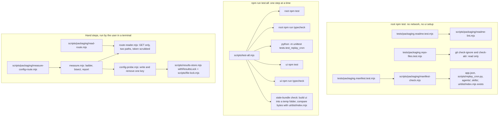

# Design Document

## Overview

`packaging` turns the finished parts into one installable Kiro Crew app. It adds few runtime files and several checked files:

1. **Repo files that Crew and git read**: `app.json`, `.gitignore` (changed), `.gitattributes` (new), the committed `ui/dist/index.mjs`, `README.md`.
2. **Four pure check modules with tests**: the manifest check, the README lint, the combined test script `scripts/test-all.mjs`, and a small set of hand-step programs under `scripts/packaging/` (route reader, probe writer, measurement ladder).
3. **Hand_Run_Steps** (Requirements 6, 9, 10, 11). Each one is a numbered command list with the paths it touches and the point where the user is asked. The programs for Requirement 6 and the route reads of Requirement 9 are run by the user, because they need the gateway token, and the token is typed at a masked prompt and never reaches a file, a log, the shell history or the agent.
4. **Records**: `docs/CREW_NOTES.md` sections, `docs/evidence/` files, one correction in the exploit-hunt design (Requirement 9, criterion 15), and the Usage_Entry.

Nothing in the replay, hunt or dashboard code changes. The only edits outside new files are `.gitignore`, the root `package.json` (one script), and the files that a hand step records into.

Terms (Manifest, Manifest_Check, Config_Route, Crons_Route, Results_Key, Byte_Budget, Config_Probe_Value, Clean_Clone, Install_Source, Crew_CLI, Hand_Run_Step, Approval_Count, README, Usage_Entry, Notes_File) are those of `requirements.md`.

## What was read, and what is not verified

Read for this design (read only): `requirements.md` (as approved), the root `package.json`, `ui/package.json`, `ui/vite.config.ts`, `ui/scripts/check-dist.mjs`, `vitest.config.mjs`, `tsconfig.json`, `.gitignore`, `scripts/file-lock.mjs`, `scripts/results-store.mjs`, `scripts/replay.mjs` (`buildRealDeps`), `scripts/replay/process.mjs` (how `npm` is started on Windows), `scripts/hunt/hunt-store.mjs` (lock names), the skill `skills/find-exploits/SKILL.md` (command lines), `docs/CREW_NOTES.md`, `docs/evidence/INDEX.md` with E24 and E26, `.kiro/steering/*.md`, and the "Model field plan" and "Together with the replay's value" parts of the exploit-hunt design. The git setting `core.autocrlf` is `true` on this machine and there is no `.gitattributes` (read only).

Not verified (nothing was built, installed, run or called):

- **How the gateway accepts a token for an API call.** The notes record that a dashboard address is obtained with `kirocrew token` and that a session token lasts 30 minutes (E24), and nothing about the header or query form an API request needs. Task 1 reads `kirocrew token --help` and the Crew docs (read only) and fixes one form (Decision D6). Until then the route reader supports two forms behind one constant, `bearer` (default) and `query`.
- **The text that `kirocrew token` prints.** Not recorded. The reader asks for the gateway origin and the token as two separate prompts, so it does not depend on that text.
- **Whether the Vite output is byte-for-byte reproducible.** Expected (pinned versions, no sourcemap, no hashed file names, no timestamps) and checked by task 2 (see "Stale-bundle check").
- **Whether the host's `lucide-react` has the icon names chosen in Q2.** Settled by the first install (the sidebar shows a glyph or not).
- **Whether `permissions.storage` is needed (Q3), the exact build-tool warning (Q4), the time field formats (Q6), the cron timing (Q7), the files copied at install (Q11) and the job registration order (Q14).** They stay open and are answered by the first install.

## Architecture



The check modules take their input as arguments (text, file lists, a runner), so their tests need no real file, process or network. The hand-step programs take `deps` of the same shape as the replay (`fs`, `paths`, `clock`, `sleep`, `token`, `pid`) plus `fetch`, so the tests use the existing fakes in `tests/helpers/fake-fs.mjs`.

## Files

Every file is created or changed in a task; the tests of a task are written first and shown failing (see "Testing Strategy").

| File | New or changed | Requirement | Tests |
|---|---|---|---|
| `app.json` | new | R1 to R5 | `tests/packaging.manifest.test.mjs` |
| `scripts/packaging/manifest-check.mjs` | new | R1 to R5 | same |
| `.gitignore` | changed (four lines) | R8.2 | `tests/packaging.repo-files.test.mjs` |
| `.gitattributes` | new (one line) | R8.2 | same |
| `ui/dist/index.mjs` | new in git (built by the existing `npm run build`, not edited) | R8.2 | manifest test (exists, non-empty); `test:all` step 6 (fresh) |
| `scripts/test-all.mjs` | new | R7 | `tests/packaging.test-all.test.mjs` |
| `package.json` (root) | changed (script `test:all`) | R7.1 | `tests/packaging.test-all.test.mjs` (reads the script) |
| `scripts/packaging/route-reader.mjs` | new | R6.13, R9.4 | `tests/packaging.route-reader.test.mjs` |
| `scripts/packaging/secret-prompt.mjs` | new | R6.13 | `tests/packaging.route-reader.test.mjs` |
| `scripts/packaging/config-probe.mjs` | new | R6.2, R6.6, R6.12 | `tests/packaging.config-probe.test.mjs` |
| `scripts/packaging/measure.mjs` | new | R6.3 to R6.10 | `tests/packaging.measure.test.mjs` |
| `scripts/packaging/measure-config-route.mjs` | new (thin entry) | R6 | `tests/packaging.entry.test.mjs` |
| `scripts/packaging/read-route.mjs` | new (thin entry, plus the summary functions) | R9.4, R9.15, R10.3 | `tests/packaging.route-reader.test.mjs`, `tests/packaging.entry.test.mjs` |
| `scripts/packaging/readme-lint.mjs` | new | R12.24 | `tests/packaging.readme.test.mjs` |
| `README.md` | new | R12, R13 | `tests/packaging.readme.test.mjs` |
| `docs/CREW_NOTES.md`, `docs/evidence/E<n>-*.md`, `docs/evidence/INDEX.md` | changed or new, by hand steps | R6.7, R9.3, R10.3, R11 | read by hand against the checklist of each step |
| `.kiro/specs/exploit-hunt/design.md` | changed once (the measured sizes), after R9.15 | R9.15 | none (a text edit); listed in the Usage_Entry |
| `KIRO_USAGE.md` | changed (last task) | R15 | none |
| Conditional: `ui/package.json` (React pins), `agents/playtester.json` and `tests/hunt.texts.test.mjs` (a `model` value), `docs/BRIEF.md` and steering files (corrections) | only after the user approves | R9.6, R11.3, R14.4 | the existing suites |

`tsconfig.json` already includes `scripts/**/*.mjs` and `tests/**/*.mjs`, so the new files are type-checked by the existing `npm run typecheck`; no change is made there. `vitest.config.mjs` already includes `tests/**/*.test.mjs`.

## The manifest (`app.json`)

Written in a task after its tests fail (R5.6). UTF-8, no BOM, two-space indent, trailing newline. All values are from the requirements; nothing is invented.

```json
{
  "name": "grimsheet-playtester",
  "displayName": "Grimsheet Playtester",
  "version": "1.0.0",
  "description": "The night watch for a haunted spreadsheet: replays every Grimsheet level each night and sends an agent to break them.",
  "author": "UBayouski",
  "agents": ["agents/playtester.json"],
  "skills": ["skills/play-level", "skills/find-exploits"],
  "crons": [
    {
      "name": "replay",
      "script": "scripts/replay_cron.py:run",
      "cron_expr": "0 3 * * *",
      "timezone": "America/Los_Angeles",
      "strict_schedule": true,
      "enabled": true,
      "timeout": 900,
      "timeout_secs": 905
    }
  ],
  "permissions": {
    "cron": true,
    "api": ["/api/apps/grimsheet-playtester/config", "/api/crons"]
  },
  "ui": {
    "entry": "dist/index.mjs",
    "pages": [
      { "route": "/apps/grimsheet-playtester", "label": "Grimsheet Playtester", "icon": "Ghost" }
    ]
  }
}
```

Points that follow from the requirements: no `resources`, no `setup`, no `mcpServers`, no `sops`, no `storage` (Q3: omit until the first install shows it is needed), no `events`, no `network`, no `mountFunction`, no `entryPoint`. The `timeout` 900 and `timeout_secs` 905 repeat `CRON_TIMEOUT = 900` of `scripts/replay_cron.py`; the Manifest_Check reads the constant from that file, so a change of the constant fails the check until the manifest follows (R5.8).

### Page icon and label (Open question Q2, settled here)

- **Icon: `Ghost`.** It is a long-standing Lucide name, it fits "haunted spreadsheet" and the Kiroween theme, and the spike's sidebar showed a Lucide name by its string (E08).
- **Fallback: `Moon`** (the night watch). It is among the oldest names in the set. The first install (R9) shows the sidebar entry; if no glyph appears, the manifest changes to `Moon`, and the finding goes in the Notes_File.
- **Label: `Grimsheet Playtester`**, the same as `displayName`, as R4.2 says. If the sidebar clips it, the label changes to `Playtester` only after the user approves.

## Manifest_Check

`scripts/packaging/manifest-check.mjs` exports one pure function:

```
checkManifest({ manifestBytes, launcherText, agentText, skillDirs, bundleBytes }) -> Problem[]
Problem = { rule: string, message: string }      // empty list = fine
```

`manifestBytes` is a `Uint8Array`, so a BOM is seen. `skillDirs` is a list of `{ path, hasSkillMd }`; the test builds it with `fs`. `bundleBytes` is the byte length of `ui/dist/index.mjs`, or `null` when the file is missing.

The test file `tests/packaging.manifest.test.mjs` has two parts: the pure function against generated and example inputs, and one test that reads the real `app.json`, `scripts/replay_cron.py`, `agents/playtester.json`, the two skill folders and `ui/dist/index.mjs` and expects no problems.

| Rule | Checks | Requirement |
|---|---|---|
| `bom` | the first three bytes are not `EF BB BF` | R1.5 |
| `json` | the text parses to an object | R1.5 |
| `identity` | `name` equals `grimsheet-playtester`; `displayName` is a non-empty string; `version` matches semver; `description` is a one-sentence string; `author` equals `UBayouski` | R1.1, R1.2, R1.7 |
| `absent` | no `resources`; no `setup`; no `mcpServers`; no `sops`; no `permissions.events`, `network`, `mcpTools`, `memory`, `sessionApproval`, `spawn`, `jobs`, `exposeToApps`; no `mountFunction`; no per-page `entryPoint`; no `crons[].command`, `message`, `agent`, `every`, `env` | R1.3, R1.4, R1.5, R2.5, R3.2, R4.4, R4.6, R4.8 |
| `agents-skills` | `agents` equals `["agents/playtester.json"]`; `skills` equals the two paths; each skill folder has `SKILL.md`; the agent parses with `tools` equal to `["execute_bash"]`, no `allowedTools`, and the single `skill://` resource whose app segment equals the manifest `name` | R2.1 to R2.4 |
| `crons` | exactly one cron; its fields equal those of R3.1; no cron named `hunt` | R3.1, R3.4, R3.5 |
| `permissions` | `cron` is true; `api` equals the two paths built from `name` | R3.3, R4.3, R4.5, R4.9 |
| `ui` | `ui.entry` is `dist/index.mjs`; one page with route `/apps/<name>`, label equal to `displayName`, and an `icon` string | R4.1, R4.2 |
| `timeout` | `crons[0].timeout` equals the integer after `CRON_TIMEOUT =` in the launcher text; both are integers | R5.1, R5.3 |
| `timeout-secs` | `timeout_secs` is an integer and at least `timeout + 5` | R5.2, R5.3 |
| `text` | the manifest text holds no drive letter (`[A-Za-z]:\`), no `Users\`, no `token=`, no URL | R1.6, R5.4 |
| `bundle` | `ui/dist/index.mjs` exists and has more than zero bytes | R8.2 (as settled) |

The check needs no network, no gateway and no Grimsheet checkout (R5.5), and runs in the root `npm test`. It does not rebuild `ui/`; the freshness comparison is in `test:all`.

## Repo files for the committed bundle

### `.gitignore`

The four lines replace the single `dist/` line, in this order (a file inside an ignored folder cannot be re-included, so the folder is first re-included and its contents ignored again):

```
dist/
!ui/dist/
ui/dist/*
!ui/dist/index.mjs
```

Why each line: `dist/` keeps every other build folder ignored; `!ui/dist/` re-includes the folder, which git allows because its parent `ui/` is not ignored; `ui/dist/*` ignores everything inside it; `!ui/dist/index.mjs` re-includes the one file. The rest of `.gitignore` stays as it is.

**Check at task time (read only, after the edit):**

```
git check-ignore -v ui/dist/index.mjs        expect: no output, exit code 1   (not ignored)
git check-ignore -v ui/dist/other.js         expect: one line naming the rule "ui/dist/*", exit code 0
git check-ignore -v ui/dist/maps/a.map       expect: ignored (rule "ui/dist/*"), exit code 0
git check-ignore -v ui/other/dist/x.js       expect: ignored (rule "dist/"), exit code 0
git status --porcelain ui/dist               expect: "?? ui/dist/index.mjs" before the user adds it
```

`tests/packaging.repo-files.test.mjs` runs the same `git check-ignore` calls with `spawnSync` and fixed arguments, reads only, and compares the exit codes and the matched rule. It does not depend on the network.

### `.gitattributes`

One line: `ui/dist/index.mjs -text`. The reason: `core.autocrlf` is `true` on the developer machine, and without the attribute git may check the bundle out with CRLF line endings, so a byte comparison with a fresh build would fail on a clone. `-text` turns line-ending conversion off for that file. The test runs `git check-attr text -- ui/dist/index.mjs` and expects `text: unset`.

### The commit rule

The developer rebuilds before each commit that touches `ui/` (R8.2). Nothing in this spec runs a git write command; the user adds and commits `ui/dist/index.mjs`, `.gitignore`, `.gitattributes` and the rest. The first install (R9) clones from that commit.

## Combined command: `scripts/test-all.mjs`

Root `package.json` gets one script: `"test:all": "node scripts/test-all.mjs"`. It is a Node script, so it runs the same in Windows PowerShell 5.1 and other shells (R7.6).

The module exports `STEPS`, `runSteps(runner, steps, log)`, `compareBundle(freshBytes, committedBytes)` and `main(io)`; `main` runs only when the file is the entry point. The runner is injected, so the tests use a fake that records calls.

**Steps, in this order, one at a time:**

| # | Label | Command | Folder |
|---|---|---|---|
| 1 | root tests | `npm test` | repo root |
| 2 | root typecheck | `npm run typecheck` | repo root |
| 3 | launcher tests | `python -m unittest tests.test_replay_cron` | repo root |
| 4 | ui tests | `npm test` | `ui/` |
| 5 | ui typecheck | `npm run typecheck` | `ui/` |
| 6 | bundle is fresh | build `ui/` into a temp folder, then compare | `ui/` |

How a step starts: `npm` is a `.cmd` file on Windows, so it is started as a fixed command string with a shell, exactly as `scripts/replay/process.mjs` does for the replay; `python` and `node` are started with an argument array and no shell. No argument comes from the user. Output of a step goes straight to the terminal (inherited). The script prints `[test:all] step n of 6: <label>` before each step and `[test:all] all 6 steps passed` at the end.

**Order and stop (R7.2, R7.3):** the next step starts only after the previous one has ended; the first non-zero exit stops the run, and `test:all` exits with that exit code. A step that cannot start (for example `python` missing) prints `[test:all] could not start: <label>` and exits 1. Step 6 failing exits 1.

**No network (R7.4):** after `npm ci` in the root and in `ui/`, none of the six steps needs the network.

### Stale-bundle check (step 6)

1. Make a temp folder with `fs.mkdtemp` under the OS temp folder (the script created it, so it may remove it).
2. Run `node node_modules/vite/bin/vite.js build --outDir <temp> --emptyOutDir` with `ui/` as the working folder. The command-line `--outDir` overrides the `outDir: 'dist'` of `ui/vite.config.ts`, so `ui/dist` is not touched. Nothing else in `vite.config.ts` changes. It does not run `check-dist` (the committed file was checked when it was built; the byte comparison covers it).
3. Read `<temp>/index.mjs` and `ui/dist/index.mjs`. Equal bytes pass.
4. Otherwise print exactly one line and exit 1: `ui/dist/index.mjs is stale or missing: run "npm run build" in ui/ and commit the result.`
5. Remove the temp folder in a `finally` block.

**Reproducibility.** The design expects the same bytes from two builds of the same tree, because the Vite config sets `sourcemap: false`, a fixed output name, no hashing and no environment-dependent value, and the versions are pinned in `ui/package.json`. Task 2 proves it before step 6 is written: build twice into two temp folders and compare; also build after `npm ci` on the Clean_Clone of R9 and compare with the committed file (the `git status --porcelain` of the clone after `npm run build` must be empty). The comparison stays byte for byte if all of these match.

If the builds differ, the only comparison that this design allows instead is **bytes after turning each CRLF into LF**, because the one cause known today is line-ending conversion by git, and `.gitattributes` removes it for new clones. If the builds still differ after that, the work stops and reports where the first difference is; it does not invent a looser comparison (for example by size).

## Route access and the token

Two programs read the gateway: the measurement (R6) and the route reads of R9 and R10. Both go through `scripts/packaging/route-reader.mjs`. They are run by the **user** in a terminal, because the user holds the token. The agent never runs `kirocrew token`, never sees the printed address, and never receives the token.

**How the token enters (R6.13).** `secret-prompt.mjs` asks two questions on the terminal: the gateway origin (an ordinary visible prompt, for example the origin part of the address `kirocrew token` printed) and the token (a masked prompt: the typed characters are not echoed). Both answers live only in program variables. Not as an argument (it would be in the history), not in an environment variable, not in a file.

**What the reader does.**

- It sends `GET` only, with `redirect: 'error'` and a 15-second limit per request. It refuses, before any request is made, every path that is not one of the two in its allow list, `/api/apps/grimsheet-playtester/config` and `/api/crons`; there is no PUT, no POST and no other path.
- The token goes in the form fixed by Decision D6 (`bearer` header by default; `query` is the other supported form). Whatever the form, every message, error text and body that the program prints or returns first passes through `scrub(text, token)`, which replaces every occurrence of the token (and of its URL-encoded form) with `<token>`.
- It prints no body. It returns `{ status, bytes, parsed, ms }` and, for the summaries below, a few numbers.
- It never writes a file. The measurement program writes one file only: the installed app's `data\config.json` (see "Measurement program").

**Summaries (so that no secret or path reaches a log).**

- `summariseCrons(body)`: for each job, only the allow-listed fields `name`, `enabled`, `user_paused`, `is_running`, `last_status`, `consecutive_failures`, `last_run_ts` and `next_run_ts`; for the two time fields also the JavaScript type and a derived format (`epoch-seconds` for a number below 1e11, `epoch-milliseconds` for a number from 1e11, `iso-string` for a string that parses as a date, else `unknown`). The `script` field and every other field are dropped, so the absolute path in `script` never appears (R9.4). It also reports whether the page's Replay_Job rule (name `replay` or ending `/replay`, else a `script` containing `replay_cron.py`) finds exactly one job, as a boolean computed inside the function.
- `summariseConfig(body)`: the UTF-8 byte size of the body, of the Results_Key `playtesterResults`, of its `latest`, of its `trend`, of `findings` when present, the number of levels in `latest` and the number of trend entries. Numbers only (R9.15, R10.3).

If the token form of D6 cannot be made to work (both forms answer 401 or 403), the fallback is documented, not built unless needed: the user reads the route inside the dashboard page they are already signed in to, with a one-line `fetch` of the same path typed in the browser console, which prints only the status and the byte length. The measurement then runs with `--manual-read` (it prints the size it just wrote, waits, and takes the two numbers the user types). That branch is a conditional task.

## Measurement program (Requirement 6)

### Files and functions

- `config-probe.mjs`
  - `PROBE_KEY = 'packagingProbe'` (a key that is not `playtesterResults`).
  - `buildProbe(bytes)`: returns `{ pad: <ASCII text> }` whose `JSON.stringify` is exactly `bytes` bytes long. The text repeats `abcdefghij`, so a cut or a changed byte shows in a comparison. The smallest size is 9 bytes (`{"pad":""}`).
  - `writeProbe(deps, bytes)`: under `withResultsLock` from `scripts/results-store.mjs`, reads `data\config.json`, sets only the key `PROBE_KEY`, writes a temp file `.config.<token>.tmp` in `data\` and renames it over `config.json` (the same steps as `mergeTopKey`). Every other key is copied as read.
  - `removeProbe(deps)`: under the same lock, reads the file, deletes only `PROBE_KEY`, writes and renames the same way.
  - Why not `mergeTopKey` itself: it can set a sub-key of a top-level key but cannot delete a top-level key, and the removal is a requirement (R6.6). The probe code reuses `withResultsLock` (the lock) and `acquireLock` through it, so it takes the same `.results.lock` file as the replay and the hunt (R6.12). The first branch of R6.12 (taking the config lock) is possible from a hand step, so the fallback branch is **not** used; the pre-checks below remain as extra safety.
  - The lock is taken once per write and once per removal and is never held while a request is waiting.
- `measure.mjs`
  - `SIZES`: `16384, 32768, 49152, 65536, 98304, 131072, 262144, 524288, 1048576`. The first six are those of R6.4; the last three continue upward by doubling until 1 MiB.
  - `runMeasurement(deps, read, opts)`: pre-checks, ladder, bisect, removal, report (below).
  - `renderReport(report)`: JSON text. Paths in the report are shown as `~\...` (the program replaces the home folder prefix); the report holds no token, no origin and no absolute path.
- `measure-config-route.mjs`: the thin entry. It builds the real `deps` (as `buildRealDeps` of the replay does, with `dataFolder` set to `<home>\.kiro\crew\apps\grimsheet-playtester\data`), calls the two prompts, and prints the report to standard output. It accepts `--dry-run`.

### What one run does, in order

1. **Pre-checks, no write.** The data folder exists. `.run.lock` and `.hunt.lock` do not exist, or are older than their stale limits (the run lock stale limit is `CRON_TIMEOUT` seconds; the hunt lock limit is that of the hunt, 2400 seconds). `GET /api/crons` shows the `replay` job with `is_running` false. If any check fails the program prints the reason and stops with no write.
2. **Snapshot.** It reads `data\config.json` and keeps the parsed object in memory as `before` (this includes the Results_Key and any `findings`). A file that is not a JSON object stops the run.
3. **Ladder** (R6.3, R6.4). For each size in `SIZES`, in order: `writeProbe`, then `GET` the Config_Route, then record `{ phase: 'ladder', probeBytes, status, bodyBytes, parsed, equal, ms }`. A step is **good** when the status is 200, the body parses, and its `packagingProbe` deep-equals the probe that was written. The first step that is not good ends the ladder; reaching 1 MiB with every step good also ends it.
4. **Bisect** (R6.5). If a step failed, the program bisects between the last good size and the first bad size, with the same write-read-compare, until the gap is at most 1024 bytes. If the first step (16384) already failed, the last good size is 0 and the program bisects from 0.
5. **Removal** (R6.6). `removeProbe`. Then it reads the file and the route again, and records `configRestored` (the file with no `PROBE_KEY` deep-equals `before`) and `routeRestored` (the route body deep-equals `before` minus nothing, or, if it differs, the difference is recorded as a fact and not assumed away, because E26 saw the route differ from the file once for a reason that is not known).
6. **Report.** `largestGood`, `firstBad` (or `null`), `reachedCap` (true when no failure up to 1 MiB), the step list, the removal result, the lock waits. The user pastes it into the chat; the agent writes the evidence file and the Notes_File section (R6.7), adding the date, the Crew version and the status codes already in the report, and checking that the text holds no user name, home path or token (R6.11).

`removeProbe` also runs in a `finally` block and on `SIGINT`, so a failed read, a thrown error or Ctrl-C does not leave the probe in the file. If the removal itself fails the program says so in the first line of its output and names the key to delete by hand.

**What the number means.** The probe size is the quantity R6.8 compares with 65536. During a step the route body holds the probe plus every other key (the real Results_Key is about 1.5 KB at the start), so the body is larger than the probe by the rest of the file. A pass at 65536 therefore returns a body at least as large as a file whose Results_Key is at the Byte_Budget. Both `probeBytes` and `bodyBytes` are in the report.

**`--dry-run`.** Prints the pre-check results and the list of sizes it would write, writes nothing and reads only `/api/crons`. It is the first command run (see the Hand_Run_Step table).

**Do not run near 03:00 America/Los_Angeles.** The approval text says so. The lock and the `is_running` check cover a run that is already going; the advice covers one that would start during the measurement.

## Hand_Run_Steps

### Protocol for every Hand_Run_Step

1. The agent prints the numbered command list of the step, the paths each command touches, and the points where it will wait (the "Ask" column).
2. The user answers each gate with an explicit yes. A gate that is not answered is not passed.
3. Commands run one at a time. The agent stops at the first unexpected output and reports it. It deletes nothing the user did not approve.
4. Paths are written as `~`, `%USERPROFILE%` or `%LOCALAPPDATA%` in every record. In a command shown to the user, PowerShell forms are used: `$env:USERPROFILE`, `$env:LOCALAPPDATA`, `$env:ProgramFiles`.
5. The Crew_CLI is called through `$env:ProgramFiles\KiroCrew\resources\backend-dist\kirocrew-backend\bin\kirocrew.cmd` (the form of the tech steering, with the drive taken from the environment variable). In the tables it is written `CREW`.
6. No git write command is run by the agent. Where a commit or push is needed, the user does it.

The order of the whole spec's hand steps: build the repo files and tests, the user commits, then **R9 first install**, then the first replay run inside R9, then **R6 measurement**, then R9.15 sizes, then **R10 first hunt**, then optional **R11**.

### Requirement 9: first install

`REPO` is the Clean_Clone folder `$env:USERPROFILE\crew-install-src\grimsheet-playtester` (outside the working folder, outside the Crew folders). `APP` is `$env:USERPROFILE\.kiro\crew\apps\grimsheet-playtester`.

| # | Command or action | Touches | Ask |
|---|---|---|---|
| 0 | The agent prints this table. | nothing | **Gate A:** approve the whole step. |
| 1 | `CREW app info grimsheet-playtester` | reads the Crew registry; expected: not installed | |
| 2 | `git clone <path of the working folder, or the repo URL> "$env:USERPROFILE\crew-install-src\grimsheet-playtester"` | creates `REPO` (reads the commit the user made) | **Gate B:** approve the clone. |
| 3 | `git -C REPO status --porcelain`; `Test-Path REPO\data`; `Test-Path REPO\ui\dist\index.mjs`; `Test-Path REPO\spike` | reads `REPO` only; expected: empty, False, True, False | |
| 4 | `CREW app install REPO` | creates `APP` (copies `REPO`, drops `.git` and `node_modules`) | **Gate C:** approve the install. |
| 5 | The user runs `CREW token` in their own terminal and opens the printed address. The agent does not run it. | opens a dashboard session | |
| 6 | The user trusts the app (Settings, Security, Third-party apps) and enables it. | changes the app's trust state | **Gate D:** the user says when done. |
| 7 | The user looks at: Library (Enabled), the sidebar entry and its icon (Q2), the Schedule page (`replay` job; the time it appeared, Q14), Details, Resources (one agent, two skills). | none | |
| 8 | In the page: reload; check that the page renders from the default export (R9.5, dashboard Q9); in the browser console read `React.version` once (R9.6, dashboard Q10); press each copy button once (R9.7). | none | |
| 9 | The user runs, in their own terminal in the working folder: `node scripts/packaging/read-route.mjs crons` (prompts for origin and token) | reads `/api/crons`; prints the summary | **Gate E:** the user runs it and pastes the printed summary. |
| 10 | The user presses **Run** on the Schedule page for `replay` and waits until it stops. | starts the replay: writes `APP\data` (Grimsheet checkout in `%LOCALAPPDATA%\grimsheet-playtester`) | **Gate F:** approve the first real run (network to the Grimsheet repository, a build). |
| 11 | The user reads the Executions tab row (status, duration, trigger, summary). The page: one card per level (R9.8, R9.9). | none | |
| 12 | `node scripts/packaging/read-route.mjs config` (the user's terminal) | reads the Config_Route; prints sizes | pasted by the user |
| 13 | `CREW app info grimsheet-playtester` | reads the stored manifest (R9.11) | |
| 14 | `Get-Content "$env:USERPROFILE\.kiro\agents\grimsheet-playtester--playtester.json"` | reads the generated agent file (R9.12) | |
| 15 | `Get-Content "$env:USERPROFILE\.kiro\crew\apps\grimsheet-playtester\approved-grants.json"` (never `.app_secret`) | reads the grants (R9.10) | |
| 16 | Developer path, in `REPO\ui`: `npm ci`, then `npm run build`, then `git -C REPO status --porcelain` | creates `REPO\ui\node_modules`; rewrites `REPO\ui\dist\index.mjs` | **Gate G:** approve (answers Q4 and the reproducibility check; expected: porcelain output empty). |
| 17 | Write the records: Notes_File section (R9.3, R9.13), evidence files, `docs/evidence/INDEX.md`, the exploit-hunt design correction (R9.15), each in the working folder. | `docs/`, `.kiro/specs/exploit-hunt/design.md` | **Gate H:** show the diff of the exploit-hunt design before writing. |

Step 16 runs after the install (step 4), so the install copies the committed state of the clone, not a rebuilt one. If `git status --porcelain` is not empty after the build, the bundle is not reproducible on a second tree: the work stops and reports (see "Stale-bundle check").

### Requirement 6: config route size (after the first replay run of R9)

`APP\data` is the installed app's data folder. The probe key `packagingProbe` is not the Results_Key. The agent runs nothing in this step; the user runs the two commands in their own terminal in the working folder, because both prompt for the token.

| # | Command | Touches | Ask |
|---|---|---|---|
| 0 | The agent prints this table, the sizes (16384 up to 1 MiB, then the bisect), and the warning about 03:00 America/Los_Angeles. | nothing | **Gate A:** approve the step; confirm the replay job is not running and no hunt is active. |
| 1 | `node scripts/packaging/measure-config-route.mjs --dry-run` | reads `/api/crons`; reads the lock files; no write | the user pastes the output |
| 2 | `node scripts/packaging/measure-config-route.mjs` | writes and removes the key `packagingProbe` in `APP\data\config.json`; creates and removes `.results.lock` and `.config.<token>.tmp` in `APP\data`; reads the Config_Route | **Gate B:** approve the real run, after the dry run shows no blocker. |
| 3 | The agent reads the pasted report and checks `configRestored` and `routeRestored`. | none | |
| 4 | `node scripts/packaging/read-route.mjs config` (the user's terminal) | reads the route; shows that the Results_Key is unchanged in size (the file itself is not printed, because it may be large) | |
| 5 | Write the evidence file and the Notes_File section (R6.7); apply R6.8 to R6.10 to the result. | `docs/` | **Gate C:** if `largestGood` is below 65536, stop and report to the user (R6.9); no other change is made. |

### Requirement 10: first agent-run hunt

| # | Command or action | Touches | Ask |
|---|---|---|---|
| 0 | The agent prints the expected Approval_Count (about 30; R12.8), the budgets (4 per level, 20 per hunt, 1800 seconds, 10 refusals) and what the hunt creates. | nothing | **Gate A:** the user approves the hunt and starts it. |
| 1 | `Test-Path "$env:USERPROFILE\.kiro\crew\apps\grimsheet-playtester\data\.hunt.lock"` and `Get-ChildItem "$env:USERPROFILE\.kiro\crew\apps\grimsheet-playtester\data\hunts"` | reads only; expected: False; no active hunt | |
| 2 | The user opens a chat with the `playtester` agent in the default approval mode **Normal** and asks for a hunt. The agent's own calls are `node SKILL_FOLDER/scripts/hunt-begin.mjs`, `hunt-info.mjs --level <id>`, `hunt-submit.mjs --level <id> --class <class> --actions ...`, `hunt-end.mjs`; each asks the user for an approval. | writes `APP\data\hunts\`, the Hunt_Checkout, candidate files, the `findings` sub-key of `config.json` | **Every approval prompt is the user's.** The user counts them (R10.3) or lets the agent count them in the chat record. |
| 3 | Optional: the same hunt again with the selector option **Trust** for that chat session only. | same as step 2 | **Gate B:** the user chooses to try it (R10.6). |
| 4 | After the hunt: `Get-Content "$env:USERPROFILE\.kiro\crew\apps\grimsheet-playtester\data\hunts\<Hunt_Id>.json"` and `node scripts/packaging/read-route.mjs config` (the user's terminal) | reads the Hunt_Record; prints sizes including `findings` | |
| 5 | The agent lists every file the hunt created, deletes none (R10.10), compares the Approval_Count with the "roughly 30" and the 3 to 12 of the spike (R10.4), and records the credits, time, model line and what the dashboard shows. | `docs/` | **Gate C:** the user approves the records. |

**YOLO is never used and the approval mode is never changed by the agent** (R10.7). If the hunt stalls or fails, the agent stops and reports; it changes no hunt code (R10.11).

### Requirement 11: model field plan (optional)

| # | Command or action | Touches | Ask |
|---|---|---|---|
| 1 | Read, with Kiro's documentation power, the Crew page on agent spec fields for the accepted form of `model`; write "not documented" for anything it does not say (R11.1). | nothing | |
| 2 | **Gate A:** the user says whether to measure at all. If not, the agent file keeps no `model` and the Notes_File records the skip (R11.5). | | **Gate A** |
| 3 | Run 1, no `model`: in a chat with `playtester`, the four calls in this order: `hunt-begin.mjs`; `hunt-info.mjs --level 02-the-chaser`; `hunt-submit.mjs --level 02-the-chaser --class cheaper_win --actions E E E E N N E E E E E S S` (the list shown in the skill's first example, the same in both runs); `hunt-end.mjs`. The user records the credits on the usage line. | `APP\data\hunts\`, a Hunt_Checkout | the user's approvals |
| 4 | Edit `agents/playtester.json` in the working folder, adding the candidate `model` value (and, in the same task, the update of `tests/hunt.texts.test.mjs` that R11.3 requires). The user runs **Sync** in the dashboard. | `agents/playtester.json`, `tests/hunt.texts.test.mjs`, the installed copy | **Gate B:** approve the edit and the Sync (no Sync while a run or a hunt is active). |
| 5 | Read `Get-Content "$env:USERPROFILE\.kiro\agents\grimsheet-playtester--playtester.json"` for the `model` value (R11.3, R11.4). | reads only | |
| 6 | Run 2, with `model`: the same four calls. Compare the credits. | same as step 3 | the user's approvals |
| 7 | If the field did not survive the Sync, revert the edit of step 4 and record that the cost question stays open (R11.4). | `agents/playtester.json`, `tests/hunt.texts.test.mjs` | **Gate C:** approve the revert or the keep. |

One pair of runs is a rough signal (0.1 to 0.4 credits is the scale of such runs); the record says so.

## README

`README.md` is written in a task after `tests/packaging.readme.test.mjs` fails. Sections, in order, each tied to its requirement:

1. Title and tagline, what the app does, and the companion statement with the two links (R12.1, R12.25).
2. The two jobs; the level colours, the fourth state "Not judged", the exploit classes (R12.2, R12.3).
3. Install, judge path (R8, R12.4): prerequisites (R8.12, R12.16); `git clone`; the `CREW app install` command in the `$env:ProgramFiles` form; trust and enable; what to see afterwards; the gateway warning to expect (R8.10); the Sync warning; uninstall leftovers (R8.15). No `ui/` build step is in this path.
4. Developer path (R8.2): `npm ci` and `npm run build` in `ui/`, rebuild before each commit that touches `ui/`, `npm run test:all` (R7.7), and Sync as the update path (R8.14). The build-tool warning is quoted only if the first install showed it (R8.9).
5. Where results appear, the polling and the Refresh button (R12.17); the nightly replay and the missed run (R12.6); the hunt on request and why (R12.7).
6. The hunt: approvals and modes, **Normal**, **Trust**, **YOLO** and **Reads** (R12.8 to R12.10), the budgets (R12.11), credits (R12.12), the bounded-search sentence (R12.13).
7. What the app never does: no writes to Grimsheet; the dashboard never writes (R12.14, R13.4); the unattended-hunt non-claim and the Crew claim (R13.2, R13.3).
8. Platform and limits: only Windows was tested; the untested process-kill branch; known limits and the measured route size (R12.5, R12.15, R12.18).
9. Screenshots (R12.20): added when the images exist; no text about them before.
10. Licence, written-from-scratch statement, no paid APIs (R12.19, R13.1), and pointers to `docs/CREW_NOTES.md` and `docs/evidence/INDEX.md` (R12.23).

Rules for text not yet measured: a number from a hand step is written only after it is recorded; before that the README says "not measured" (R10.12, R12.12). A text that was not seen is described without quotation marks (R12.22). The CLI command is shown as `& "$env:ProgramFiles\KiroCrew\resources\backend-dist\kirocrew-backend\bin\kirocrew.cmd" app install <path>`, because the form with a drive letter would fail the lint (see "Changes to requirements").

### README lint

`readme-lint.mjs` exports `lintReadme(text) -> Problem[]`. It checks (R12.24):

- the phrases `Windows`, `only Windows was tested`, `03:00`, `on request`, `bounded search`, `MIT` are present;
- the two links `https://github.com/UBayouski/Grimsheet` and `https://grimsheet.onrender.com`, and the words `companion` and `Grimsheet entry`, are present (R12.25);
- there is no drive letter (`[A-Za-z]:\`), no `Users\`, no `token=`, no `localhost` and no `127.0.0.1`;
- every `http://` or `https://` address begins with one of the two allowed prefixes `https://github.com/UBayouski/` and `https://grimsheet.onrender.com` (this replaces the check "no dashboard URL" with a check a program can do);
- no placeholder word (`TBD`, `TODO`, `FIXME`).

It holds **no list of other tool or assistant names** (Q10, closed): R12.21 is a review rule. The review is done by reading the README before the Usage_Entry task and is listed there as a checklist line.

## Correctness Properties

Each property is a `fast-check` test with at least 100 runs (the library default; set explicitly where a different number is used). A failing property stops the work and reports the counterexample (see "Testing Strategy").

- **P1. Valid manifests pass.** For all launcher constants T in 30 to 3600, all `timeout_secs` from T+5 to T+305, and all `displayName`/`description` values without forbidden text: a manifest built by the valid builder gives no problem. (R5.1, R5.2, R5.4)
- **P2. A `timeout` that differs from the constant is found.** For all valid manifests and all non-zero integer offsets: the rule `timeout` is reported. (R5.1, R5.8)
- **P3. A short `timeout_secs` is found.** For all valid manifests and all `timeout_secs` from 0 to `timeout + 4`: the rule `timeout-secs` is reported. (R5.2)
- **P4. An extra cron is found.** For all valid manifests with one additional cron entry of any name, any fields (including `message`, `agent`, `command`, `every`, `env`): a problem is reported; a cron named `hunt` is reported by name. (R3.2, R3.4, R3.5)
- **P5. Forbidden text is found.** For all valid manifests with a drive letter, `Users\`, `token=`, a URL or a leading BOM inserted at any string position or at the front: a problem is reported. (R1.5, R1.6, R5.4)
- **P6. The probe round trip restores the file.** For all JSON-safe config objects without `packagingProbe` and all sizes from 9 to 200000: after `writeProbe` then `removeProbe`, the parsed file deep-equals the original, the lock file and the temp file are gone, and at no moment in between was any other key changed or lost. Also when an error is thrown between the write and the removal and the `finally` block runs. (R6.2, R6.6, R6.12)
- **P7. The probe has the exact size.** For all sizes from 9 to 2 MiB: the UTF-8 length of `JSON.stringify(buildProbe(n))` is exactly `n`. (R6.4)
- **P8. The measurement finds the boundary.** For all limits L from 0 to 2 MiB and all failure modes of a fake route (a non-200 status, a truncated body, a body that does not parse, a timeout): `largestGood` is the greatest tested size at most L; if L is below 1 MiB, `firstBad` is above L, and `firstBad - largestGood` is at most 1024; if L is at least 1 MiB, `reachedCap` is true and `firstBad` is null. The probe is removed in every case. (R6.3 to R6.5, R6.6)
- **P9. The token never leaves.** For all tokens (8 to 64 printable characters, including regular-expression characters, `%` and `+`) and all gateway behaviours (200; 401 whose body echoes the token; a thrown network error whose message holds the token; a body that holds the token): the printed report, every message and every write of the fake file system contain no occurrence of the token or of its URL-encoded form. (R6.13)
- **P10. The cron summary leaks nothing.** For all job objects with an arbitrary `script` value and arbitrary extra fields: the summary text never contains the `script` value, and its keys are only the allow-listed ones. (R9.4)
- **P11. The home path is hidden.** For all home folder strings: the report and every message contain the home folder string zero times. (R6.11, R14.1)
- **P12. The route reader is GET-only and allow-listed.** For all paths outside the allow list: no request is made and the result is a refusal; for the allowed paths: every request has the method `GET`. (R6.2, R9.4)
- **P13. `test:all` runs in order and stops at the first failure.** For all lists of six exit codes: the fake runner is called for the steps up to and including the first non-zero one, in list order, never with two calls in flight; the returned code equals that first non-zero code, or 0 when all are zero. (R7.2, R7.3)
- **P14. The bundle comparison is exact.** For all byte arrays: equal arrays pass; any array that differs by one changed, inserted or removed byte, or a missing file, fails with the one-line message that holds `npm run build`. (R8.2)
- **P15. The README lint finds each missing phrase and each forbidden pattern.** For all README texts built from the required phrases plus filler: it passes; removing any one required phrase gives a problem that names it; inserting a drive letter, `Users\`, `token=`, a foreign URL or a placeholder word gives a problem. (R12.24)

Example-based tests (not properties) cover the exact messages, the real `app.json`, `.gitignore` and `.gitattributes` through `git`, the step list of `test:all`, the dry run (no write), the pre-check refusals (replay running, lock files present, `config.json` not an object), the masked prompt (typed characters are not echoed), the report shape, and the entry scripts with injected input and output.

## Testing Strategy

Rules, the same as in the earlier specs:

- Test first. Each task writes its tests, runs only that file, and shows it failing for the stated reason before any code is written. After the code, the same file passes.
- Property tests use `fast-check` with `numRuns` of at least 100. No `numRuns` is lowered, no generator is narrowed, no `fc.pre` is added, and no expectation is loosened to make a test pass. A failing check stops the work and the counterexample is reported.
- Suites run one at a time, never in parallel (R7.2). No test uses the network or a real Crew gateway. The `git` calls of `packaging.repo-files.test.mjs` are read only.
- The fakes of `tests/helpers/fake-fs.mjs` (`makeMemFs`, `makeFakeClock`, `makeSleep`, `makeTokenSource`, `makeScheduler`) are reused; a fake `fetch` and a fake runner are added in `tests/helpers/packaging-fakes.mjs`.
- After each code task: `npm test`, `npm run typecheck`; after the last code task also `npm run test:all` (which runs the six steps, including the bundle comparison).

Test files: `tests/packaging.manifest.test.mjs` (P1 to P5 and the real files), `tests/packaging.repo-files.test.mjs`, `tests/packaging.readme.test.mjs` (P15), `tests/packaging.route-reader.test.mjs` (P9, P10, P12 and the masked prompt), `tests/packaging.config-probe.test.mjs` (P6, P7), `tests/packaging.measure.test.mjs` (P8, P11), `tests/packaging.test-all.test.mjs` (P13, P14), `tests/packaging.entry.test.mjs` (the thin entries).

**Planned order of the tasks (for the next step, not written now):** reproducibility check of the build; `.gitignore` and `.gitattributes` (tests first); manifest check, then `app.json`; route reader and prompt; probe writer; measurement; `read-route`; `test:all`; README lint, then README; then the Hand_Run_Steps in the order given above; then the Usage_Entry.

## Error Handling

- A hand-step program that cannot continue prints one line saying why and exits non-zero; it never prints the token, the origin, a body, or an absolute path.
- A missing or unreadable `data\config.json` stops the measurement before any write.
- A lock that cannot be taken within the wait of `withResultsLock` ends the run with `lock_timeout` and no write.
- A probe that cannot be removed is reported in the first output line with the key name; nothing else is changed.
- `test:all` prints the failing label and returns the failing exit code; it does not continue.
- A clipboard, icon or route finding of a hand step that differs from the design is recorded as observed and reported; it does not change code inside this spec without the user's approval (R9.5, R9.6, R10.11).

## Changes to requirements

The design found these points. None of them has been written into `requirements.md`; they wait for approval.

1. **R8.4 and R12.4 (drive letter).** The requirement asks for "the full-path form" of the Crew_CLI, which starts with a drive letter, while R12.24 makes the README lint reject a drive letter. The design shows the command as `$env:ProgramFiles\KiroCrew\...`. Proposed wording: "the path built from `$env:ProgramFiles`".
2. **R12.21 and R12.24 (dashboard URL).** The README now holds URLs (R12.25), so "no dashboard URL" becomes a check that every address starts with one of two allowed prefixes, plus a ban on `localhost`, `127.0.0.1` and `token=`. Proposed wording for R12.24.
3. **R8.2 and R14.5 (`.gitattributes`).** The committed bundle needs `.gitattributes` with `ui/dist/index.mjs -text`, because the developer machine has `core.autocrlf` set to `true`. Proposed: name the file in R8.2 and in the list of R14.5.
4. **R7.1 and R8.2 (where the freshness check lives).** Settled by the user: step 6 of `test:all`. R8.2 still says "the Manifest_Check (or the combined command)". Proposed: say "the combined command" and say that the Manifest_Check checks only that the file exists and is not empty.
5. **R6.12 (fallback not used).** The lock can be taken from a hand step, so the fallback branch (only when the job is not running and no `.hunt.lock` exists) is not used as the main path. The design keeps its checks as extra pre-checks. No wording change is needed; recorded here.
6. **R6 and R9.4 (who runs the read).** The reads need the token, which only the user holds, so the user runs the reader programs in a terminal and pastes the output. R6 and R9 say "the measurement" and "read once" without saying who runs it. Proposed: add "run by the user" to R6.1 and R9.4.
7. **R9.2 (clone source).** The Clean_Clone can come from the working folder by a local `git clone <path>`, which needs a commit but not a push. No wording change; the clone URL form is used for the README path.

## Decisions to confirm

- **D1. Icon `Ghost`, fallback `Moon`, label equal to the display name.** (Q2)
- **D2. Probe writer built on `withResultsLock`, not on `mergeTopKey`,** because the probe must be deleted.
- **D3. The user runs the token-using programs.** The token is typed at a masked prompt. The alternative (the agent runs them with a token in an argument or a file) is rejected by R6.13.
- **D4. Size ladder.** The six sizes of R6.4, then doubling to 1 MiB, then bisect to 1024 bytes.
- **D5. Stale-bundle comparison.** Bytes of a Vite build into a temp folder against the committed file, run in `test:all` step 6; fallback only the CRLF-to-LF normalisation (see "Stale-bundle check").
- **D6. Token form for an API request.** Open until task 1 reads `kirocrew token --help` and the Crew docs; the reader supports `bearer` and `query` behind one constant. If neither works, the conditional `--manual-read` branch is built.
- **D7. `.gitattributes`.** One line, `ui/dist/index.mjs -text`.
- **D8. README lint uses an address allow-list** in place of the "no dashboard URL" check.
- **D9. Open for the first install:** Q3 (`storage`), Q4 (build-tool warning, developer path only), Q6 (time formats), Q7 (cron timing), Q11 (files copied), Q14 (job registration).
