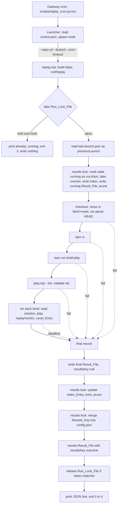

# Design Document

## Overview

The nightly replay has two programs. A small Python **Launcher** (`scripts/replay_cron.py`) is what the cron runs. It reads the control file, starts `node scripts/replay.mjs`, waits, and writes `last-launch.json`. The Node **Replay_Script** does the work of one Run: it takes a run lock, fetches and builds Grimsheet, plays every stored solution, asks the verifier for a verdict on each, and writes the Result_File, the Index_File and the Results_Key in `data\config.json`.

The design keeps all decisions in small modules that take their dependencies as arguments (clock, file system, process starter, verifier, token source, pid, sleep). The entry file `scripts/replay.mjs` is the only place that builds real dependencies. Tests pass fakes, so no test needs the network, a Grimsheet checkout, a real git or a real npm.

The verifier is used only through `replayVerdict(levelId, storedSolution, exitCode, playResult)`. The runner never computes a colour (Requirement 5.5).

Type choice for the verifier shapes: the runner **re-declares** `ReplayOk` and `ReplayError` as JSDoc typedefs in `scripts/replay/types.mjs` instead of importing them from `../verifier.mjs`. The verifier file is still being written, a typedef import would break type-checking if a name moves, and the runner already receives the verifier as an injected function. The shapes follow `.kiro/specs/verifier/design.md`. Only `scripts/replay.mjs` imports `../verifier.mjs` at run time.

What was read for this design:

- `requirements.md` (the source), `.kiro/specs/verifier/design.md`, steering `tech.md` and `crew-app.md`, `docs/CREW_NOTES.md` sections h.1, h.3, h.4 and h.7.
- `tests/fixtures/`: `manifest.json`, `GRIMSHEET_COMMIT.txt` (`e1c61a35b3da027aada5d9ef4460efa4470488a4`, then `dirty`), `solutions/02-the-chaser.json`, and the end values of the `*.play.json` files (01: ink 0 to 0, hp 3, won; 02: ink 2 to 1, hp 3, won; 02 truncated: hp 3, status `playing`).
- `../grimsheet/scripts/play.mjs`, read only. `--list` prints `{"levels": [...]}` and exits 0; bad input exits 2.

Not verified here: a real `--list` output (none is in `tests/fixtures/` yet), a real nightly run, the behaviour of the gateway when the Launcher raises an exception, and the config route size limit (belongs to `packaging`).

## Architecture



Lock nesting: the Run_Lock_File is the outer lock and the results Lock_File is the inner lock. A holder of the results lock never takes the Run_Lock_File. The results lock is never held across an external process.

### Order of operations of one Run

1. `replay.mjs` parses the flags, builds real dependencies and calls `runReplay`. `startedAt` is read from the clock once.
2. Take the **Run_Lock_File** (`data\.run.lock`) with exclusive create, no waiting (7.14). If it exists and is younger than `cronTimeout`, return `already_running`: print `{"state":"already_running"}`, exit 3, touch nothing (7.15). If it is older, take over (7.16, algorithm below); a failed second take behaves as 7.15. A file-system error here exits 4 (nothing recorded, see Decision 24).
3. Read `data\launcher\last-launch.json` (read only) into `previousLaunch`, or `null` when missing or unreadable (1.10).
4. **Start the record**, in one hold of the results Lock_File (inner lock):
   1. Read the Index_File. If missing or unparsable, rebuild it from the Result_Files (8.4).
   2. Cut-short marking (7.8): for each Index_Entry in state `running` with `startedAt` more than `cronTimeout` seconds before `startedAt` of this Run, rewrite its Result_File to `cut-short` (when the file exists and parses), then change the entry.
   3. `counter = max(index.lastCounter, highest counter in Result_File names) + 1`. Insert an Index_Entry in state `running`, keep the 30 highest counters, set `lastCounter = counter`, and write the Index_File atomically (8.3: the counter is stored before the Result_File).
   4. Write the Result_File `run-NNNNNN.json` with state `running`, `finishedAt` null, `resultsKey` null (7.1, 11.7).
   5. Delete every file in `data\runs\` that matches the Result_File name pattern and has no Index_Entry (8.7).
   6. Release the results Lock_File.
5. Checkout (stage `checkout`), then `npm ci` (`install`), then `npm run build:play` (`build`), then `--list` (`list`). A failure at any of them goes to step 8 with state `failed`.
6. Replay (stage `replay`): for each distinct listed id in list order, read the solution file once, play it, call `replayVerdict`, record a Level_Entry. Before each level, check the Run_Deadline. If it is reached, record `not_played` entries for the rest and go to step 8 with `deadline_reached`.
7. Count colours and coverage, set state `complete`.
8. **Finish**:
   1. Build the final Run_Record with `resultsKey` `null`, and write the Result_File atomically (first write of the final state; 7.7 first item). If this write fails, skip to step 9 and exit 4.
   2. In one hold of the results Lock_File: update the Index_Entry (state, `finishedAt`, commit, counts), write the Index_File, prune (7.7 second item).
   3. Merge the Results_Key into `data\config.json` through the Write_Module (own hold of the results Lock_File; 7.7 third item). Outcome: `ok`, `too_large`, `config_unreadable` or `lock_timeout`.
   4. Rewrite the Result_File with `resultsKey` set to the outcome (see Decision 20: this resolves 7.2 against 7.7). If this rewrite fails the first file stays, with `resultsKey` `null`; the exit code stays 0.
9. Release the Run_Lock_File only if it holds this Run's token (7.17). This runs in a `finally` block, also after an internal error.
10. Print the one JSON line and exit 0 (state `complete` or `failed`, Result_File written), 3 or 4.

An unexpected error between steps 4 and 8 is caught by `runReplay`: it sets state `failed`, stage `record`, reason code `internal_error`, and runs step 8 (7.6).

What exists on disk if the Run is killed (the cron `timeout`, a Sync, a reboot):

| Killed during | Run_Lock_File | Index_File | Result_File | config.json |
|---|---|---|---|---|
| Steps 1 to 3 | left (stale after `cronTimeout`) | unchanged | unchanged | unchanged |
| Step 4 (inside the hold) | left | old, or new with the entry `running` | none, or `running` | unchanged |
| Steps 5 to 7 | left | entry `running` | `running` | unchanged (shows the previous Run) |
| Step 8.1 | left | entry `running` | `running` or final | unchanged |
| Steps 8.2 to 8.4 | left | final or `running` | final, `resultsKey` `null` | previous or new |
| After step 9 | removed | final | final | final |

The next Run marks a `running` Run `cut-short` once it is older than `cronTimeout`. A killed Run leaves the Run_Lock_File until it is older than `cronTimeout` (900 seconds), so a manual re-run within 15 minutes of a kill gets `already_running` (Decision 11). The Launcher kills the Node child at `cronTimeout - 5` seconds, but the Node child never removes its lock when killed.

## Components and Interfaces

All files under `scripts/` are plain ESM JavaScript with JSDoc and `// @ts-check` (the tsconfig include is `scripts/**/*.mjs`). The only Python file is `scripts/replay_cron.py`.

### Module list

| File | Role |
|---|---|
| `scripts/replay_cron.py` | Launcher (Python standard library, tested with `unittest`) |
| `scripts/replay.mjs` | Thin CLI entry: parse flags, build real dependencies, call `runReplay`, print the JSON line, set the exit code |
| `scripts/replay/run.mjs` | Orchestrator `runReplay(deps, args)` |
| `scripts/replay/types.mjs` | JSDoc typedefs only (no run-time code): `Deps`, `ReplayOk`, `ReplayError`, `LevelEntry`, `RunRecord`, `IndexEntry`, `IndexFile`, `TrendEntry`, `ResultsKey`, `Failure` |
| `scripts/replay/checkout.mjs` | `ensureCheckout`: clone or fetch+reset, repair, commit hash; git allow-list |
| `scripts/replay/levels.mjs` | Level list validation, solution reading, coverage |
| `scripts/replay/run-record.mjs` | Pure builders: record, counts, compact forms, Index_Entry, Trend_Entry, Results_Key build and trim |
| `scripts/replay/index-store.mjs` | Index_File and Result_File read and write, counter, eviction, rebuild, cut-short marking |
| `scripts/replay/process.mjs` | `startProcess` with Step_Limit and tree kill; `effectiveLimit` |
| `scripts/file-lock.mjs` | Exclusive-create lock primitive used for both the Run_Lock_File and the results Lock_File |
| `scripts/results-store.mjs` | Shared Write_Module (also used later by `exploit-hunt`) |

Why `types.mjs` was added to the suggested list: shared typedefs stay in one place and no module needs a type import from another module that does real work. `file-lock.mjs` and `results-store.mjs` sit directly in `scripts/` because the hunt uses them.

### Dependencies object

Every function that does I/O takes the pieces it needs from this object (or a named subset of it).

```js
/**
 * @typedef {Object} Deps
 * @property {{ nowMs(): number }} clock                 Epoch milliseconds. Tests give a fixed or stepping clock.
 * @property {(ms:number)=>Promise<void>} sleep          Lock retry wait. Tests advance the fake clock instead of waiting.
 * @property {Fs} fs                                     Subset of node:fs/promises (see below). Tests give a real temp folder or an in-memory fake.
 * @property {{ appFolder:string, dataFolder:string, localAppData:string }} paths
 *           Absolute paths. dataFolder is appFolder\data. localAppData is %LOCALAPPDATA% (empty string when unset).
 * @property {StartProcess} spawn                        Process starter (process.mjs startProcess or a fake).
 * @property {(levelId:unknown, stored:unknown, exitCode:unknown, play:unknown)=>ReplayOk|ReplayError} verifier
 *           replayVerdict from ../verifier.mjs, or a stub.
 * @property {()=>string} token                          32 hex characters. Real: crypto.randomBytes(16).toString('hex').
 * @property {number} pid                                process.pid
 * @property {string} appName                            'grimsheet-playtester'
 * @property {'win32'|'other'} platform                  Picks the tree-kill method and the npm shell rule.
 */
/**
 * @typedef {Object} Fs   Methods used: readFile, writeFile (flag 'wx' for exclusive create), rename, rm, mkdir,
 *   readdir, stat, chmod, realpath. All return promises. The in-memory fake implements exactly these.
 */
```

`runReplay(deps, args)` takes `args = { repoUrl, branch, cronTimeoutSec }`. It never reads `process.env`, `process.argv`, the real clock or the real file system itself.

### scripts/replay.mjs

```js
// Entry: node scripts/replay.mjs --repo-url <url> --branch <name> --cron-timeout <seconds>
/** @param {string[]} argv @returns {{repoUrl:string, branch:string, cronTimeoutSec:number}|null} null on a bad flag set */
export function parseArgs(argv)
/** Builds real Deps from process, node:fs/promises, crypto and ../verifier.mjs. @returns {Deps} */
export function buildRealDeps()
/** Calls runReplay, prints the one JSON line to stdout, sets process.exitCode. */
async function main()
```

`parseArgs` is exported for tests; `main` runs only when the file is the entry (checked with `import.meta.url`). A bad flag set prints `{"state":"record_failed"}` and exits 4.

### scripts/replay/run.mjs

```js
/**
 * @param {Deps} deps
 * @param {{repoUrl:string, branch:string, cronTimeoutSec:number}} args
 * @returns {Promise<{exitCode:0|3|4, line:{state:string, runId?:string, commit?:string|null}}>}
 */
export async function runReplay(deps, args)
```

Private steps: `startRecord`, `runStages`, `replayLevels`, `finish`. It owns the order of operations above.

### scripts/replay/checkout.mjs

```js
export const ALLOWED_GIT = ['clone', 'fetch', 'reset', 'rev-parse', 'remote get-url'];
/** Throws for any subcommand not on the list (used by every git call in this module). @param {string[]} args */
export function assertAllowedGit(args)
/** Sub-folder name: one or more segments matching ^[a-z0-9][a-z0-9-]*$ joined by a backslash. Default 'grimsheet'.
 *  The replay always uses the default; `exploit-hunt` may pass another one (its dependencies D-1 and D-2). */
export function isValidSubPath(subPath)
/** @returns {string|null} `<localAppData>\<appName>\<subPath>`, or null when localAppData is empty or subPath is invalid */
export function checkoutPath(localAppData, appName, subPath = 'grimsheet')
/** Pure. The delete rule is "absolute, under localAppData, ends with `<appName>\<subPath>`", and the checkout and the
 *  app folder must not overlap in either direction. An invalid subPath gives checkout_delete_failed.
 *  @returns {{ok:true}|{ok:false, reasonCode:'checkout_inside_app'|'checkout_delete_failed'}} */
export function checkDeletable(path, localAppData, appName, appFolder, dataFolder, subPath = 'grimsheet')
/**
 * @param {Pick<Deps,'fs'|'spawn'|'paths'|'appName'|'clock'|'platform'>} deps
 * @param {{repoUrl:string, branch:string, deadlineMs:number, subPath?:string}} args   subPath defaults to 'grimsheet'; an invalid one fails with invalid_sub_path
 * @returns {Promise<{ok:true, dir:string, commit:string}|{ok:false, failure:Failure}>}
 */
export async function ensureCheckout(deps, args)
/** Clears the read-only attribute on every file (chmod 0o666), then removes the folder. @returns {Promise<boolean>} */
export async function forceRemove(fs, dir)
```

### scripts/replay/levels.mjs

```js
export const LEVEL_ID_PATTERN = /^[a-z0-9][a-z0-9-]*$/;
/** @param {unknown} id @returns {boolean} true for a string that matches the pattern */
export function isValidLevelId(id)
/** Parses --list stdout. @param {unknown} json parsed stdout (undefined when not JSON) @param {number} exitCode
 *  @returns {{ok:true, ids:string[], duplicates:string[]}|{ok:false, reasonCode:'list_failed'|'empty_level_list'}} */
export function parseLevelList(json, exitCode)
/** @param {Pick<Deps,'fs'>} deps @param {string} checkoutDir @param {string} id
 *  @returns {Promise<{kind:'ok', path:string, solution:unknown}|{kind:'no_file'}|{kind:'unreadable'}>}
 *  Reads the file once; the parsed value goes to replayVerdict and the same path goes to play.mjs. */
export async function readSolution(deps, checkoutDir, id)
/** Lists ids of tests/solutions/*.json that are not in the list. @returns {Promise<string[]>} sorted */
export async function findUnlisted(deps, checkoutDir, listedIds)
/** Pure. @param {LevelEntry[]} entries @param {string[]} duplicates @param {string[]} unlisted @returns {Coverage} */
export function buildCoverage(entries, duplicates, unlisted)
```

### scripts/replay/run-record.mjs (pure, no I/O)

```js
export const SCHEMA_VERSION = 1;
export const BYTE_BUDGET = 65536;
export const MAX_RUNS = 30;
/** @returns {LevelEntry} Copies the verdict fields unchanged; adds timedOut only when true. */
export function levelEntryFromVerdict(verdict, levelId, timedOut)
/** @returns {LevelEntry} colour 'error' with a runner reason code (no_solution_file, solution_unreadable, not_played). */
export function levelEntryError(levelId, reasonCode)
/** @param {LevelEntry[]} levels @returns {{green:number, amber:number, red:number, error:number}} */
export function countColours(levels)
/** @returns {RunRecord} state 'running', counts 0, levels [], resultsKey null. */
export function newRunRecord(params)
/** @returns {RunRecord} A new object with the final fields applied. Input is not changed. */
export function finalizeRecord(record, { state, finishedAt, commit, levels, coverage, failure })
/** @returns {IndexEntry} */
export function indexEntryOf(record)
/** @returns {TrendEntry} from a full record (levels map is colour per level id) */
export function trendEntryOf(record)
/** @returns {TrendEntry} from an Index_Entry alone, with an empty levels map (used when the Result_File is gone) */
export function trendEntryFromIndexEntry(entry)
/** @returns {CompactRun} the `latest` form of a record */
export function compactLatest(record)
/**
 * Builds the owned sub-keys and trims trend until the whole top-level value fits.
 * @param {{existingTop:Record<string,unknown>, latest:CompactRun, trend:TrendEntry[], updatedAt:string, budget:number}} p
 * @returns {{ok:true, owned:{schemaVersion:1, updatedAt:string, latest:CompactRun, trend:TrendEntry[]}}|{ok:false}}
 */
export function buildResultsKey(p)
/** UTF-8 length of JSON.stringify(value). @returns {number} */
export function byteLength(value)
```

### scripts/replay/index-store.mjs

```js
export const RESULT_FILE_PATTERN = /^run-(\d{6,})\.json$/;
/** @returns {string} 'run-000042' */
export function runIdOf(counter)
/** Pure. Adds the entry, sorts by counter descending, keeps the 30 highest, drops duplicates of a runId (newer data wins).
 *  @param {IndexFile} index @param {IndexEntry} entry @returns {{index:IndexFile, evicted:IndexEntry[]}} */
export function insertEntry(index, entry)
/** Pure. Marks stale running entries. @param {IndexEntry[]} entries @param {number} nowMs @param {number} cronTimeoutSec
 *  @returns {{entries:IndexEntry[], changedRunIds:string[]}} */
export function markCutShort(entries, nowMs, cronTimeoutSec)
/** @param {Pick<Deps,'fs'|'paths'>} deps @returns {Promise<IndexFile>} reads the index, or rebuilds it from Result_Files */
export async function loadOrRebuildIndex(deps)
/** @returns {Promise<void>} atomic write: temp file in data\runs\, then rename */
export async function writeResultFile(deps, record)
/** @returns {Promise<RunRecord|null>} null when missing or unparsable */
export async function readResultFile(deps, runId)
/** @returns {Promise<void>} atomic write of the Index_File (temp in data\, rename) */
export async function writeIndex(deps, index)
/** Deletes Result_Files with no Index_Entry. Touches no other file. @returns {Promise<string[]>} deleted names */
export async function pruneResultFiles(deps, index)
/**
 * Whole "start the record" step (order of operations, step 4). Caller holds the results lock.
 * @returns {Promise<{record:RunRecord, index:IndexFile}>}
 */
export async function startRun(deps, params)
/** Whole "update Index_Entry" step (step 8.2). Caller holds the results lock. */
export async function finishRunInIndex(deps, record)
```

### scripts/replay/process.mjs

```js
/** @typedef {{command:string, args:string[], cwd:string, shell:boolean, timeoutMs:number, label:string}} ProcSpec */
/** @typedef {{exitCode:number|null, stdout:string, stderr:string, timedOut:boolean, startError:string|null}} ProcResult */
/** @typedef {(spec:ProcSpec)=>Promise<ProcResult>} StartProcess */
export const STEP_LIMITS_MS = { gitFetch:120000, npmCi:180000, build:120000, list:30000, play:30000, git:30000 };
export const SAFETY_MARGIN_MS = 60000;
/** Pure. min(fixed, deadline - now), never below 0. @returns {number} */
export function effectiveLimit(fixedMs, nowMs, deadlineMs)
/** Pure. @returns {number} startedAtMs + cronTimeoutSec*1000 - SAFETY_MARGIN_MS */
export function runDeadline(startedAtMs, cronTimeoutSec)
/** Real starter. Uses node:child_process.spawn with the argument array. On timeout kills the tree and resolves timedOut true. */
export function makeStartProcess(opts)   // opts: { platform, setTimeoutFn, clearTimeoutFn }
```

Tree kill on Windows: `taskkill /PID <pid> /T /F` through a second `spawn` with `shell: false`. On other hosts the child is started `detached` and killed with `process.kill(-pid, 'SIGKILL')`. Only Windows was tested; the other branch is untested code and the README says so. The collected stdout is capped at 16 MiB; a larger output is cut and the caller sees non-JSON.

Start rules (4.8, 3.11): `git` and `node` with `shell: false` and an argument array. `npm` on Windows (`win32`) is started with `shell: true` as one fixed command string and no argument array (Node 24 prints DEP0190 when `shell: true` is combined with an argument array). The string comes only from an allow-list of exact argument sets: `['ci']` gives `npm ci` and `['run', 'build:play']` gives `npm run build:play`. Any other npm argument set is rejected before anything is started (the result has `startError` set, nothing is spawned), on every platform. On other hosts the allowed sets are started with an argument array and `shell: false`. A level id or path is never placed in a shell command line. The play command is `node scripts/play.mjs <level-id> --actions-file <abs path>` with `cwd` set to the Checkout, `shell: false`.

### scripts/file-lock.mjs

```js
/**
 * @typedef {Object} LockOpts
 * @property {string} path
 * @property {number} staleAfterMs        Run lock: cronTimeoutSec*1000. Results lock: 60000.
 * @property {number} waitMs              Run lock: 0 (no waiting). Results lock: 10000.
 * @property {number} retryEveryMs        200
 */
/** @param {Pick<Deps,'fs'|'clock'|'sleep'|'token'|'pid'>} deps @param {LockOpts} opts
 *  @returns {Promise<{ok:true, token:string, release:()=>Promise<void>}|{ok:false, reason:'held'|'timeout'|'io_error'}>} */
export async function acquireLock(deps, opts)
/** Release only if the file holds this token. @returns {Promise<boolean>} true when removed */
export async function releaseLock(deps, path, token)
/** Pure. @param {string|null} content lock text @param {number|null} mtimeMs @returns {number|null} creation time in ms */
export function lockCreatedMs(content, mtimeMs)
```

`reason: 'held'` is returned when `waitMs` is 0 and a fresh lock exists. `'timeout'` is returned after the wait. `'io_error'` is any other file-system error (not `EEXIST`).

### scripts/results-store.mjs (Write_Module)

```js
/**
 * Merge owned sub-keys into one top-level key of data\config.json under the results Lock_File.
 * @param {Pick<Deps,'fs'|'paths'|'clock'|'sleep'|'token'|'pid'>} deps
 * @param {{
 *   topKey: string,                                              // 'playtesterResults'
 *   buildOwned: (existingTop: Record<string,unknown>) => {ok:true, owned: Record<string,unknown>}|{ok:false},
 *   budgetBytes: number                                          // 65536
 * }} opts
 * @returns {Promise<{ok:true}|{ok:false, reason:'lock_timeout'|'config_unreadable'|'too_large'|'write_failed'}>}
 */
export async function mergeTopKey(deps, opts)
/** Runs fn while holding the results Lock_File. Does not nest. @returns {Promise<{ok:true, value:T}|{ok:false, reason:'lock_timeout'}>} */
export async function withResultsLock(deps, fn)
export const RESULTS_LOCK_FILE = '.results.lock';
```

`buildOwned` receives the existing top-level value (so the replay can count the size of a `findings` sub-key it does not own) and returns the owned sub-keys; this is how `exploit-hunt` can reuse the module for its own sub-keys without touching the replay's (10.8). The module itself checks the final size and returns `too_large` without writing when the merged value is still over `budgetBytes`.

## Data Models

All JSON files are UTF-8 without a BOM, indented two spaces, with a trailing newline. All times are ISO 8601 UTC with milliseconds and a `Z`. Values in the examples are illustrative; the level ids, the commit hash, the ink values and the end HP of 01 and 02 come from the fixtures.

### Run_Record (`data\runs\run-000042.json`)

```json
{
  "schemaVersion": 1,
  "runId": "run-000042",
  "counter": 42,
  "state": "complete",
  "startedAt": "2026-11-08T11:03:12.481Z",
  "finishedAt": "2026-11-08T11:03:47.902Z",
  "repoUrl": "https://github.com/UBayouski/Grimsheet",
  "branch": "main",
  "commit": "e1c61a35b3da027aada5d9ef4460efa4470488a4",
  "levels": [
    { "levelId": "01-the-corridor", "colour": "green", "won": true, "endHp": 3, "inkSpent": 0, "minimalInk": 0, "statusChangeIndex": 8, "refusedAt": null },
    { "levelId": "02-the-chaser", "colour": "amber", "won": true, "endHp": 3, "inkSpent": 2, "minimalInk": 1, "statusChangeIndex": 13, "refusedAt": null },
    { "levelId": "03-the-locked-crypt", "colour": "red", "won": false, "endHp": 3, "inkSpent": 2, "minimalInk": 2, "statusChangeIndex": null, "refusedAt": null },
    { "levelId": "04-the-trap-row", "colour": "error", "reasonCode": "no_solution_file", "reason": "The listed level has no stored solution file." },
    { "levelId": "05-the-lich", "colour": "error", "reasonCode": "play_failed", "reason": "The play command failed (unexpected exit code).", "timedOut": true }
  ],
  "coverage": {
    "listed": 5, "played": 4, "noSolution": 1, "unreadable": 0, "unlisted": 1,
    "duplicateListedLevels": [],
    "unlistedSolutions": ["99-old-level"]
  },
  "failure": null,
  "previousLaunch": { "outcome": "child-exited", "finishedAt": "2026-11-07T11:04:20.115Z" },
  "resultsKey": "ok",
  "green": 1, "amber": 1, "red": 1, "error": 2
}
```

Notes: the `04` entry is a runner error (no play process); the `05` entry is a play that timed out, so the verdict is whatever `replayVerdict` returned for a non-number exit code, plus `timedOut: true` (5.4). `statusChangeIndex` and `refusedAt` are copied from the verdict as the verifier returns them. When `failure` is set it looks like:

```json
{ "stage": "replay", "reasonCode": "deadline_reached", "message": "The run reached its deadline before every level was played.", "exitCode": null }
```

`failure.exitCode` is the process exit code when one exists, otherwise `null`. `failure.step` (the step name) is present only for `step_timeout`. `resultsKey` is `null` while the Run is `running` and in the first final write, then one of `ok`, `too_large`, `config_unreadable`, `lock_timeout`.

### Index_File (`data\_index.json`)

```json
{
  "schemaVersion": 1,
  "lastCounter": 42,
  "runs": [
    {
      "runId": "run-000042", "counter": 42, "state": "complete",
      "startedAt": "2026-11-08T11:03:12.481Z", "finishedAt": "2026-11-08T11:03:47.902Z",
      "commit": "e1c61a35b3da027aada5d9ef4460efa4470488a4",
      "green": 1, "amber": 1, "red": 1, "error": 2
    }
  ]
}
```

At most 30 entries, Newest first. `commit` and `finishedAt` are `null` until known.

### Results_Key (`playtesterResults` in `data\config.json`)

```json
{
  "playtesterResults": {
    "schemaVersion": 1,
    "updatedAt": "2026-11-08T11:03:47.950Z",
    "latest": {
      "runId": "run-000042", "counter": 42, "state": "complete",
      "startedAt": "2026-11-08T11:03:12.481Z", "finishedAt": "2026-11-08T11:03:47.902Z",
      "commit": "e1c61a35b3da027aada5d9ef4460efa4470488a4",
      "repoUrl": "https://github.com/UBayouski/Grimsheet", "branch": "main",
      "failure": null,
      "coverage": { "listed": 5, "played": 4, "noSolution": 1, "unreadable": 0, "unlisted": 1, "duplicateListedLevels": [], "unlistedSolutions": ["99-old-level"] },
      "levels": [
        { "levelId": "01-the-corridor", "colour": "green", "endHp": 3, "inkSpent": 0, "minimalInk": 0 },
        { "levelId": "02-the-chaser", "colour": "amber", "endHp": 3, "inkSpent": 2, "minimalInk": 1 },
        { "levelId": "03-the-locked-crypt", "colour": "red", "endHp": 3, "inkSpent": 2, "minimalInk": 2 },
        { "levelId": "04-the-trap-row", "colour": "error", "reasonCode": "no_solution_file" },
        { "levelId": "05-the-lich", "colour": "error", "reasonCode": "play_failed", "timedOut": true }
      ]
    },
    "trend": [
      {
        "runId": "run-000042", "counter": 42, "state": "complete",
        "startedAt": "2026-11-08T11:03:12.481Z",
        "commit": "e1c61a35b3da027aada5d9ef4460efa4470488a4",
        "green": 1, "amber": 1, "red": 1, "error": 2,
        "levels": { "01-the-corridor": "green", "02-the-chaser": "amber", "03-the-locked-crypt": "red", "04-the-trap-row": "error", "05-the-lich": "error" }
      }
    ],
    "findings": []
  }
}
```

`findings` is written only by `exploit-hunt`. When it does not exist the replay does not create it (9.3). Other top-level keys of `config.json` stay as they were. The compact Level_Entry keeps `levelId`, `colour`, `endHp`, `inkSpent`, `minimalInk`, `reasonCode` and `timedOut` (only when true); `endHp` is present only on a ReplayOk entry, and keys that the entry does not have are left out, not set to `null`. The `levels` list in `latest` has one entry per level, in list order.

### Launcher and lock files

`data\launcher\control.json` (BOM-free, written by the developer):

```json
{ "repoUrl": "https://github.com/UBayouski/Grimsheet", "branch": "main" }
```

`data\launcher\last-launch.json` (written by the Launcher on every exit path):

```json
{
  "startedAt": "2026-11-08T11:03:12.020Z",
  "finishedAt": "2026-11-08T11:03:48.010Z",
  "exitCode": 0,
  "outcome": "child-exited",
  "controlFile": "ok",
  "controlFileCause": null,
  "childLog": "ok",
  "repoUrl": "https://github.com/UBayouski/Grimsheet",
  "branch": "main"
}
```

`outcome` is `child-exited`, `spawn-failed` or `killed-by-launcher`; `exitCode` is `null` for the last two. `controlFile` is `ok`, `missing` or `invalid`; `controlFileCause` is a short text when `invalid`, otherwise `null`. `childLog` is `ok` when `last-child.log` was opened and `unavailable` when it could not be (the child then ran with its output discarded; Decision 31).

`data\launcher\last-child.log` holds the stdout and stderr of the Node child of the latest launch, as raw text. The Launcher overwrites it at each launch. Nothing in the app reads it; it is for the developer. The Launcher does not parse it. `previousLaunch` in the Run_Record copies only `outcome` and `finishedAt` (Decision 9).

`data\.run.lock` and `data\.results.lock` have the same shape:

```json
{ "pid": 12345, "token": "9f3c0a51d2b84e67a1c05be3f7d92a48", "createdAt": "2026-11-08T11:03:12.490Z" }
```

stdout lines of `replay.mjs` and exit codes:

| Case | stdout (one line) | Exit |
|---|---|---|
| Run recorded, state `complete` or `failed` | `{"runId":"run-000042","state":"complete","commit":"e1c61a35b3da027aada5d9ef4460efa4470488a4"}` | 0 |
| Run recorded, failed before a commit was read | `{"runId":"run-000043","state":"failed","commit":null}` | 0 |
| Fresh Run_Lock_File | `{"state":"already_running"}` | 3 |
| Result_File could not be written, or bad flags, or lock I/O error | `{"state":"record_failed"}` | 4 |

Nothing but this line is printed to stdout. Diagnostics may go to stderr, and nothing reads stderr (14.4).

## Algorithms

Stale-lock takeover (`acquireLock`):

```
deadline = now + waitMs
loop:
  try writeFile(path, lockJson, flag 'wx')  -> return ok (token = deps.token())
  catch EEXIST:
    text, mtime = read(path) or (null, null) if gone
    if gone: continue                                  // retry the create at once
    created = lockCreatedMs(text, mtime)               // createdAt from JSON, else mtime
    if created is null or now - created > staleAfterMs:
      moved = path + '.stale-' + token
      if rename(path, moved) succeeds:
        if content of moved != text: try writeFile(path, content of moved, 'wx')   // we moved a newer lock; put it back
        else: rm(moved); continue                      // one create attempt follows
      else: continue                                   // someone else moved it
    if waitMs == 0: return {ok:false, reason:'held'}
    if now >= deadline: return {ok:false, reason:'timeout'}
    sleep(retryEveryMs)
  catch other: return {ok:false, reason:'io_error'}
```

For the Run_Lock_File a second failed take after a takeover is reported as `held` (7.16). Rename is used so only one of two racing takeovers removes the stale file.

Index insert, eviction and rebuild:

```
insertEntry(index, entry):
  runs = [entry] + index.runs without entry.runId
  runs sort by counter descending
  evicted = runs[30..]; runs = runs[0..30]
  lastCounter = max(index.lastCounter, entry.counter)

loadOrRebuildIndex:
  try parse _index.json; valid if object, runs array of entries, lastCounter integer -> return
  names = readdir(data\runs) matching RESULT_FILE_PATTERN
  maxCounter = max counter in names, or 0
  entries = for each name: parse the file; if it parses as a Run_Record -> indexEntryOf(record); skip others
  runs = 30 highest counters, Newest first
  lastCounter = max(maxCounter, highest counter in runs)

nextCounter = max(index.lastCounter, highest counter in Result_File names) + 1
```

Cut-short marking (pure part):

```
markCutShort(entries, nowMs, cronTimeoutSec):
  for each entry:
    if entry.state == 'running' and nowMs - parse(entry.startedAt) > cronTimeoutSec*1000: state = 'cut-short'
    else unchanged (complete, failed, cut-short, young running)
```

Idempotent: a `cut-short` entry is not `running`. For each changed entry the caller also rewrites the Result_File when it exists and parses (state `cut-short`, `finishedAt` left `null`).

Trend building and trimming to the Byte_Budget (65536):

```
trend = for each Index_Entry (Newest first, at most 30):
          record = readResultFile(runId)
          record ? trendEntryOf(record) : trendEntryFromIndexEntry(entry)
buildResultsKey({existingTop, latest, trend, updatedAt, budget}):
  owned = {schemaVersion:1, updatedAt, latest, trend}
  candidate = {...existingTop, ...owned}              // foreign sub-keys (findings) count toward the size
  while byteLength(candidate) > budget and trend.length > 1:
    trend = trend without its last (oldest) entry
    rebuild candidate
  if byteLength(candidate) > budget: return {ok:false}   // too_large; config.json is left unchanged
  return {ok:true, owned}
```

Level coverage:

```
ids = distinct listed ids in list order; duplicates = ids listed more than once (played once)
for id in ids:
  if deadline reached: entry = error not_played; continue
  sol = readSolution(id)
  no_file    -> error no_solution_file (no play process)
  unreadable -> error solution_unreadable (no play process)
  ok         -> run play, verdict = verifier(id, sol.solution, exitCode, parsedStdoutOrUndefined)
unlisted = files tests/solutions/*.json whose id is not in ids   // sorted, never played
coverage = {listed: |ids|, played: entries from a play process, noSolution, unreadable, unlisted: |unlisted|,
            duplicateListedLevels, unlistedSolutions}
```

`levels.length == |ids|` unless the Run ends with `deadline_reached`, where the unplayed ids still get `not_played` entries, so the length is still `|ids|` (the 6.8 exception is covered by 11.5: the count holds either way).

Deadline and Step_Limit:

```
runDeadline = startedAtMs + cronTimeoutSec*1000 - 60000
effectiveLimit(fixed, now, deadline) = max(0, min(fixed, deadline - now))
before any non-play step: if deadline - now <= 0 -> failed, that stage, step_timeout  (Decision 14)
before each level: if deadline - now <= 0 -> remaining ids get not_played, failed replay deadline_reached
a play that times out -> timedOut true, verdict from replayVerdict with a null exit code, Run not failed
a non-play step that times out -> failed, reason step_timeout, failure.step = label
```

Config merge (`mergeTopKey`):

```
hold results Lock_File (200 ms retry, 10 s wait, stale after 60 s)  -> else {ok:false, 'lock_timeout'}, nothing written
try:
  text = read config.json; missing -> config = {}
  parse text (a leading BOM counts as unparsable); not a JSON object -> {ok:false,'config_unreadable'}, file untouched
  existingTop = config[topKey] if it is an object, else {}
  built = buildOwned(existingTop); not ok -> {ok:false,'too_large'}
  if byteLength({...existingTop, ...built.owned}) > budgetBytes -> {ok:false,'too_large'}
  config[topKey] = {...existingTop, ...built.owned}     // only owned sub-keys replaced; findings and unknown sub-keys kept
  write temp file data\.config.<token>.tmp (UTF-8, no BOM); rename over config.json
finally: releaseLock(path, token)   // removes only when the file holds our token
```

Compact forms:

```
compactLatest(record) = pick(record, runId, counter, state, startedAt, finishedAt, commit, repoUrl, branch, failure, coverage)
                        + levels: record.levels.map(e => pick(e, levelId, colour, endHp, inkSpent, minimalInk, reasonCode) + (e.timedOut ? {timedOut:true} : {}))
trendEntryOf(record)    = pick(record, runId, counter, state, startedAt, commit, green, amber, red, error)
                        + levels: object of levelId -> colour
indexEntryOf(record)    = pick(record, runId, counter, state, startedAt, finishedAt, commit, green, amber, red, error)
```

`pick` leaves out keys the source does not have.

## Python Launcher design

File `scripts/replay_cron.py`, Python standard library only, entry point `def run(ctx=None)` (cron `script`: `scripts/replay_cron.py:run`). The gateway passes one argument, a `ScriptContext` (`kiro_crew.cron_script_context.ScriptContext`; the spike's working launcher was `run(ctx)`, see `docs/evidence/E20-script-cron-first-run.md`). The Launcher does not use `ctx`; the default `None` lets a test or a hand run call `run()` with no argument.

Constants:

```python
CRON_TIMEOUT = 900            # seconds; equals the cron "timeout" in app.json (packaging checks this)
KILL_AFTER = CRON_TIMEOUT - 5 # the Launcher stops waiting here (1.6)
DEFAULT_REPO_URL = "https://github.com/UBayouski/Grimsheet"
DEFAULT_BRANCH = "main"
```

Paths come from `__file__`: `scripts_dir = dirname(abspath(__file__))`, `app_folder = dirname(scripts_dir)`, `data_dir = join(app_folder, "data")`, `launcher_dir = join(data_dir, "launcher")`. The working folder of the cron (the KiroCrew install folder) is never used (1.2). The data folder can be replaced in tests.

Steps of `run()`:

1. `started = now()`.
2. Read `launcher/control.json` as bytes. Missing: defaults, `controlFile = "missing"`. Starts with the bytes `EF BB BF`: defaults, `controlFile = "invalid"`, cause `byte order mark`. Not valid UTF-8 or not JSON or not an object: defaults, `invalid`, short cause. Otherwise each of `repoUrl` and `branch` is used when it is a non-empty string, else its default for that field only (2.5). The Launcher never writes the control file (2.6).
3. Start `node scripts/replay.mjs --repo-url <url> --branch <name> --cron-timeout 900` as an argument list (no shell), `cwd=app_folder`, on Windows with `creationflags=CREATE_NEW_PROCESS_GROUP` so the tree can be killed. Output handling: create `data/launcher/` if needed and open `last-child.log` for writing (binary, truncating, so each launch overwrites it) **before** the spawn; pass the same file object as both `stdout` and `stderr` (no pipes, so nothing can fill and block the child); close it after the child has exited or been killed. If the file cannot be opened (`OSError`), start the child anyway with `stdout` and `stderr` set to `subprocess.DEVNULL` and record `childLog = "unavailable"`; otherwise `childLog = "ok"`. A failure to open the log is never a launch failure.
4. Wait for the child up to `KILL_AFTER` seconds with a poll loop (`proc.poll()` and `sleep(0.5)`).
5. On timeout: kill the tree, outcome `killed-by-launcher`. The approach is `taskkill /PID <pid> /T /F` through `subprocess.run` with an argument list (no spike code exists in the repo, so this is a design choice, Decision 4); if `taskkill` fails it falls back to `proc.kill()`.
6. On `OSError` at start (node not found): outcome `spawn-failed`, exit code `None`.
7. Write `last-launch.json` atomically (temporary file in `data/launcher/`, then `os.replace`), BOM-free, **before** raising (1.7, 1.8).
8. Map the result: exit 0 returns `None`. Exit 3 raises `RuntimeError("Another replay is already running; this launch did nothing.")`. Any other non-zero exit raises `RuntimeError("The replay script exited with code N.")`. Spawn failure raises `RuntimeError("Could not start node: <cause>.")`. A kill raises `RuntimeError("The replay did not finish in time and was stopped.")`. `run()` never raises the runner's Done or Skip (1.9); any other failure writing `last-launch.json` is caught and is added to the exception text, so the original cause is not lost.

The Launcher does not parse the child's output (the log file is for the developer); success is the exit code. The Launcher kills at 895 s while Node ends itself at 840 s (Run_Deadline). The Launcher kill is only a backstop (Decision 5).

Seams for `unittest`: module-level functions `_spawn(args, cwd, out)` (wraps `subprocess.Popen`; `out` is the log file object or `subprocess.DEVNULL`), `_kill_tree(proc)`, `_now()` (UTC datetime), `_sleep(seconds)`, and a `_data_dir()` function. A test replaces them with `unittest.mock.patch.object`. The tests use a fake child object with `pid`, `poll()`, `kill()`, and a temporary folder for `data/`.

Test file: `tests/test_replay_cron.py`, run with `python -m unittest tests.test_replay_cron` (no install, no network). Cases:

- Arguments passed to the child are exactly `node`, the script path, `--repo-url`, URL, `--branch`, name, `--cron-timeout`, `900`; `cwd` is the app folder; no shell; no `env` argument; no pipes (`stdout` and `stderr` are the same file object).
- `run` accepts a dummy object (`run(object())`) and no argument (`run()`) and behaves the same in both; `ctx` is never touched (a dummy that raises on any attribute access does not fail the test).
- Child log: `data/launcher/last-child.log` exists and is open when `_spawn` is called, is closed after the launch, and a second launch overwrites the first content; the Launcher does not read or parse it; `last-launch.json` has `childLog` `ok`.
- Child log unavailable (the open raises `OSError`, for example the path is a folder): the child is still started with `subprocess.DEVNULL` for output, `last-launch.json` has `childLog` `unavailable`, and the launch result is the same as with a log (exit 0 returns).
- Paths are taken from `__file__`, not from the working directory (change the working directory in the test).
- Control file: missing, invalid JSON, a BOM-prefixed file, a JSON array, a field of the wrong type (per-field default), valid file. The file is not created or changed.
- `last-launch.json` has the expected fields (including `childLog`) and no BOM, and is written before the exception is raised (the fake `_spawn` checks the file after the raise).
- Exit 0 returns; exit 3 raises with "already running" and writes the file with `exitCode` 3; exit 1 raises; spawn failure raises; a child that never exits raises after `KILL_AFTER` with outcome `killed-by-launcher` and calls `_kill_tree`.
- The raised exception is never a Done or Skip type.

## Failure and reason codes

Runner reason codes (written to `failure.reasonCode` or to a Level_Entry `reasonCode`). Verifier codes (`bad_input`, `play_failed`, ...) are passed through unchanged in Level_Entries and are never used as runner codes (6.7).

| Code | Where | Stage | Raised by | Message text |
|---|---|---|---|---|
| `no_local_app_data` | Run failure | `checkout` | `ensureCheckout` | The LOCALAPPDATA setting is missing, so there is no place for the Grimsheet checkout. |
| `checkout_inside_app` | Run failure | `checkout` | `checkDeletable` / `ensureCheckout` | The checkout folder would be inside the app folder, which is not allowed. |
| `checkout_delete_failed` | Run failure | `checkout` | `ensureCheckout` | The old checkout could not be removed safely. |
| `invalid_sub_path` | Run failure | `checkout` | `ensureCheckout` (never with the replay's default) | The checkout sub-folder name is not allowed. |
| `git_not_found` | Run failure | `checkout` | `ensureCheckout` (git cannot be started) | git could not be started. Install git and make sure it is on the PATH. |
| `git_failed` | Run failure | `checkout` | `ensureCheckout` (clone, fetch, reset or rev-parse exits non-zero) | A git step failed with exit code N. |
| `install_failed` | Run failure | `install` | `run.mjs` (`npm ci` non-zero) | npm ci failed with exit code N. |
| `build_failed` | Run failure | `build` | `run.mjs` (`build:play` non-zero) | The Grimsheet build failed with exit code N. |
| `list_failed` | Run failure | `list` | `parseLevelList` | The level list could not be read or has an invalid level id. |
| `empty_level_list` | Run failure | `list` | `parseLevelList` | Grimsheet lists no levels. |
| `step_timeout` | Run failure | the step's stage | `run.mjs` (non-play step over its limit, or no time left) | The step "<name>" did not finish in time. |
| `deadline_reached` | Run failure | `replay` | `replayLevels` | The run reached its deadline before every level was played. |
| `internal_error` | Run failure | `record` | `runReplay` catch | The replay hit an internal fault. |
| `no_solution_file` | Level_Entry | none | `replayLevels` | The listed level has no stored solution file. |
| `solution_unreadable` | Level_Entry | none | `replayLevels` | The stored solution file could not be read or is not valid JSON. |
| `not_played` | Level_Entry | none | `replayLevels` | The level was not played because the run reached its deadline. |

`git_failed`, `install_failed` and `build_failed` are not named in the requirements, which say only "failure stage and exit code" for them; they are added so every failure has a code (Decision 15).

`resultsKey` values on the Run_Record: `ok` (written), `too_large` (9.11), `config_unreadable` (9.15), `lock_timeout` (10.5), `null` (still running, or the final rewrite did not happen). A `write_failed` result from the Write_Module (file-system error on the temp file or the rename) is stored as `write_failed`, a fifth value (Decision 21).

## Correctness Properties

*A property is a characteristic or behavior that should hold true across all valid executions of a system-essentially, a formal statement about what the system should do. Properties serve as the bridge between human-readable specifications and machine-verifiable correctness guarantees.*

PBT applies to the pure parts: index insertion and eviction, counters, cut-short marking, Results_Key build, config merge, lock behaviour on an in-memory file system, level coverage and the process-limit arithmetic. It does not apply to the Launcher, the real process starter, the cron entry or the git/npm wiring, which use example tests with fakes. Properties marked **PBT** use fast-check with at least 100 runs; properties marked **Example** are example-based tests.

### Property 1: Index bound and newest kept (PBT)
For any sequence of Index_Entries with distinct counters inserted in any number, the Index_File never holds more than 30 entries, and the entries it holds are exactly those with the highest counters, listed Newest first.
**Validates: Requirements 8.2, 8.5, 8.6, 8.8, 8.11**

### Property 2: Unique Run_Ids (PBT)
For any sequence of insertions, including repeated insertions of the same Run_Id (a Run updating its own entry), the Index_Entries have unique Run_Ids.
**Validates: Requirements 8.12**

### Property 3: Insertion order does not matter (PBT)
For any set of Runs and any two orders of inserting them, the set of kept Runs is the same.
**Validates: Requirements 8.13**

### Property 4: Counters strictly increase (PBT)
For any sequence of Runs, including eviction, failed Runs, `cut-short` marking and a rebuild of the Index_File from the Result_Files, each Run_Counter issued is greater than every counter issued before.
**Validates: Requirements 8.3, 8.4, 8.14**

### Property 5: Cut-short marking is idempotent and spares final states (PBT)
For any set of stored entries and any clock time, marking twice gives the same result as marking once, and every entry in state `complete`, `failed` or `cut-short` is unchanged.
**Validates: Requirements 7.8, 7.12**

### Property 6: Young running Runs are unchanged (PBT)
For any entry in state `running` whose age is not above `cronTimeoutSec`, marking leaves it unchanged; an older `running` entry becomes `cut-short`.
**Validates: Requirements 7.8, 7.13**

### Property 7: Overlap records nothing (PBT on a fake file system)
For any file-system state with a Run_Lock_File younger than the Cron_Timeout, a starting Run returns `already_running`, leaves every file under `data\` and the Checkout byte-for-byte equal, and takes no counter. For any two Runs started with scripted interleaving of their steps, at most one reaches the checkout stage.
**Validates: Requirements 7.14, 7.15, 7.16, 7.18**

### Property 8: Results_Key fits the Byte_Budget (PBT)
For any Run history and any existing `config.json`, when a merge reports `ok`, the serialised top-level value is at most 65536 bytes; when even one trend entry does not fit, the file is left unchanged and the outcome is `too_large`.
**Validates: Requirements 9.5, 9.6, 9.9, 9.11, 9.17**

### Property 9: Trend keeps the newest (PBT)
For any Run history and any budget, the trend is sorted Newest first, and any entry the trimming drops has a lower counter than every entry it keeps.
**Validates: Requirements 9.2, 9.18**

### Property 10: Foreign keys survive a merge (PBT)
For any `config.json` object, a merge leaves every top-level key other than the Results_Key deeply equal, and every sub-key of the Results_Key other than `schemaVersion`, `updatedAt`, `latest` and `trend` deeply equal; `findings` is not created when absent.
**Validates: Requirements 9.3, 9.4, 9.19**

### Property 11: Merge is idempotent (PBT)
For any Run history and any `config.json`, merging the same Run twice gives the same file content as merging once (the clock is fixed so `updatedAt` is the same).
**Validates: Requirements 9.12, 9.20**

### Property 12: Results_Key round trip (PBT)
For any Results_Key built from generated Run histories, parsing the written `config.json` and reading the Results_Key gives a value deeply equal to the value written, and the file has no BOM.
**Validates: Requirements 9.13, 9.21**

### Property 13: Two writers with different owned sub-keys (PBT on a fake file system)
For any scripted interleaving of two writers, one owning `latest` and `trend` and one owning `findings`, the final file holds the last value written by each writer and every other key unchanged; the lock file does not exist at the end unless a writer still holds it; and a lock is removed only by a holder of its token.
**Validates: Requirements 7.17, 10.6, 10.10, 10.11**

### Property 14: Same play output gives the same Level_Entries (PBT)
For any Level_List, set of solution files and canned play outputs and exit codes, running the Replay_Script twice gives deeply equal Level_Entries, and each ReplayOk entry's fields equal the verdict's fields (the colour is never computed by the runner).
**Validates: Requirements 5.5, 5.6, 5.7, 5.9, 5.11**

### Property 15: One entry per distinct listed id (PBT)
For any Level_List (with duplicates) and any set of solution files (missing, unreadable, valid, unlisted), the number of Level_Entries equals the number of distinct listed ids, in list order, and an id with no usable solution never starts a play process.
**Validates: Requirements 4.7, 5.9, 6.1, 6.2, 6.3, 6.4, 6.5, 6.8, 11.5**

### Property 16: Level ids are validated before use (PBT)
For any list output, the Level_List is accepted only when it is a `{levels: string[]}` object whose ids all match `^[a-z0-9][a-z0-9-]*$`, and for any id that fails the pattern (including `..`, a path separator, a space, an upper-case letter), no process is started and no path is built.
**Validates: Requirements 4.5, 4.10**

### Property 17: Only allowed git subcommands (PBT)
For any run of `ensureCheckout` over generated checkout states (missing, valid, wrong origin, not a repository), every git invocation the fake spawn sees has a subcommand from the allowed list, and none is `push`, `commit`, `branch`, `tag`, `status`, `remote add` or `remote set-url`.
**Validates: Requirements 3.4, 3.5, 3.6, 3.9**

### Property 18: Step limit is the smaller of the fixed limit and the time left (PBT)
For any fixed limit, time and deadline, `effectiveLimit` equals `max(0, min(fixed, deadline - now))`.
**Validates: Requirements 11.3, 11.4**

Example tests (no property): each failure stage and reason code in the table above; the missing, invalid and BOM-prefixed Control_File (Python); stale lock takeover and a lock timeout; `config.json` missing, unparsable, with foreign keys; a killed play (`timedOut: true`, Run not failed); every `resultsKey` value; the checkout delete checks (3.6); the process start rules (4.8); `deadline_reached` with `not_played` entries; the order of writes in step 8; the stdout line and exit code for 0, 3 and 4; the verifier called with exactly four arguments (13.8).

## Error Handling

- Every external step returns a value (`ProcResult`); a non-zero exit is a stage failure, not an exception. Text on stderr is never a failure (3.10).
- Diagnostics for a failed step (added after the first smoke run, when `last-child.log` held only the final JSON line): when an external step of the `checkout`, `install`, `build` or `list` stage fails (non-zero exit, start error or timeout), `runReplay` writes the last 2000 characters of that process's stdout and of its stderr to the Replay_Script's own stderr, every line prefixed with the step label (for example `[npm ci] npm ERR! ...`), through the optional dependency `logStderr` (real: `process.stderr.write`; absent: nothing is printed). The Launcher gives the child's stderr to `data/launcher/last-child.log`, so the text lands there. A successful step prints nothing, a play process prints nothing, and neither does the `git remote get-url` whose non-zero exit only means "repair the checkout". The text is never stored in the Result_File or the results key, and a step that exits 0 with unusable output (for example a `--list` that is not JSON) is reported as `list_failed` without a log line. Output can contain whatever the tool printed, so the log is for the developer only.
- `runReplay` wraps steps 4 to 8 in one `try`. A thrown error becomes state `failed`, stage `record`, `internal_error`, and the final writes still run. If those writes also fail, the exit code is 4.
- A Level_Entry error (no solution, unreadable solution, verifier `error` colour, `not_played`) never fails the Run (6.6). A play that times out never fails the Run (5.4).
- A file-system error while reading the Index_File triggers a rebuild, not a failure. A file-system error while writing the Result_File in step 8.1 exits 4.
- `replayVerdict` is called inside the same guard as the verifier's own `try/catch`; an `internal_error` code from the verifier is passed through as a `error` Level_Entry.
- The Launcher always writes `last-launch.json` first, then raises on a bad outcome.
- The Run_Lock_File is released in a `finally` block with the owner-token check. A killed Run leaves it until it is stale.
- `data\config.json` is touched only through the Write_Module, with a temp file and rename. A failed merge leaves the file as it was.
- Safety around deletion: the Checkout folder is deleted only after `checkDeletable` passes (absolute path, under `LOCALAPPDATA`, ends with `<App_Name>\grimsheet`, not inside the App_Folder or Data_Folder), and Result_File pruning matches only `RESULT_FILE_PATTERN`.

## Testing Strategy

PBT applies to the pure modules and to lock and merge logic on an in-memory file system. The tests use Vitest and fast-check (versions pinned in the verifier's `package.json`); each property is one `fc.assert` with `numRuns` of 100 or more, tagged `// Feature: replay-runner, Property N: <title>`. No test uses the network, a Grimsheet checkout, a real git or a real npm.

Test files (names only; this spec does not create them):

| File | Content |
|---|---|
| `tests/replay.arbitraries.mjs` | fast-check arbitraries and the fakes below |
| `tests/replay.index-store.test.mjs` | Properties 1 to 6 and index unit cases |
| `tests/replay.run-record.test.mjs` | compact forms, trend trimming, Property 8, 9 |
| `tests/replay.results-store.test.mjs` | Properties 10 to 13 and config unit cases |
| `tests/replay.file-lock.test.mjs` | stale takeover, timeout, owner-token release, lock content |
| `tests/replay.levels.test.mjs` | Properties 15, 16 and list parsing examples |
| `tests/replay.checkout.test.mjs` | Property 17, delete checks, reason codes |
| `tests/replay.process.test.mjs` | Property 18, start rules with a fake spawn |
| `tests/replay.run.test.mjs` | whole `runReplay` with fakes: Properties 7 and 14, failure stages, step order, stdout and exit codes |
| `tests/test_replay_cron.py` | Launcher cases (see Python Launcher design) |

Arbitraries:

- `arbIndexEntry`: counter in 1 to 200, `runId` from the counter, state from the four values, start times in a fixed range, counts 0 to 8.
- `arbRunRecord`: built from `arbLevelEntry` lists with consistent counts and coverage.
- `arbLevelEntry`: a ReplayOk shape (colour, ink, hp) or an error entry (runner or verifier code), `timedOut` sometimes true.
- `arbConfig`: a JSON object with random foreign keys and, sometimes, an existing `playtesterResults` with `findings` and an unknown sub-key.
- `arbRunHistory`: 0 to 60 records with increasing counters, to exercise eviction and the budget (a size-stress variant uses long commit-less error reasons).
- `arbLevelList`: 0 to 8 ids from valid and invalid pools, with duplicates.

In-memory fake file system (`makeMemFs`): a map from normalised path to `{content, mtimeMs, readOnly}`. It implements the `Fs` methods, `writeFile` with flag `wx` raising `EEXIST`, `rename` as atomic replace, and `rm`/`chmod` for read-only files. For interleaving tests every operation is `async` and first awaits a gate: a scheduler holds one pending operation per writer and a generated array of 0s and 1s decides which writer's next operation proceeds. The test runs two writers (two `mergeTopKey` calls, or two `runReplay` calls with fake processes) against the same fake file system and the shared fake clock; `sleep` advances the clock and yields. This covers Properties 7 and 13 without real timing. Real-folder tests (a temporary directory) are used only for a few smoke cases of atomic rename.

Fake processes (`makeFakeSpawn`): a table keyed by `command + args` prefix returns a `ProcResult`. The Fake_Play_Command maps a level id to a canned stdout and exit code taken from `tests/fixtures/*.play.json` and `manifest.json` (01, 02, 03 green; the truncated 02 for red; the undo-first capture for a refused step). Fake git answers `clone`, `fetch`, `reset`, `rev-parse HEAD` (returns the hash from `GRIMSHEET_COMMIT.txt`, first line), `remote get-url`, and can be told to fail or to hang (`timedOut`). Fake npm answers `ci` and `run build:play` and creates nothing. The fake records every call, so tests assert allowed git subcommands, no shell for `node` and `git`, `shell: true` only for `npm`, and the exact four arguments to the verifier stub. The verifier stub is either the real `replayVerdict` (fixtures) or a table-driven function.

Fixtures reuse: `solutions/` copies are the Stored_Solution_Files; `*.play.json` are canned play output; `manifest.json` gives exit codes; `GRIMSHEET_COMMIT.txt` gives the commit. A later task captures a real `--list` output into `tests/fixtures/list.json` (read only against the Grimsheet checkout, BOM-free write). Until then the tests build `{"levels": [...]}` from the shape in the requirements.

Not tested automatically: the real gateway running the cron, the real `taskkill` tree kill, a real git/npm run, a Sync during a run, the config route size limit (the `packaging` spec measures it), behaviour on macOS, Linux or WSL (only Windows was tested), and what the Executions tab shows for a raised exception (checked by hand once).

## Tooling

- No `package.json` or `tsconfig.json` change is needed beyond the verifier's. Vitest, fast-check and TypeScript are pinned there, and the tsconfig include `scripts/**/*.mjs` and `tests/**/*.mjs` already covers every new file.
- Python tests need no install: `python -m unittest tests.test_replay_cron`.
- No hook is added by this spec. The existing note stands for a later hook: a Vitest hook on Windows must start from the real-case working directory.

## Out of scope

The verifier, `checkCandidate`, the hunt, the agent and skills, the dashboard, the `.mjs` results fallback (Open question D6), a Sync during a run, and the README. The `app.json` edit (the `replay` cron entry of Requirement 12), the measurement of the config route size limit (9.7, 9.8, 13.10), and the check that the `app.json` `timeout` equals `CRON_TIMEOUT` belong to the `packaging` spec.

## Dependencies for later specs

`exploit-hunt` must keep its `findings` sub-key bounded. The replay's Write_Module counts the whole top-level `playtesterResults` value, `findings` included, against the 65536-byte Byte_Budget, and it can trim only the replay's own `trend`. If `findings` alone is large enough that even a one-entry `trend` does not fit, every replay merge returns `too_large` and the page stops updating. The hunt spec therefore needs a hard cap on the size of `findings` (a count limit and a per-finding size limit) that leaves room for `latest` and a short `trend`.

## Decisions to confirm

1. **Module layout and names.** The module list above, including the extra `scripts/replay/types.mjs` and the placement of `file-lock.mjs` and `results-store.mjs` directly in `scripts/` for reuse by the hunt.
2. **Verifier shapes re-declared** in `types.mjs`, not imported by typedef from `../verifier.mjs` (reason in Overview).
3. **Launcher passes settings as named flags** (`--repo-url`, `--branch`, `--cron-timeout`). The requirements say "command-line arguments" only.
4. **Tree kill.** Python: `taskkill /PID <pid> /T /F`, fallback `proc.kill()`. Node: the same through a second `spawn` on Windows; `detached` plus `process.kill(-pid)` elsewhere (untested). No spike code exists to copy.
5. **Two timers.** The Launcher kills at `CRON_TIMEOUT - 5` (895 s) as a backstop, while Node ends itself at the Run_Deadline (840 s). Both exist; the Node one is the normal path.
6. **Lock file content.** `{pid, token, createdAt}` with a 32-hex-character token from `crypto.randomBytes(16)`; the same shape for both locks. Age comes from `createdAt`, else the file's modification time (7.16).
7. **Stale takeover by rename.** A stale lock is renamed to `<lock>.stale-<token>` and deleted, then a fresh exclusive create follows. A small race remains (a slow taker can move a lock that a faster taker has just created; the code puts it back when it notices). The requirements do not say how to take over.
8. **Counter source.** `counter = max(index.lastCounter, highest counter among Result_File names) + 1`, not just `lastCounter + 1` (8.3), so a lost index cannot reuse a number.
9. **`previousLaunch` shape and source.** Read from `data\launcher\last-launch.json` at step 3 as `{outcome, finishedAt}`, or `null` when missing. The Launcher writes the file when it exits, so at the start of a Run the file describes the previous launch.
10. **Rebuild details.** When the Index_File is missing or bad, entries are rebuilt from Result_Files that parse; `lastCounter` is the highest counter seen in file names or entries.
11. **Lock left by a killed Run.** The Run_Lock_File stays until older than `cronTimeoutSec` (900 s). A manual re-run within 15 minutes after a kill gets `already_running` (exit 3).
12. **Clock and format.** One injected clock; all times are UTC ISO 8601 with milliseconds and `Z`; `startedAt` is read once at the start; `updatedAt` is read at the time of the merge.
13. **`schemaVersion` is `1`** for the Run_Record, Index_File and Results_Key.
14. **No time left before a non-play step.** If the Run_Deadline has already passed before a clone, install, build or list step starts, the Run fails in that step's stage with `step_timeout`. Requirement 11.5 names `deadline_reached` only for the replay stage.
15. **Extra reason codes** `git_failed`, `install_failed`, `build_failed` for non-zero exits of those steps.
16. **`latest` choice.** `latest` is the Newest Run (highest counter), whatever its state, including `failed` and `cut-short`. A failed Run therefore replaces the last good one in `latest`; the trend still shows the earlier good Runs.
17. **Trend source.** The trend is rebuilt from the Result_Files of the Index_Entries at each merge (not appended to the previous trend); an entry whose Result_File is missing gets an empty `levels` map. This keeps the merge idempotent.
18. **Result_File name pattern.** `run-NNNNNN.json`, matched by `^run-(\d{6,})\.json$` (six digits minimum, wider after 999999). Temporary files use another name (`.<name>.<token>.tmp`) so pruning never touches them.
19. **Coverage fields.** Besides the five counts of 6.5, the record holds `duplicateListedLevels` and `unlistedSolutions` (6.4, 4.7). `played` counts Level_Entries made by a play process (a timed-out play counts). Unplayed `not_played` entries have no separate count; they are `listed - played - noSolution - unreadable`.
20. **`resultsKey` ordering (7.2 against 7.7).** 7.7 lists the Result_File, the Index_Entry and the Results_Key in that order, but 7.2 puts the Results_Key outcome inside the Result_File. Resolution: the Result_File is written twice at the end. The first write has the final state and `resultsKey` `null`; after the merge the file is rewritten with the outcome. A kill between the two leaves `resultsKey` `null` on a finished Run, which means "unknown". Index_Entries carry no `resultsKey`.
21. **A fifth `resultsKey` value** `write_failed` for a file-system error while writing the temp file or renaming `config.json`. The requirements list four values.
22. **Failure object.** `{stage, reasonCode, message, exitCode}` with `exitCode` `null` when none, plus `step` only for `step_timeout`.
23. **Start of record in one results-lock hold** (cut-short marking, counter, Index_File, running Result_File, pruning). The requirements name the pieces but not the grouping. The Result_Files of stale Runs are rewritten before their index entries, so a kill leaves a state the next Run still repairs.
24. **Exit 4 and its line.** The line is `{"state":"record_failed"}`; exit 4 is used when the Result_File cannot be written, when the flags are bad, and when the Run_Lock_File cannot be handled because of a file-system error (not `already_running`). The requirements define exit 4 only for the Result_File.
25. **Solution read once.** The solution file is read and parsed once before the play, then the same path is passed to `play.mjs`. The file could change between the read and the play (very unlikely inside a Checkout the runner owns); the runner does not re-read it.
26. **Stdout cap.** Process output is capped at 16 MiB per process; a larger output is cut and treated as non-JSON.
27. **Cut-short Result_File.** Marking sets `state` to `cut-short` and leaves `finishedAt` `null`.
28. **`findings` left absent.** The replay never creates `findings` and leaves an existing value untouched; its size counts toward the Byte_Budget. `exploit-hunt` must therefore keep `findings` bounded, or every replay merge returns `too_large` (see Dependencies for later specs).
29. **Python exception type.** The Launcher raises plain `RuntimeError`.
30. **No Node version check.** Only a failure to start git is reported (`git_not_found`, 14.7). A Node older than 22.12 shows up as a Launcher `spawn` or exit error.
31. **Child output goes to `data\launcher\last-child.log`, with a fallback.** The Launcher writes the child's stdout and stderr to this file (overwritten each launch, opened before the spawn, closed after, no pipes). If the file cannot be opened, the Launcher still starts the child with output discarded and records `childLog: "unavailable"` in `last-launch.json` (otherwise `"ok"`). The requirements do not mention this file or the field.
32. **`run(ctx=None)`.** The entry point takes the gateway's `ScriptContext` as an optional argument and ignores it.

## Notes on requirements.md

Only points that are still open or need confirmation are kept. The flag names (1.4), exit code 4 cases (14.5), `failure.step` for `step_timeout` (7.3), the fifth `resultsKey` value (7.2), the new reason codes (3.8, 4.2, 4.3) and the git list without `status` (3.9) are being aligned in `requirements.md` by a separate edit and are no longer listed here.

- 8.3 against 7.1 (order of the Index_File and Result_File writes): resolved in design. The Index_File with a `running` entry is written first, then the Result_File; a kill between them leaves an entry with no file, which the next Run's rebuild and marking handle (step 4).
- 6.8 against 11.5 (entry count on `deadline_reached`): resolved in design. 11.5 requires `not_played` entries, so the count equals the distinct listed ids in both cases.
- 9.1 does not say what `latest` holds when the Newest Run failed. Open, see Decision 16.
- A timed-out play carries `timedOut: true` and a verdict from `replayVerdict` with a null exit code, which the verifier turns into `play_failed` (an `error` colour). So a timed-out level counts as `error`, not `red`. The requirements do not state the colour; this follows from 5.4 and the verifier design. Open note.
- The Launcher output file `last-child.log` and the `childLog` field in `last-launch.json` are not in the requirements (Decision 31).
