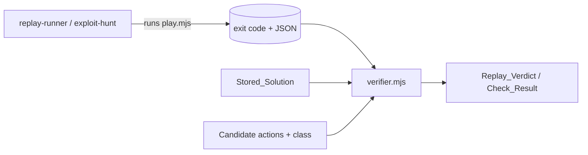

# Design Document

## Overview

`scripts/verifier.mjs` is one pure ES module. It exports two functions: `replayVerdict` (Requirement 2) and `checkCandidate` (Requirement 3). Both take the play exit code and the parsed `play.mjs` JSON, validate them in a fixed order, then decide. They never throw, never do I/O, and return plain JSON-safe objects. Each exported function is a thin public wrapper around a private inner function: the wrapper calls the inner function inside a `try/catch` and, on any throw, returns an error outcome with the reason code `internal_error`. The verifier runs inside the nightly cron, where one uncaught throw would abort the whole replay, so the wrapper is a safety net. The inner functions are written so the net is never needed, and the tests check that (Property 14).

Read-only check of the local Grimsheet checkout (`../grimsheet`) done for this design:

- `scripts/play.mjs` exists. It prints JSON and exits 0 when it ran, 2 for bad input (unknown level, invalid actions, unreadable file, missing bundle). It only imports `dist-play/headless.js`.
- `--actions-file <path>` takes either a bare JSON array of actions or a solution object with an `actions` array. So the stored solution files can be passed directly.
- `dist-play/headless.js` exists (also `favicon.svg` and `fonts/`). Nothing needs to be built to capture fixtures.
- `tests/solutions/` holds five files. Ink counts and edits match Requirements:

| Level id | minimalInk | Actions | Edit addresses |
|---|---|---|---|
| 01-the-corridor | 0 | 9 | none |
| 02-the-chaser | 1 | 14 | B14 |
| 03-the-locked-crypt | 2 | 11 | B14, B15 |
| 04-the-trap-row | 1 | 10 | B17 |
| 05-the-lich | 2 | 13 | B16, B19 |

- Checkout HEAD is `e1c61a35b3da027aada5d9ef4460efa4470488a4` (read with `git rev-parse HEAD`).
- Observed in the stored solutions: action kinds `move` and `edit` only. `undo` is not used by any stored solution.

Not verified here: the exact step fields of a refused action, because no play was run. The design relies on Requirements (`accepted`, `reason`, `message`, `action`). The refused-step fixture `01-the-corridor.undo-first` (see Fixtures) settles the real shape: an `undo` as the first action is refused with nothing to undo, so the capture shows `accepted`, `reason`, `message` and `refusedAt` for a real refusal.

## Architecture



Each public function is a wrapper plus a private inner function: `replayVerdict` calls `replayVerdictInner`, and `checkCandidate` calls `checkCandidateInner`, each inside a `try/catch` that returns `errorOutcome` with `internal_error` (see Error Handling). Both inner functions share private helpers in the same file: `validateCommon`, `isKnownAction`, `actionsMatchSteps`, `inkSpent`, `statusChangeIndex`, `acceptedEditAddresses`, `normaliseAddress`, `errorOutcome`. Nothing else is exported except typedefs. No clock, no randomness, no environment, no fs. Inputs are read, never changed (no `sort` on an input array; copy first).

## Components and Interfaces

```js
// scripts/verifier.mjs
// @ts-check

/** @typedef {{kind:'move', dir:'N'|'S'|'E'|'W'} | {kind:'wait'} | {kind:'edit', address:string, raw:string} | {kind:'undo'}} Action */
/** @typedef {'cheaper_win'|'free_win'|'unexpected_route'} ExploitClass */
/** @typedef {{levelId:string, minimalInk:number, actions:Action[]}} StoredSolution */
/** @typedef {{status:string, ink:number, hp:number}} PlayState  (start and final also carry hero, turn, monsters; ignored) */
/** @typedef {{index?:number, action:Action, accepted:boolean, hp?:number, ink?:number, status:string, reason?:string, message?:string}} Step */
/** @typedef {{levelId?:string, start:PlayState, steps:Step[], final:PlayState, refusedAt?:number}} PlayResult */
/** @typedef {'green'|'amber'|'red'} Colour */

/** @typedef {{levelId:string, colour:Colour, won:boolean, endHp:number, inkSpent:number,
 *   minimalInk:number, statusChangeIndex:number|null, refusedAt:number|null}} ReplayOk */
/** @typedef {{levelId?:string, colour:'error', reasonCode:ReasonCode, reason:string}} ReplayError */
/** @typedef {ReplayOk | ReplayError} ReplayVerdict */

/** @typedef {{levelId:string, claimedClass:ExploitClass, outcome:'confirmed'|'rejected', reasonCode:ReasonCode,
 *   reason:string, won:boolean, inkSpent:number, minimalInk:number, editCount:number,
 *   newEditAddresses:string[]}} CheckOk */
/** @typedef {{levelId?:string, claimedClass?:string, outcome:'error', reasonCode:ReasonCode, reason:string}} CheckError */
/** @typedef {CheckOk | CheckError} CheckResult */

/**
 * @param {unknown} levelId
 * @param {unknown} storedSolution   StoredSolution when valid
 * @param {unknown} exitCode         number when valid
 * @param {unknown} playResult       PlayResult when valid
 * @returns {ReplayVerdict}
 */
export function replayVerdict(levelId, storedSolution, exitCode, playResult)

/**
 * @param {unknown} levelId
 * @param {unknown} storedSolution
 * @param {unknown} claimedClass     ExploitClass when valid
 * @param {unknown} candidateActions Action[] when valid
 * @param {unknown} exitCode
 * @param {unknown} playResult       replay of candidateActions
 * @returns {CheckResult}
 */
export function checkCandidate(levelId, storedSolution, claimedClass, candidateActions, exitCode, playResult)
```

Arguments are `unknown` because the functions must accept anything without throwing (Requirement 5.1). Error objects omit optional keys instead of setting them to `undefined`, so a JSON round trip returns an equal object (Requirement 1.4).

### Reason codes

`ReasonCode` is the union of the codes below. Reason text is fixed per code (the text may append values such as the level id or class names, never anything random).

| Code | Used by | Outcome | Plain-English reason |
|---|---|---|---|
| `bad_input` | both | error | The play command rejected its input (exit code 2). |
| `play_failed` | both | error | The play command failed (unexpected exit code). |
| `malformed_play_result` | both | error | The play output is missing fields or has values that cannot be judged. |
| `level_mismatch` | both | error | The level id does not match between the call, the play output and the stored solution. |
| `malformed_solution` | both | error | The stored solution is missing, has no actions list, has an invalid minimalInk, or holds an action of unknown kind. |
| `unknown_class` | check | error | The claimed class is not cheaper_win, free_win or unexpected_route. |
| `malformed_candidate` | check | error | The candidate is not a list of actions of known kinds. |
| `replay_mismatch` | both | error | The play output is not the replay of these actions. |
| `internal_error` | both | error | The verifier hit an internal fault. |
| `class_reproduced` | check | confirmed | The replay reproduces the claimed class. |
| `not_won` | check | rejected | The replay did not win. |
| `no_ink_below_zero` | check | rejected | minimalInk is 0, so no win can cost less. |
| `minimal_ink_zero` | check | rejected | minimalInk is 0, so a win with no edits is not a free win. |
| `not_cheaper` | check | rejected | The win spent at least minimalInk ink. |
| `has_edits` | check | rejected | The candidate contains edit actions, so it is not a free win. |
| `no_new_cell` | check | rejected | Every kept edit is on a cell the stored solution also edits. |

Replay colours need no reason code in the ok shape. A rejected reason may end with "Measured class: X." (see Algorithms).

### Validation order (Requirement 5.13)

Every bad input maps to the first failing step. The check functions skip the candidate-only steps.

1. `levelId` is not a string: `level_mismatch` (no `levelId` field in the result).
2. `exitCode === 2`: `bad_input`. Any other value that is not the number 0 (including non-numbers): `play_failed`.
3. Play result shape: not an object, or `start`, `final` not objects, or `steps` not an array: `malformed_play_result`. Then `start.ink`, `final.ink`, `final.hp` not finite numbers, or `final.status` not a string: `malformed_play_result`. Then any step that is not an object, has no object `action`, or has non-boolean `accepted`: `malformed_play_result`. Then `inkSpent < 0`: `malformed_play_result`.
4. Play result `levelId` present and not equal to `levelId`: `level_mismatch`.
5. Stored solution not an object, `actions` not an array, `minimalInk` not a non-negative integer, or any stored action failing `isKnownAction`: `malformed_solution`.
6. Stored solution `levelId` not equal to `levelId`: `level_mismatch`.
7. (check only) `claimedClass` not one of the three: `unknown_class`.
8. (check only) candidate not an array, or any candidate action failing `isKnownAction`: `malformed_candidate`.
9. `replay_mismatch`: steps count differs from the actions list (stored solution for replay, candidate for check), or any step `action` differs in `kind`, `dir` (move) or `address`/`raw` (edit, exact, case-sensitive).
10. Decide: colour, or confirmed/rejected.

The shared helper `isKnownAction(a)` is true when `a` is an object whose `kind` is `move` with `dir` in N/S/E/W, `wait`, `edit` with string `address` and `raw`, or `undo`. Steps 5 and 8 use it for stored and candidate actions alike. This tightens Requirement 5.9: stored actions are now checked for shape, not only for being an array (requirements.md 5.9 is updated to match by a separate edit).

Steps 3 and 4 come before step 9 so `steps` can be trusted when compared. Steps 7 and 8 come after the solution checks and before the mismatch check, because the mismatch check needs the candidate list.

## Data Models

Inputs follow the play JSON as described in the Requirements. Only these fields are read: `levelId`, `start.ink`, `start.status`, `steps[].action`, `steps[].accepted`, `steps[].status`, `final.ink`, `final.hp`, `final.status`, `refusedAt`. Action files and solution files are not read by the verifier.

`refusedAt` in the verdict is the Play_Result `refusedAt` when it is a non-negative integer, otherwise the index of the first step with `accepted === false`, otherwise `null`.

## Algorithms

```
inkSpent(r)         = r.start.ink - r.final.ink
won(r)              = r.final.status === "won"
norm(a)             = a.trim().toUpperCase()

statusChangeIndex(r):
  prev = r.start.status
  for i, step in r.steps:
    if step.status !== prev: return i
    prev = step.status
  return null

acceptedEditAddresses(steps):            // returns normalised addresses, in step order
  out = []
  for i, s in steps:
    if !(s.accepted && s.action.kind == "edit"): continue
    j = next index > i with steps[j].accepted      // refused steps skipped
    if j exists and steps[j].action.kind == "undo": continue    // edit was undone
    out.push(norm(s.action.address))
  return out

storedEdits = set(norm(a.address) for a in stored.actions if a.kind == "edit")
newEditAddresses = sorted(unique(acceptedEditAddresses(steps) not in storedEdits))   // default string sort
editCount = count of kind == "edit" in candidate actions (as given, accepted or not)
```

Class tests (all need `won`; `not_won` is checked first, so every rejection below is for a won replay):

```
isCheaper    = inkSpent < minimalInk
isFree       = editCount == 0 && minimalInk > 0
isUnexpected = newEditAddresses.length > 0

cheaper_win:      if minimalInk == 0 -> rejected no_ink_below_zero
                  else isCheaper ? confirmed : rejected not_cheaper
free_win:         if minimalInk == 0 -> rejected minimal_ink_zero
                  else editCount == 0 ? confirmed : rejected has_edits
unexpected_route: isUnexpected ? confirmed : rejected no_new_cell
```

Requirement 4.8: on a rejection, compute `others` = the other two classes whose tests (`isCheaper && minimalInk>0`, `isFree`, `isUnexpected`) are true. If exactly one, the reason ends "Measured class: <name>." If none, it ends "Measured class: none." If two, it ends "Measured classes: <a> and <b>." The reason code stays the claimed-class code, so the code is stable. `not_won` and `minimal_ink_zero`/`no_ink_below_zero` reasons carry no measured-class suffix, since the class tests do not apply.

Requirement 3.8 holds by construction for stored solutions that spend ink only through edits, as every real one does (in Grimsheet only an accepted edit spends ink): a copy of a green stored solution has `inkSpent == minimalInk` (so not cheaper), edits only stored addresses, and either has edits (`has_edits`) or has `minimalInk` 0 (`minimal_ink_zero`). A stored solution with `minimalInk` above 0 and no edit does not occur in the real engine; the verifier does not check for it (Requirement 5.9 is unchanged), and Property 7 is stated for the real domain.

Requirement 3.9 and 3.10: `confirmed` is returned only from the three branches above, which read only `won`, `inkSpent`, `minimalInk`, `editCount` and `newEditAddresses`.

## Correctness Properties

*A property is a characteristic or behavior that should hold true across all valid executions of a system-essentially, a formal statement about what the system should do. Properties serve as the bridge between human-readable specifications and machine-verifiable correctness guarantees.*

### Property 1: Determinism
For any arguments, calling either function twice with deeply equal (cloned) arguments returns deeply equal results.
**Validates: Requirements 1.5, 2.12, 3.11**

### Property 2: Verdicts are JSON-safe and inputs are untouched
For any arguments, the result equals `JSON.parse(JSON.stringify(result))`, and the arguments deep-equal a clone made before the call.
**Validates: Requirements 1.3, 1.4**

### Property 3: Colour matches won and ink
For any valid replay input, `green` implies `won` and `inkSpent == minimalInk`; `amber` implies `won` and `inkSpent != minimalInk`; `red` implies `!won`; and the colour is exactly one of the three.
**Validates: Requirements 2.2, 2.3, 2.4, 2.8, 2.9, 2.10, 2.11**

### Property 4: Refusals do not change the colour
For any valid winning replay input, adding a refused step (and keeping steps and actions in step) leaves the colour unchanged and sets `refusedAt`.
**Validates: Requirements 2.7**

### Property 5: Confirmed only when the replay reproduces the class
For any valid candidate input, `confirmed` implies the play is won and the measured values meet the claimed class definition; `free_win` confirmed implies `editCount == 0` and `minimalInk > 0`; `cheaper_win` confirmed implies `inkSpent < minimalInk`.
**Validates: Requirements 3.2, 3.3, 3.9, 4.1, 4.2, 4.3, 4.10, 4.11**

### Property 6: Not won is never confirmed
For any valid candidate input with a non-winning play result and any claimed class, the outcome is `rejected` with `not_won`.
**Validates: Requirements 3.6**

### Property 7: Copy of the stored solution is rejected
For any valid stored solution and a green replay of its own actions, every class is rejected. The domain is stored solutions in which `minimalInk` above 0 implies at least one `edit` action. This holds for every real stored solution: in Grimsheet only an accepted edit spends ink (1 ink per edit, `src/game/turn.ts`; an undo refunds it), so a green replay with `minimalInk` above 0 always contains an edit. A stored solution that spends ink with no edit cannot come from the real engine, and for such an input a copy would be a `free_win` under Requirement 4.2 (won, no edits, `minimalInk` above 0), so Requirement 3.8 would not hold; the property is therefore stated for the real domain.
**Validates: Requirements 3.8**

### Property 8: Edit order in the stored solution does not matter
For any valid candidate input, permuting the edit actions of the stored solution does not change the outcome.
**Validates: Requirements 4.9**

### Property 9: Address case does not matter
For any valid candidate input, changing the case and padding of the stored solution addresses (not the candidate's, which must match the steps exactly) does not change the outcome.
**Validates: Requirements 4.6**

### Property 10: Undone and refused edits are not new cells
For any valid candidate input, `newEditAddresses` contains no address whose only accepted edits are refused or followed by an accepted `undo`, and it is sorted and free of duplicates.
**Validates: Requirements 3.4, 4.7**

### Property 11: Bad input gives an error, never a throw
For any value in each argument position (including `undefined`, `null`, numbers, strings, arrays, deep random JSON), the function returns without throwing and the result is an error outcome with a code from the table, or a valid verdict.
**Validates: Requirements 5.1, 5.2, 5.13**

### Property 12: Mismatched steps are an error
For any valid input, changing one step action (kind, dir, address or raw) or dropping or adding a step gives `replay_mismatch`, never a colour, `confirmed` or `rejected`.
**Validates: Requirements 2.13, 3.7, 5.11**

### Property 13: Status change index is valid
For any play result, `statusChangeIndex` is `null` or a valid position whose step status differs from the one before it (or from `start.status` at 0), and no earlier step changes status.
**Validates: Requirements 6.1, 6.2, 6.3, 6.4, 6.5**

### Property 14: Generated inputs never reach the safety net
For any generated arguments, valid or broken (built by `arbReplayInput`, `arbCandidateInput` with and without a breaker, and `arbAnything`), the result is never an error with the reason code `internal_error`. A bug in the inner functions therefore fails the tests instead of being hidden by the catch.
**Validates: Requirements 5.1**

## Error Handling

All failures are values, never exceptions. The verifier runs inside the nightly cron, where one throw would abort the whole replay, so each exported function wraps its inner implementation in a `try/catch` that returns the error outcome with the reason code `internal_error` (reason text: "The verifier hit an internal fault."). The catch result carries `levelId` only when it is a string and, for checks, `claimedClass` only when it is a string, and building it must itself not throw (it uses `typeof` checks only and no property access on unchecked values). The net must not hide bugs: Property 14 requires that generated inputs, valid and broken, never produce `internal_error`, and Property 11 still requires that nothing throws. Validation in the inner functions is written with `typeof` and `Array.isArray` checks only (no property access on unchecked values). `normaliseAddress` is only called on strings. `claimedClass` is only compared, never used as a key. Error results carry `levelId` when it is a string and, for checks, `claimedClass` when it is a string.

## Testing Strategy

PBT applies: the module is a pure function of structured inputs. Libraries: Vitest and fast-check (no hand-made property runner). Each property is one `fc.assert` with `numRuns: 100` or more, tagged `// Feature: verifier, Property N: <title>`.

Test files:

| File | Content |
|---|---|
| `tests/arbitraries.mjs` | fast-check arbitraries and the breaker list |
| `tests/verifier.replay.test.mjs` | unit tests for `replayVerdict` |
| `tests/verifier.candidate.test.mjs` | unit tests for `checkCandidate` |
| `tests/verifier.properties.test.mjs` | Properties 1 to 14 |
| `tests/verifier.fixtures.test.mjs` | real outputs from `tests/fixtures/` (read only, never runs `play.mjs`) |

### Arbitraries

Valid inputs first, breakers second:

1. `arbAction`: `move` with `dir` from N/S/E/W, `wait`, `edit` with address from a small grid (`A1`..`C20`) and `raw` a short string, or `undo`.
2. `arbStored(levelId)`: `{levelId, minimalInk: nat(0..4), actions: array(arbAction)}`.
3. `arbPlayFor(levelId, actions, mode)`: builds a consistent play result from an action list. Each action becomes a step with `accepted` (mostly true, sometimes false with `reason` and `message`), `status`, `ink`, `hp`. The `mode` is `won`, `lost` or `other`, and the ink spent is chosen as below, equal, or above `minimalInk`. `start.ink` is generated, `final.ink = start.ink - spent`, and `final` equals the last step. `refusedAt` is set to the first refused index when any.
4. `arbReplayInput`: stored, then a play result built from `stored.actions`; yields `[levelId, stored, 0, play]`.
5. `arbCandidateInput`: stored, claimed class, candidate actions (`arbAction` array, sometimes a copy of the stored actions), play built from the candidate; yields all six arguments.
6. `breaker` applied with probability about 0.15 (`fc.option` with `freq`): wrong exit code (2, 1, `"0"`), delete or null a play field, `NaN` ink, negative ink spent, other `levelId`, solution `minimalInk` of `-1` or `1.5`, missing `actions`, unknown class, candidate action of unknown kind, a stored action of unknown kind (must give `malformed_solution`), one step action changed, one step dropped, address case flipped. Each breaker records the reason code it must produce, so the property "a broken input gives that code" is checked, not only "no throw".
7. `arbAnything`: `fc.anything()` for each argument position, for Property 11.
8. Property 7 builder (in `tests/verifier.properties.test.mjs`, not in `arbitraries.mjs`): a stored solution from `arbStored` in which, when `minimalInk` is above 0 and there is no `edit` action, one generated `edit` is put in front. This is a construction, not a filter, and `arbStored` itself is unchanged. The reason is the Property 7 domain: in Grimsheet only an accepted edit spends ink. The play is built with `arbPlayFor(..., 'won', minimalInk, ['equal'])`, whose optional fifth argument `spendKinds` limits the ink spent to equal. `arbReplayInputFor(modes)` and `arbCandidateInputFor(modes)` build the valid replay and candidate inputs for a chosen set of end statuses (used by Properties 4 and 6); `arbReplayInput` and `arbCandidateInput` are those with all three statuses.

Properties that need valid input filter on `breaker === null` through construction, not `fc.pre`.

### Unit cases (Requirement 7.4)

- Replay: `green`, `amber` (more and less ink), `red`; refused step with a win keeps the colour and sets `refusedAt`; a stored action of unknown kind gives `malformed_solution`; one case for each error code (`bad_input` with exit 2, `play_failed` with exit 1, `malformed_play_result` for each of the missing-field, non-finite ink and negative-spent cases, both `level_mismatch` sources, `malformed_solution`, `replay_mismatch`, and `internal_error` forced by an input with a throwing getter, which returns an error outcome carrying `levelId` only when it is a string).
- `replay_mismatch`: a step with an extra field only does not mismatch; an `address` differing only in case does mismatch; count differs mismatches.
- Candidate: each class confirmed and rejected; `unknown_class`, `malformed_candidate`, `replay_mismatch`, `not_won`; `minimalInk` 0 gives `no_ink_below_zero` and `minimal_ink_zero`; lower-case stored address and upper-case step address match; refused edit on a new cell gives `no_new_cell`; edit on a new cell then undo, then the stored solution, gives `rejected` `unexpected_route` with `no_new_cell`; refused step between the edit and the undo still counts as undone; measured-class text for exactly one, none and two other classes.
- Fixtures: see below.

## Fixtures (Requirement 8)

Capture is a later task. It reads from `../grimsheet` and writes only inside this repo. It does not build, install or write anything in `../grimsheet`. `play.mjs` reads only `dist-play/headless.js` there. Action files live in this repo, so `--actions-file` points at them.

Chosen cases:

| Fixture | Action file | Why |
|---|---|---|
| `01-the-corridor.play.json` | copy of its stored solution | green, `minimalInk` 0 |
| `02-the-chaser.play.json` | copy of its stored solution | green, one edit |
| `03-the-locked-crypt.play.json` | copy of its stored solution | two edits, also used as the candidate copy case |
| `02-the-chaser.truncated.play.json` | first 3 actions of the 02 solution, a bare array | not won (red); also the `not_won` candidate case |
| `01-the-corridor.undo-first.play.json` | `{"kind":"undo"}` followed by the 01 solution moves, a bare array (`actions/01-the-corridor.undo-first.json`) | refused step: `undo` with nothing done yet is refused (nothing to undo); settles the real shape of a refused step |

Layout under `tests/fixtures/`:

```
GRIMSHEET_COMMIT.txt        commit hash on the first line, then "clean" or "dirty"
manifest.json               [{file, levelId, actionsFile, exitCode, note}]  (note describes the case, e.g. "01 solution preceded by a refused undo")
solutions/<level-id>.json   copies of the stored solutions used
actions/<name>.json         action files passed to --actions-file
<name>.play.json            raw stdout of play.mjs
```

Capture commands (PowerShell, no inline JSON, no `&&`). Paths are absolute: `$g` is `../grimsheet` resolved to an absolute path and `$r` is this repo root, both set first.

```powershell
$g = (Resolve-Path ../grimsheet).Path
$r = (Get-Location).Path
git -C $g rev-parse HEAD
git -C $g status --porcelain
Copy-Item "$g\tests\solutions\02-the-chaser.json" "$r\tests\fixtures\actions\02-the-chaser.json"
node "$g\scripts\play.mjs" 02-the-chaser --actions-file "$r\tests\fixtures\actions\02-the-chaser.json"
# refused-step case: the action file is written by hand (see below)
node "$g\scripts\play.mjs" 01-the-corridor --actions-file "$r\tests\fixtures\actions\01-the-corridor.undo-first.json"
```

Grimsheet has `scripts/canonical-cwd.mjs` (read only, not run). It does call `process.chdir`, but only to the real-case form of the same folder, and only as a wrapper for hook commands; `play.mjs` does not import it. Relative paths would still resolve, but absolute paths do not depend on the working directory at all, so they are used.

The `play.mjs` stdout is saved with `[System.IO.File]::WriteAllText(path, text, (New-Object System.Text.UTF8Encoding $false))`, because PowerShell 5.1 `Out-File -Encoding utf8` writes a BOM. The exit code is read from `$LASTEXITCODE` straight after the node call and written to `manifest.json`. `git rev-parse HEAD` and `git status --porcelain` only read. The truncated and undo-first action files are written by hand as JSON arrays in this repo; the undo-first file is one `{"kind":"undo"}` object followed by the moves copied from the 01 solution. Success is the exit code and the JSON, not stderr text. If `status --porcelain` lists files, `GRIMSHEET_COMMIT.txt` says `dirty`.

`tests/verifier.fixtures.test.mjs` loads each `.play.json`, passes it with the manifest exit code and the solution copy, and expects: 01, 02, 03 green; truncated red; the 03 solution as a candidate rejected for all three classes; the truncated list rejected with `not_won`; for the undo-first capture: the play result has `refusedAt` 0, step 0 has `accepted === false` with a `reason` and `message`, and the replay wins. Because `replayVerdict` needs the steps to match the stored actions, the test builds a stored-solution copy from the undo-first action list with `minimalInk` 0 and passes that; the colour follows Requirement 2.7 (green, since 01 has `minimalInk` 0 and a refused undo spends no ink) and the verdict `refusedAt` is 0. If the real output differs from these expectations, the test is changed to match the real output and the difference is recorded in the task notes, not hidden.

## Tooling

A `package.json` does not exist yet and is created in a task. It has `"type": "module"`, `"engines": {"node": ">=22.12"}` and:

```json
{
  "scripts": {
    "test": "vitest --run",
    "typecheck": "tsc --noEmit -p tsconfig.json"
  },
  "devDependencies": {
    "vitest": "5.1.0",
    "fast-check": "4.10.2",
    "typescript": "6.0.3",
    "@types/node": "22.x (pin the exact 22 release at install)"
  }
}
```

Pin `typescript` 6.0.3, `vitest` 5.1.0 and `fast-check` 4.10.2 exactly (no `^`). These three versions are the ones pinned in the sibling Grimsheet repo's package.json. `@types/node` is held to major 22 to match the Node floor and pinned exactly at install.

`tsconfig.json`:

```json
{
  "compilerOptions": {
    "allowJs": true,
    "checkJs": true,
    "noEmit": true,
    "strict": true,
    "target": "ES2022",
    "module": "NodeNext",
    "moduleResolution": "NodeNext",
    "types": ["node"]
  },
  "include": ["scripts/**/*.mjs", "tests/**/*.mjs"]
}
```

`// @ts-check` is also written at the top of each file for editors; `npm run typecheck` is the gate because `checkJs` covers every included file even without the comment. No build step: the module is run and imported as is.

Note for a later spec that adds a Kiro hook running Vitest on Windows: the hook must start Vitest from the real-case working directory. The IDE can start hooks from a lowercase drive path such as `d:\`, which makes Vitest load two copies of itself and fail every suite. The fix is written in this repo (for example resolving the working directory with `fs.realpathSync.native` before starting Vitest), not copied from Grimsheet.

## Out of scope

Running `play.mjs` in tests or the verifier, the result index, `data\config.json`, the cron, the agent, the UI, and `tasks.md`.

## Decisions to confirm

1. Validation order: level argument, exit code, play shape, play `levelId`, solution shape, solution `levelId`, class, candidate, mismatch. Requirements list the checks but not their order. Exit code comes before play shape so a crash with empty output is `play_failed`, not `malformed_play_result`.
2. A non-number exit code is `play_failed`.
3. A `levelId` argument that is not a string gives `level_mismatch` with no `levelId` field.
4. `unknown_class` and `malformed_candidate` come after the solution checks and before `replay_mismatch`; `unknown_class` first.
5. Step-level shape checks (object, object `action`, boolean `accepted`) are added to `malformed_play_result`; Requirement 5.5 and 5.6 do not list them.
6. Decided: every stored action is checked with the same `isKnownAction` shape check as candidate actions; a failure gives `malformed_solution` at step 5. This tightens Requirement 5.9, which only required an actions array (requirements.md is updated separately).
7. New reason codes not named in Requirements: `class_reproduced`, `not_cheaper`, `has_edits`. Requirement 4.4, 4.5 and 3.6 name the others.
8. `minimal_ink_zero` and `no_ink_below_zero` take precedence over `has_edits` and `not_cheaper`.
9. Measured class (Requirement 4.8) for none or two other classes is written as "none" or "a and b"; the reason code does not change.
10. `refusedAt` is taken from the play output when valid, else computed from the steps.
11. `editCount` counts all `edit` actions in the candidate, including refused ones; `newEditAddresses` uses accepted, non-undone steps only.
12. Pinned versions: `typescript` 6.0.3, `vitest` 5.1.0 and `fast-check` 4.10.2, exact, as pinned in the sibling Grimsheet repo's package.json. `@types/node` stays on major 22, pinned exactly at install.
13. Decided: safety net added. Each exported function catches any throw from its inner function and returns `internal_error`; Property 14 keeps bugs visible in tests.
